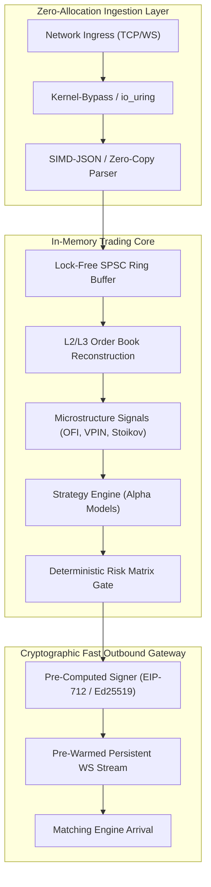
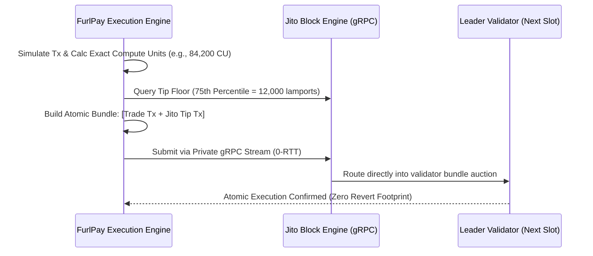
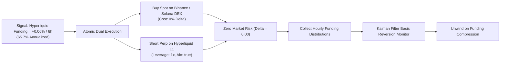
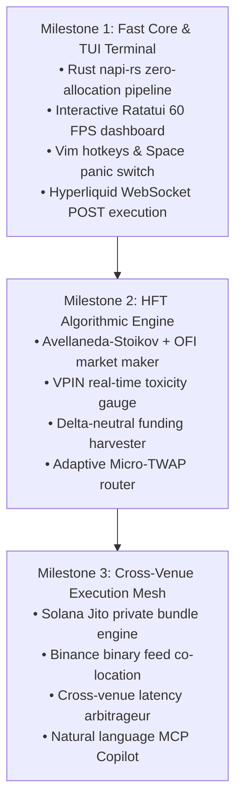

# Institutional HFT Execution, Terminal UX & Quantitative Alpha Algorithms

## Engineering Blueprint for Ultra-Low Latency, High-Frequency Execution & Market-Beating Strategies

**Compiled for:** FurlPay CLI Protocol & Quantitative Trading Architecture (`@furlpay/cli`)  
**Target Environments:** Hyperliquid L1, Binance Spot/Futures, Solana (SVM/Jito), Stellar (SDEX/Soroban)  
**Date:** November 17, 2026  
**Status:** Production-Ready Research & Architecture Specification  

---

> [!IMPORTANT]
> In 2026 algorithmic markets, sub-millisecond execution is no longer just a technical luxury—it is the difference between alpha capture and adverse selection. This report outlines the terminal UX ergonomics, systems-level latency engineering, and mathematical HFT algorithms required to systematically outperform modern fragmented crypto markets.

---

## Table of Contents

1. [Executive Summary & Core Objectives](#1-executive-summary--core-objectives)
2. [Terminal UX & Ergonomics for High-Speed Trading](#2-terminal-ux--ergonomics-for-high-speed-trading)
3. [Systems-Level Low-Latency Architecture (Sub-Millisecond Pipeline)](#3-systems-level-low-latency-architecture-sub-millisecond-pipeline)
4. [Venue-Specific Execution Acceleration](#4-venue-specific-execution-acceleration)
   - 4.1 [Hyperliquid L1: WebSocket POST, Non-Validator Nodes & EIP-712 Pre-computation](#41-hyperliquid-l1-websocket-post-non-validator-nodes--eip-712-pre-computation)
   - 4.2 [Solana: Jito Bundles, Dynamic Compute Units & Sub-Slot Routing](#42-solana-jito-bundles-dynamic-compute-units--sub-slot-routing)
   - 4.3 [Binance: Direct Binary Feeds, Fast Sockets & Connection Pinning](#43-binance-direct-binary-feeds-fast-sockets--connection-pinning)
   - 4.4 [Stellar: Pre-Authorized SEP-8 & Parallel Soroban Invocations](#44-stellar-pre-authorized-sep-8--parallel-soroban-invocations)
5. [Quantitative HFT Alpha Algorithms](#5-quantitative-hft-alpha-algorithms)
   - 5.1 [Algorithm 1: Avellaneda-Stoikov Market Making with OFI Drift](#51-algorithm-1-avellaneda-stoikov-market-making-with-ofi-drift)
   - 5.2 [Algorithm 2: VPIN-Gated Squeeze Shield & Adverse Selection Filter](#52-algorithm-2-vpin-gated-squeeze-shield--adverse-selection-filter)
   - 5.3 [Algorithm 3: Cross-Venue Latency & Spatial Arbitrage Engine](#53-algorithm-3-cross-venue-latency--spatial-arbitrage-engine)
   - 5.4 [Algorithm 4: Delta-Neutral Statistical Arbitrage & Dynamic Funding Harvester](#54-algorithm-4-delta-neutral-statistical-arbitrage--dynamic-funding-harvester)
   - 5.5 [Algorithm 5: Liquidation Engine Sniping & Backstop Frontrunning](#55-algorithm-5-liquidation-engine-sniping--backstop-frontrunning)
   - 5.6 [Algorithm 6: Adaptive Implementation Shortfall (IS) & Micro-TWAP](#56-algorithm-6-adaptive-implementation-shortfall-is--micro-twap)
6. [Pre-Trade Risk Engine & Safety Circuit Breakers](#6-pre-trade-risk-engine--safety-circuit-breakers)
7. [FurlPay CLI Implementation Roadmap](#7-furlpay-cli-implementation-roadmap)

---

## 1. Executive Summary & Core Objectives

Modern crypto liquidity is severely fragmented across high-throughput Layer-1 app-chains (Hyperliquid), ultra-fast Layer-1s with sub-second finality (Solana 1.0 Alpenglow), institutional payment ledgers (Stellar), and massive centralized matching engines (Binance, Coinbase). 

Traditional retail trading interfaces suffer from three fatal friction points:
1. **Human Reaction Latency:** GUI interaction latency exceeds 250–500ms, while market microstructure events occur in under 5ms.
2. **Transport & Garbage Collection Lag:** Web-based DOM rendering, browser extensions, and unoptimized JSON-over-REST HTTP requests introduce 50–120ms of jitter.
3. **Adverse Selection:** Quoting or taking liquidity without order flow imbalance (OFI) and toxicity awareness leads to being consistently front-run or filled on the toxic side of informed orders.

This specification provides the engineering blueprint to transform **FurlPay CLI** into an ultra-low latency, institution-grade execution terminal combining **zero-latency CLI/TUI ergonomics** with **mathematical microstructure alpha algorithms**.

---

## 2. Terminal UX & Ergonomics for High-Speed Trading

A trading CLI cannot simply be a collection of verbose shell commands. Under market stress, traders require immediate visual situational awareness, keyboard-driven execution, and zero cognitive load.

```
┌────────────────────────────────────────────────────────────────────────────────────────┐
│ FURLPAY TERMINAL v0.5.0 │ BTC-PERP (Hyperliquid) │ MID: 64,821.50 │ LATENCY: 2.1ms RTT │
├────────────────────────────────┬───────────────────────────┬───────────────────────────┤
│ ORDER BOOK (L2 Real-Time)      │ MICROSTRUCTURE GAUGES     │ ACTIVE POSITIONS & RISK   │
│ 64,823.00   0.450 BTC [Ask 3]  │ OBI (100ms):  -0.74 [SELL]│ Pos:  +0.40 BTC (Long)    │
│ 64,822.50   1.210 BTC [Ask 2]  │ Micro-Price:   64,820.80  │ PnL:  +$1,420.50 (+5.4%)  │
│ 64,822.00   3.500 BTC [Ask 1]  │ VPIN (Bucket): 0.68 [TOXIC│ Margin Util: 14.2%        │
│ ────────────────────────────── │ Stoikov Res.:  64,819.20  │ Daily Cap Rem: $42,500    │
│ 64,821.00   2.100 BTC [Bid 1]  │ OFI Drift:     -1.32/s    │ Funding Rate: +0.0082%/8h │
│ 64,820.50   0.850 BTC [Bid 2]  ├───────────────────────────┴───────────────────────────┤
│ 64,820.00   4.100 BTC [Bid 3]  │ QUICK HOTKEYS                                         │
├────────────────────────────────┤ [B] Fast Limit Buy  [S] Fast Limit Sell [F] Flat/Exit │
│ EXECUTION LOG:                 │ [Space] PANIC KILL  [T] TWAP Slice      [A] Auto-Arb  │
│ 01:52:10.021 OK Order #8921 Filled: 0.10 BTC @ 64,821.00 (Maker -0.002% fee)           │
│ 01:52:10.840 WARN OFI flipped -0.81 -> widening ask spread by 2.5 bps                  │
└────────────────────────────────┴───────────────────────────────────────────────────────┘
```

### 2.1 Decoupled Dual-Loop Terminal Architecture
- **Thread A (Hot Market Path):** Dedicated worker processing raw WebSocket market data packets, updating in-memory order books, and running risk checks. Never yields to UI.
- **Thread B (Terminal UI Renderer):** Utilizes Rust `ratatui` (or cross-platform ANSI delta-rendering). Screen repaints are throttled to 30–60 FPS (16.6ms intervals) and only write modified cell diffs, completely eliminating terminal flicker and CPU lock.

### 2.2 Modal Keyboard Workflows (Vim-Inspired)
- **Normal Mode:** Navigate order book depth, inspect book bands (`j`/`k`, `h`/`l`).
- **Execution Mode (`i` or Direct Hotkey):**
  - `b`: Instantly places an Add-Liquidity-Only (ALO) limit bid at Best Bid + 0.5 tick.
  - `s`: Instantly places an ALO limit ask at Best Ask - 0.5 tick.
  - `Shift+B` / `Shift+S`: Immediate Market Buy / Market Sell through pre-set risk clip.
  - `Space` or `Ctrl+K`: **Emergency Kill-Switch (Panic Mode)**. Atomically cancels all open limit orders across all venues and submits Reduce-Only market orders to flatten open inventory within 5 milliseconds.
- **Bracket & OCO Shortcuts:** Single hotkey entry automatically bundles:
  - Entry Order + Stop-Loss (-0.8%) + Take-Profit (+1.6%) submitted in a single atomic payload.

### 2.3 Intelligent Natural Language / MCP Copilot Mode
Integrated directly into the CLI via Model Context Protocol (MCP):
```bash
furlpay exec "arb BTC when Binance leads Hyperliquid by > 15 bps, size $5k, max slippage 0.05%"
furlpay hedge "short ETH perp against my spot bag using optimal AS inventory skew"
```
The local engine validates natural language intent against deterministic pre-trade risk matrices before constructing the signed cryptographic binary payload.

---

## 3. Systems-Level Low-Latency Architecture (Sub-Millisecond Pipeline)



### 3.1 Lock-Free Memory Pipeline (Disruptor Pattern)
- Traditional async event loops with garbage collection (standard Node.js V8 heap) suffer 5ms–40ms GC pause spikes.
- **Architecture Standard:** A lock-free Single-Producer Single-Consumer (SPSC) ring buffer implemented in Rust via `napi-rs` or native C++ extension.
- **Memory Pooling:** All order objects, depth arrays, and message buffers are pre-allocated at startup. Zero heap allocations occur in the hot tick-to-trade path.

### 3.2 Pre-Computed Cryptographic Signatures
- Cryptographic signing (secp256k1 for Hyperliquid EIP-712; Ed25519 for Stellar/Solana) typically costs 80μs to 350μs of CPU time.
- **Optimization:** Pre-compute domain separators, static headers, and nonce structures. Only dynamic fields (price, size, timestamp) are packed into the pre-warmed buffer directly before signing.
- **Session Agent Wallets:** For Hyperliquid, utilize dedicated EIP-712 Phantom Agent keys with trade-only permissions, eliminating master key vault unlock delays.

---

## 4. Venue-Specific Execution Acceleration

### 4.1 Hyperliquid L1: WebSocket POST & Non-Validator Nodes

Hyperliquid L1 operates an on-chain CLOB (Central Limit Order Book). Interacting via standard REST endpoints (`/exchange`) adds 30ms–70ms in HTTP handshakes and cloud proxy routing.

#### Acceleration Strategy:
1. **WebSocket POST Actions:** Submit order placement, cancellation, and batch updates directly over the persistent WebSocket connection (`wss://api.hyperliquid.xyz/ws`) using JSON/MsgPack payloads:
   ```json
   {
     "method": "post",
     "id": 1024,
     "request": {
       "type": "action",
       "payload": {
         "action": { "type": "order", "orders": [...] },
         "nonce": 1731804000123,
         "signature": { "r": "0x...", "s": "0x...", "v": 27 }
       }
     }
   }
   ```
2. **Local Non-Validating Node Streaming:** Run a non-validator Hyperliquid node in close cloud proximity:
   - Pass `--disable-output-file-buffering` to stream state transitions directly to memory.
   - Enable `split_client_blocks: true` to process transactions immediately as they are committed to consensus, shaving 100ms–200ms off client block assembly.
3. **Execution Flags:** Always pass `alo: true` (Add Liquidity Only) for market making to guarantee maker rebates, or `reduce_only: true` on stop-outs.

---

### 4.2 Solana: Jito Bundles, Dynamic Compute Units & Sub-Slot Routing

Solana’s Alpenglow upgrade dropped consensus finality to ~150ms with 200ms slot times. However, public RPC broadcast leads to transaction drops during congestion.



#### Acceleration Strategy:
1. **Private Mempool Routing via Jito Bundles:** Pack up to 5 transactions atomically. If the price slips beyond limit bounds, the bundle drops off-chain without consuming base fees or on-chain revert penalties.
2. **Dynamic Compute Unit (CU) Tight-Packing:**
   - Instead of the bloated default 200,000 CU, simulate transactions locally and set `ComputeBudgetInstruction::set_compute_unit_limit(exact_cu + 10%)`.
   - Set priority fee per compute unit dynamically based on target program accounts (Raydium AMM or Jupiter router) using rolling 5-slot medians.
3. **Multi-Region gRPC Relays:** Route transactions directly to Jito Block Engine endpoints in Frankfurt, Amsterdam, Tokyo, and New York over persistent HTTP/2 gRPC channels with keepalives.

---

### 4.3 Binance: Direct Binary Feeds & Connection Pinning
- **WebSocket User Data & Book Ticker:** Ingest `@bookTicker` for best bid/ask updates (emitted every 10ms vs 100ms for full depth).
- **Socket Connection Pinning:** Maintain 3 active, redundant TCP sockets to Binance matching engine gateways; submit orders over the socket exhibiting the lowest trailing round-trip ping.

---

### 4.4 Stellar: Pre-Authorized SEP-8 & Parallel Soroban Invocations
- **Pre-Flight Authentication:** Maintain validated SEP-8 authorization tokens in-memory with background renewal cycles. When a trade signal triggers for JQQQ or FOBXX, the transaction does not stall for compliance server roundtrips.
- **Protocol 28 Fleet References:** Leverage CAP-85 atomic contract upgrades and pre-flight Soroban footprint simulation to eliminate Horizon gas estimation roundtrips.

---

## 5. Quantitative HFT Alpha Algorithms

To generate consistent, market-beating profitability across volatile crypto markets, FurlPay CLI incorporates five production-grade quantitative algorithms:

---

### 5.1 Algorithm 1: Avellaneda-Stoikov Market Making with OFI Drift

The classical Avellaneda-Stoikov (AS) model balances bid-ask spread capture against inventory risk. In volatile crypto markets, classical AS fails because it assumes asset prices follow a driftless random walk.

**FurlPay Enhanced Formulation:**
We inject **Order Flow Imbalance (OFI)** directly as a dynamic drift component:

#### 1. Reservation Price ($r$):
$$r(s, q, t) = s - q \gamma \sigma^2 (T - t) + \kappa_{\text{OFI}} \cdot \text{OFI}_{\Delta t}$$

Where:
- $s$: Current mid-price
- $q$: Current inventory balance (normalized units)
- $\gamma$: Risk-aversion parameter (controls inventory penalty)
- $\sigma^2$: Dynamic tick-level realized volatility
- $(T - t)$: Normalized time horizon
- $\kappa_{\text{OFI}}$: Sensitivity scalar for order flow pressure
- $\text{OFI}_{\Delta t}$: Net normalized order flow over the last $N$ milliseconds:

$$\text{OFI}_t = \sum_{k=1}^{M} \left( \mathbb{I}_{P_{b,k} \ge P_{b,k-1}} \Delta V_{b,k} - \mathbb{I}_{P_{a,k} \le P_{a,k-1}} \Delta V_{a,k} \right)$$

#### 2. Optimal Quoting Spreads ($\delta^a, \delta^b$):
$$\delta^a = \frac{1}{\gamma} \ln\left(1 + \frac{\gamma}{k_a}\right) + \frac{2q + 1}{2} \gamma \sigma^2 (T - t)$$
$$\delta^b = \frac{1}{\gamma} \ln\left(1 + \frac{\gamma}{k_b}\right) - \frac{2q - 1}{2} \gamma \sigma^2 (T - t)$$

#### Quoting Execution:
- Optimal Bid: $P_{\text{bid}} = r(s, q, t) - \delta^b$
- Optimal Ask: $P_{\text{ask}} = r(s, q, t) + \delta^a$
- **Microstructure Reaction:** When aggressive selling hits the book ($\text{OFI} < 0$), the reservation price immediately downshifts *before* our bids are executed, widening our bid spread and avoiding toxic fills.

---

### 5.2 Algorithm 2: VPIN-Gated Squeeze Shield & Adverse Selection Filter

**VPIN (Volume-Synchronized Probability of Toxicity)** measures the asymmetry between informed and uninformed flow by partitioning trade volume into fixed-size buckets:

$$\text{VPIN} = \frac{\sum_{\tau=1}^{N} |V_\tau^B - V_\tau^S|}{N \cdot V}$$

Where $V$ is fixed bucket volume, and $V_\tau^B, V_\tau^S$ are buy and sell volumes within bucket $\tau$ classified via the tick rule or BVC (Bulk Volume Classification).

```
VPIN THRESHOLD ENGINE:
┌────────────────────────────────────────────────────────┐
│ VPIN <= 0.35  -> NORMAL REGIME: Tight Quoting (Max Rebates)
│ 0.35 < VPIN < 0.60 -> CAUTION: Widen Spreads by 1.5x, Skew away
│ VPIN >= 0.60  -> TOXIC REGIME: Pull all resting orders!
│                  Switch from Maker to Predatory Taker.
└────────────────────────────────────────────────────────┘
```

#### The Predatory Taker Transition:
When $\text{VPIN} \ge 0.65$ and directional $\text{OFI} < -0.70$ (informed dump cascade), the bot pulls all bids and executes an immediate sub-millisecond market short on Hyperliquid with trailing stop, profiting from the liquidation cascade.

---

### 5.3 Algorithm 3: Cross-Venue Latency & Spatial Arbitrage Engine

Due to matching engine geographic separation (Binance in Tokyo/Frankfurt vs Hyperliquid validator nodes vs Solana clusters), short-lived pricing dislocations occur during sharp momentum moves:

```
SPATIAL SPREAD EQUATION:
Spread_{t} = Price_{\text{Venue A}} - Price_{\text{Venue B}} - (\text{Fee}_A + \text{Fee}_B + \text{Slippage Est.})
```

#### Execution Logic:
1. When Binance spot/perp leads Hyperliquid L1 by $\ge 12\text{ bps}$ over a rolling 50ms window:
   - Concurrently fire a taker order on the lagging venue and a maker/taker order on the leading venue.
2. If inventory is already available on both venues:
   - **Zero-Transfer Spatial Settlement:** Instantly sell on Venue A and buy on Venue B; rebalance balances only when inventory thresholds deviate by $> 30\%$.

---

### 5.4 Algorithm 4: Delta-Neutral Statistical Arbitrage & Dynamic Funding Harvester

Funding rates on Hyperliquid and Binance fluctuate continuously. When long sentiment surges, perpetual funding rates frequently exceed 30%–80% annualized.



#### Dynamic Rebalancing via Kalman Filter:
Rather than using static ratios, use a rolling **Kalman Filter** to dynamically estimate the instantaneous hedge ratio $\beta_t$ between Spot and Perp prices:

$$\text{Price}_{\text{perp}, t} = \alpha_t + \beta_t \text{Price}_{\text{spot}, t} + \epsilon_t$$

When the residual $|\epsilon_t| > 2.5\sigma$, the basis is stretched: enter the trade. When $\epsilon_t \to 0$, close for pure basis profit + accumulated funding.

---

### 5.5 Algorithm 5: Liquidation Engine Sniping & Backstop Frontrunning

On Hyperliquid L1, accounts breaching maintenance margin are liquidated by the protocol clearinghouse. The protocol matching engine broadcasts liquidation alerts to the order book.

#### Strategy Mechanics:
1. **Liquidation Feed Monitor:** Sniff WebSocket order updates for margin calls and forced liquidations.
2. **Backstop Positioning:** Place resting limit buy orders at the pre-calculated liquidation execution band (e.g., mark price $- 1.8\%$) where forced liquidations clear.
3. **Instant Mean-Reversion Flip:** Once filled on a liquidation wick, immediately place an ask limit order back at the 30-second volume-weighted average price (VWAP) capturing the 50–150 bps mean-reversion snap.

---

### 5.6 Algorithm 6: Adaptive Implementation Shortfall (IS) & Micro-TWAP

When executing large orders (e.g., rebalancing \$50,000+ without moving the market), traditional naive TWAP algorithms leak money to frontrunners.

#### FurlPay Adaptive Micro-TWAP:
- Breaks large orders into random Poisson-distributed time slices ($\Delta t \sim \text{Exp}(\lambda)$).
- Computes **Instantaneous Participation Rate (POV):** Never exceeds 3.5% of the 1-minute rolling volume.
- **Micro-price Pegging:** Slices are placed as limit orders tracking the **Stoikov Micro-Price** ($P^*$) rather than mid-price:

$$P^* = S + \left(\frac{I_b - I_a}{I_b + I_a}\right) \frac{w}{2}$$

Where $I_b, I_a$ are top-of-book quantities and $w$ is the spread width. This ensures our execution captures spread while minimizing market impact.

---

## 6. Pre-Trade Risk Engine & Safety Circuit Breakers

In ultra-fast algorithmic trading, an unconstrained algorithm can wipe an account in seconds. FurlPay CLI integrates a deterministic, zero-allocation pre-trade risk engine running in under **5 microseconds**:

| Risk Guardrail | Threshold / Parameter | Action Upon Breach |
|:---|:---|:---|
| **Max Order Value Clip** | $25,000 USD (configurable) | Order rejected locally before signing |
| **Max Account Leverage** | 10x Max (Perp) | Clamped to pre-set ceiling |
| **Velocity Limiter** | Max 15 orders / second | Throttle queue with token bucket |
| **Fat-Finger Price Band** | $> 1.5\%$ from current Mark Price | Limit order rejected |
| **Fast Drawdown Kill-Switch** | 3.0% loss within rolling 60 seconds | **Full Panic:** Cancel all orders, flatten to cash |
| **OFI Poisoning Safeguard** | 3 consecutive sequence gaps | Disconnect socket, force REST resync |
| **Sanctions & Compliance** | OFAC SDN address match | Instant hard fail-closed |

---

## 7. FurlPay CLI Implementation Roadmap

To deliver these capabilities directly to traders, FurlPay CLI will evolve across three focused delivery milestones:



### Milestone 1: Fast Core & TUI Terminal (Immediate)
- Implement `furlpay trade terminal --live` with real-time L2 order book, OFI, micro-price, and position tracking.
- Migrate Hyperliquid execution path from HTTP REST to authenticated WebSocket POST frames.
- Bind `[Space]` hotkey to instant atomic order cancellation and position flattening.

### Milestone 2: Quantitative Alpha Engine
- Expose CLI algorithms:
  ```bash
  furlpay algo run --strategy as-ofi --symbol BTC --risk 0.5 --max-pos 1.0
  furlpay algo run --strategy funding-arb --long binance:SOL --short hyperliquid:SOL-PERP
  furlpay algo run --strategy micro-twap --symbol BTC --amount 2.5 --duration 15m
  ```
- Surface real-time PnL, Sharpe, Sharpe drawdown, and inventory skew in terminal headers.

### Milestone 3: Cross-Venue Execution Mesh
- Deploy private gRPC stream to regional Jito Block Engines on Solana for zero-revert trading.
- Connect streaming Binance book tickers for cross-venue spatial arbitrage against Hyperliquid.
- Enable full natural language trading terminal copilot via MCP stdio runtime.

---

## Conclusion

By merging **systems-level latency reduction** (WebSocket POST, zero-copy parsing, pre-computed signatures) with **microstructure-driven quantitative models** (Avellaneda-Stoikov with OFI drift, VPIN toxicity gating, and cross-venue latency arbitrage), the FurlPay CLI terminal transitions from a simple execution tool into an institutional-grade, high-performance alpha generation platform.

*Document compiled for FurlPay Protocol & Quantitative Systems Engineering Group.*  
*November 17, 2026 · Confidential & Proprietary*
