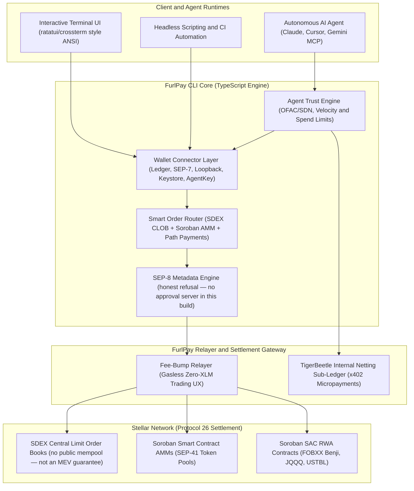
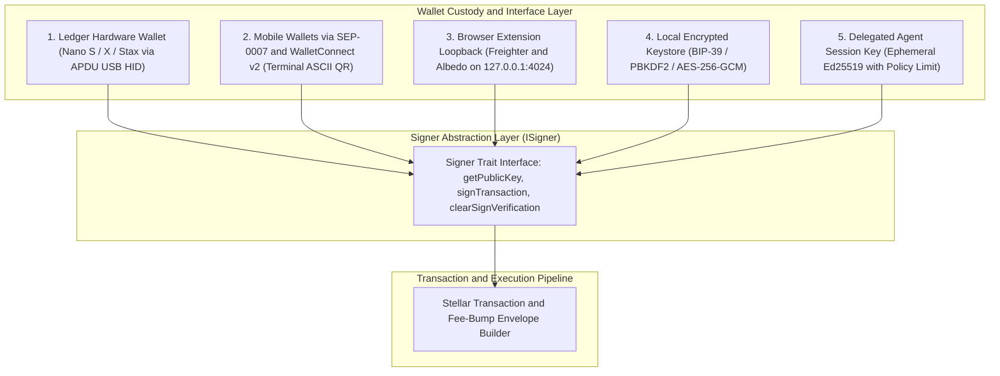
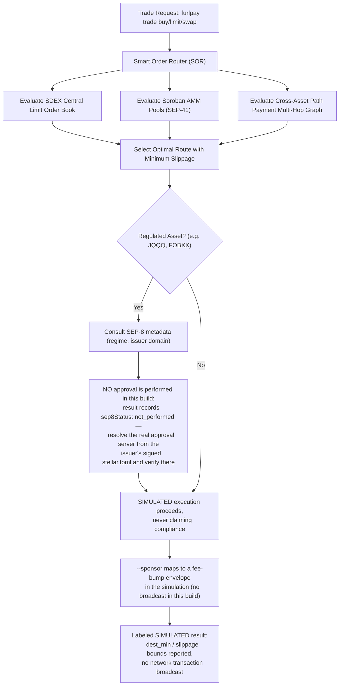
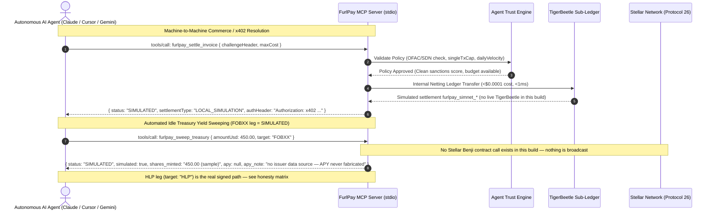

# @furlpay/cli

FurlPay CLI — Stellar Tokenized Equities & RWAs, SDEX/Soroban Trading, x402 Micropayments & MCP Server.

[](https://www.npmjs.com/package/@furlpay/cli)
[](https://nodejs.org)
[](src/index.ts)
[](https://stellar.org)
[](#model-context-protocol-mcp-ai-agents)
[](../../LICENSE)

High-performance terminal execution layer written in TypeScript for connecting Stellar hardware wallets, SDEX/Soroban **trade tooling** (Hyperliquid perp execution is live and signed; Stellar SDEX/Soroban execution is a clearly-labeled local simulation in this build — see the [honesty matrix](#what-is-live-vs-simulated-honesty-matrix)), surfacing **SEP-8 issuer-authorization requirements** for regulated tokenized equities (JQQQ, Securitize NVDA) and money market funds (FOBXX, USTBL) without ever faking an approval, resolving **x402 micropayment challenges** (simulated settlement), and running autonomous **Model Context Protocol (MCP)** agent trading runtimes.

```bash
npm install -g @furlpay/cli
furlpay wallet connect ledger
furlpay trade terminal --pair JQQQ/USDC
```

---

# Install FurlPay CLI

**Requires Node.js ≥ 22.19.0** (npm ships with it). Works on Linux, macOS,
and Windows — no administrator/root privileges needed. Full details,
verification, troubleshooting and uninstall steps:
[docs/INSTALLATION.md](docs/INSTALLATION.md).

### npm — recommended

```bash
npm install -g @furlpay/cli
furlpay --version
```

### Quick install — macOS / Linux

```bash
curl -fsSL https://raw.githubusercontent.com/FurlPay/furlpay-cli/main/install.sh | sh
```

The script verifies Node/npm, warns on unofficial registry mirrors, never
uses sudo, and verifies the installed version afterwards. Inspect it first,
or run `sh install.sh --help` for pinning (`--version X.Y.Z`), the beta
channel (`--channel beta`), `--dry-run`, and `--uninstall`.

### Quick install — Windows (PowerShell)

```powershell
irm https://raw.githubusercontent.com/FurlPay/furlpay-cli/main/install.ps1 | iex
```

Same checks and options (`-Version`, `-Channel`, `-DryRun`, `-Uninstall`),
per-user, no elevation.

### npx — no global install

```bash
npx @furlpay/cli --help
```

### Other package managers

```bash
pnpm add -g @furlpay/cli     # or: yarn global add @furlpay/cli / bun install -g @furlpay/cli
```

### Offline install from the release tarball

Each [release](https://github.com/FurlPay/furlpay-cli/releases) publishes the
exact npm tarball plus `checksums.txt`, a CycloneDX SBOM, and sigstore
build-provenance attestations:

```bash
sha256sum -c checksums.txt --ignore-missing   # verify first
npm install -g ./furlpay-cli-<version>.tgz
```

> **Standalone binaries (no Node.js required) are not yet available** — npm
> is the supported installation channel. This page will list binaries, with
> checksums and attestations, only once they actually ship.

### Keep it current

```bash
furlpay update --check        # read-only check against npm
furlpay update                # self-update (npm installs), with confirmation
furlpay doctor                # install method, registry, config, connectivity
```

Updates are installation-method aware, transmit no credentials, never touch
`~/.furlpay` (config, wallets, escrow ledger), and roll back with
`npm install -g @furlpay/cli@<previous>`. See [docs/UPDATING.md](docs/UPDATING.md).

---

## System Architecture

### 1. End-to-End System Architecture



---

### 2. Multi-Interface Wallet Connectivity Topology



---

### 3. Trade Execution, Smart Order Routing & SEP-8 Compliance Lifecycle



---

### 4. Autonomous Agent MCP & x402 Micropayments Workflow



---

## Stellar Commands Reference

### 1. Stellar Wallet & Hardware Custody (`furlpay wallet`)

```bash
# Connect Ledger Nano S/X/Stax over USB HID (derivation: m/44'/148'/0')
furlpay wallet connect ledger --derivation-index 0

# Connect mobile wallets via SEP-0007 / WalletConnect v2 (displays high-contrast ASCII QR)
furlpay wallet connect walletconnect --qr
furlpay wallet connect sep7

# Browser loopback bridge on 127.0.0.1:4024 for Freighter & Albedo extension
furlpay wallet connect extension --port 4024

# Generate delegated session key for autonomous AI agent with spending policy cap
furlpay wallet agent-keygen \
  --name agent-alpha \
  --daily-limit 50.00 \
  --allowed-assets USDC,JQQQ,FOBXX \
  --expiry 7d

# Import private key or 12/24-word mnemonic into PBKDF2/AES-256-GCM encrypted keystore
furlpay wallet import --name desk-primary --mnemonic
furlpay wallet list
```

### 2. SDEX & Soroban Trading Execution (`furlpay trade`)

```bash
# SDEX Central Limit Buy Order for Janus Henderson Nasdaq-100 (JQQQ) with gasless sponsorship
furlpay trade limit \
  --side buy \
  --asset JQQQ:GDXFE4P76X667RKYHVMZ4H5XQWPLK3X72Z7YXZGHK8R5M7OQ3V7QJQQQ \
  --against USDC:GA5ZSEJYB37JRC5AVCIA5MOP4RHTM335X2KGX3IHOJAPP5RE34K4KZVN \
  --amount 25 \
  --price 104.20 \
  --sponsor

# Path payment strict send (market buy) with guaranteed dest_min slippage protection
furlpay trade market-buy \
  --asset JQQQ:GDXFE4P76X667RKYHVMZ4H5XQWPLK3X72Z7YXZGHK8R5M7OQ3V7QJQQQ \
  --with USDC \
  --spend 1000.00 \
  --slippage 0.5 \
  --sponsor

# Soroban AMM SEP-41 liquidity pool swap with pre-flight gas simulation
furlpay trade swap \
  --pool-id 7c8e99...SOROBAN_AMM \
  --sell-asset USDC \
  --sell-amount 500 \
  --min-receive 4.88 \
  --asset FOBXX

# Interactive real-time ASCII depth chart & order book
furlpay trade terminal --pair JQQQ/USDC
```

### 3. Order Management (`furlpay order`)

```bash
# List resting open limit orders
furlpay order list --pair JQQQ/USDC

# Inspect specific SDEX order
furlpay order inspect --offer-id 8829104

# Gasless cancellation via Fee-Bump Relayer
furlpay order cancel --offer-id 8829104 --sponsor

# Batch cancel all resting offers for a pair
furlpay order cancel-all --pair NVDA/USDC
```

### 4. Tokenized Stocks & RWAs (`furlpay rwa`)

```bash
# List institutional tokenized equities and money market funds
furlpay rwa list --category equities,treasuries

# Inspect SEP-8 compliance parameters and SEC CIK registry details
furlpay rwa inspect --asset JQQQ
furlpay rwa inspect --asset FOBXX

# SEP-8 issuer KYC guidance — NOT implemented in this build: prints what must
# be verified with the issuer and exits non-zero. It never reports an approval.
furlpay rwa kyc --asset FOBXX --interactive
```

### 5. HTTP 402 Micropayments (`furlpay x402`)

```bash
# Settle an HTTP 402 payment challenge.
# NOTE: the engine has no live TigerBeetle connection in this build — settlement
# runs as a clearly-labeled local simulation (status: SIMULATED, LOCAL_SIMULATION).
furlpay x402 pay \
  --challenge-header 'WWW-Authenticate: x402 recipient="GBLX99API", amount="0.0005", token="USDC"' \
  --max-cost 0.005
```

---

### 6. Hyperliquid L1 Perpetuals & Microstructure (`furlpay hyperliquid`, `furlpay market`)

```bash
# Check Hyperliquid validator connectivity, active universe, and canonical HLP vault
furlpay hyperliquid status

# List tradeable perpetual contracts with mark price, funding rate, and open interest
furlpay hyperliquid markets

# Realtime L2 order book, depth bands (10/25/50 bps), OFI, micro-price, and slippage
furlpay market BTC
furlpay market BTC --slippage 0.5 --side buy

# Execute authenticated L1 perpetual order via EIP-712 Phantom Agent
furlpay hyperliquid trade --symbol BTC --side buy --size 0.05 --leverage 5 --limit 75000

# Inspect account equity, margin ratio, unrealized PnL, and open positions
furlpay account balance
furlpay account positions

# Manage pre-trade risk controls and emergency kill-switch
furlpay trading limits --max-single-order 50000 --max-leverage 20
furlpay trading kill-switch --symbol BTC

# Inspect, deposit into, and withdraw from the HLP clearinghouse vault
# (4-day lockup notification on deposits and withdrawals)
furlpay earn hlp stats
furlpay earn hlp deposit 1000
furlpay earn hlp withdraw 100

# Deposits/withdrawals require a funded signer — the CLI fails closed without one:
export HYPERLIQUID_PRIVATE_KEY=0x...   # or ETH_PRIVATE_KEY
```

> **Data provenance:** `earn hlp stats` derives equity, APY, and all-time PnL
> from the live Hyperliquid `/info` vault response. Fields the public API does
> not report (share price, open position count) are shown as *unavailable* —
> never fabricated benchmarks. Withdrawals/deposits are real signed L1
> `vaultTransfer` actions and strictly require a configured signer.

---

### 7. Escrow & Time-Locked Settlement Scheme (`furlpay escrow`)

A deterministic escrow state machine
(`CREATED → FUNDED → PROOF_SUBMITTED → RELEASED`, with `DISPUTED` and
refund paths) persisted across invocations in a durable local ledger at
`~/.furlpay/escrows.json` (atomic writes, 0600 on POSIX, symlink refusal).

```bash
# Create an escrow with a pre-agreed SHA-256 delivery proof commitment
furlpay escrow create \
  --seller 0x70997970C51812dc3A010C7d01b50e0d17dc79C8 \
  --arbiter 0x3C44CdDdB6a900fa2b585dd299e03d12FA4293BC \
  --amount 5000 \
  --timeout-days 7 \
  --proof-hash 0x2cf24dba5fb0a30e26e83b2ac5b9e29e1b161e5c1fa7425e73043362938b9824

# Fund (requires the real funding transaction hash — the CLI never fabricates one)
furlpay escrow fund --escrow-id escrow_1710000000000 --tx-hash 0x<your funding tx>

# Seller submits the cryptographic delivery proof (SHA-256 of the deliverable)
furlpay escrow proof --escrow-id escrow_1710000000000 --hash 0x<sha256> --signature <sig>

# Release funds to the seller (buyer approval; auto-release timer also supported)
furlpay escrow release --escrow-id escrow_1710000000000 --tx-hash 0x<settlement tx>

# Open a dispute for arbiter resolution
furlpay escrow dispute --escrow-id escrow_1710000000000 --reason "delivery did not match spec"

# Inspect the ledger (add --verbose for the immutable transition audit log)
furlpay escrow status [--escrow-id escrow_1710000000000] [--verbose]
```

> **Honesty label:** this is a *local* escrow ledger (state machine + audit
> log on disk) — no on-chain escrow contract is deployed and no funds move
> except the transactions you reference via `--tx-hash`. Unauthorized actors,
> malformed proof hashes, and tx-hash-less fund/release attempts fail closed.

---

## Model Context Protocol (MCP) AI Agents

The CLI provides a standardized STDIO MCP server for Claude, Cursor, Gemini, and autonomous AI trading agents:

```bash
furlpay mcp --wallet agent-alpha
```

Add to your MCP configuration (`claude_desktop_config.json` / Cursor):

```json
{
  "mcpServers": {
    "furlpay-execution": {
      "command": "furlpay",
      "args": ["mcp", "--wallet", "agent-alpha"]
    }
  }
}
```

### Exposed MCP Tools:
- `furlpay_settle_invoice`: Settle x402 payment challenges with Agent Trust Engine policy checks (OFAC/SDN check, velocity limit, spend caps). Responses are explicitly labeled `SIMULATED` / `LOCAL_SIMULATION` in this build.
- `furlpay_sweep_treasury`: Detect idle USDC and sweep into Franklin Templeton FOBXX (Benji) yield on Soroban (labeled simulated) or Hyperliquid HLP (real signed vault transfer).
- `furlpay_trade`: Execute limit orders, path payments, or AMM swaps with delegated budget enforcement on Stellar.
- `furlpay_trade_perp`: Execute perpetual futures orders on Hyperliquid L1 (BTC-PERP, ETH-PERP, NVDA-PERP, HYPE-PERP).
- `furlpay_get_hlp_yield`: Query live HLP vault performance — equity/APY/PnL derived from the live `/info` response; unreported fields (share price, position count) are returned as `null` rather than fabricated.
- `furlpay_balance`: Query balances across Stellar native assets, USDC, and tokenized RWAs (labeled simulated sample data in unauthenticated mode).
- `furlpay_get_quote`: Retrieve optimal multi-hop quotes across SDEX and Soroban AMMs.

---

## Multi-Chain Payments & Banking (Original Suite)

```bash
# Session & Account
furlpay login               # email OTP login (--device for RFC 8628 browser flow)
furlpay whoami              # active session and Safe address
furlpay balance             # token balances across Arbitrum, Base, Optimism, Ethereum

# A2A Transfers & Payments
furlpay pay @recipient 10 usd   # A2A transfer to a verified handle (no FurlPay fee)
furlpay send 25 0xAbc... --token USDC --chain arbitrum
furlpay swap USDT USDC 100
furlpay bridge 100 --from eth --to arb

# Fractional Stocks & Travel
furlpay invest buy AAPL 50
furlpay travel search --city Tokyo --min-stars 4
furlpay dashboard

# CLI Management
furlpay update --check        # check npm for a newer release (no changes)
furlpay update                # self-update npm global installs (confirmed)
furlpay doctor                # install, config, and connectivity diagnostics
```

---

## What Is Live vs. Simulated (Honesty Matrix)

Every execution surface in this CLI is labeled at runtime. Summary:

| Surface | Status | Notes |
|---|---|---|
| Hyperliquid market data (`market`, `hyperliquid markets/status`) | **LIVE** | Real `/info` responses from Hyperliquid validators |
| HLP vault stats (`earn hlp stats`) | **LIVE** | Equity/APY/PnL derived from live `vaultDetails`; unreported fields → `unavailable`, never fabricated |
| HLP deposit / withdraw | **LIVE** (signed) | Real EIP-712 `vaultTransfer` actions; fail closed without `HYPERLIQUID_PRIVATE_KEY`/`ETH_PRIVATE_KEY` |
| Hyperliquid perp execution (`hyperliquid trade`) | **LIVE** (signed) | Requires configured signer; pre-trade risk engine enforced |
| Escrow (`furlpay escrow`) | **LOCAL LEDGER** | Deterministic state machine + audit log at `~/.furlpay/escrows.json`; fund/release require real `--tx-hash` (never fabricated); no on-chain contract is deployed |
| x402 settlement (`x402 pay`, MCP `furlpay_settle_invoice`) | **SIMULATED** | No live TigerBeetle facilitator in this build; responses say `SIMULATED` / `LOCAL_SIMULATION` |
| Stellar SDEX order flow / SEP-8 KYC / Soroban swaps | **SIMULATED** | Deterministic local simulation of Horizon/Soroban submission — no network transactions are broadcast in this build. SEP-8: `rwa kyc` reports `NOT_IMPLEMENTED` (exit 1), and regulated-asset trade results carry `sep8Status: "not_performed"` — compliance is never claimed. Registry carries no hardcoded APY and no invented approval-server URLs. |
| MCP `furlpay_balance` (unauthenticated mode) | **SIMULATED** | Sample fixture balances, flagged `simulated: true` |
| FOBXX sweep (`furlpay_sweep_treasury` target FOBXX) | **SIMULATED** | No Stellar Benji contract call in this build |

**Environment keys:** HLP/perp execution reads `HYPERLIQUID_PRIVATE_KEY` (or
`ETH_PRIVATE_KEY`) from the environment — never from argv. Private keys and
mnemonics for `wallet import` / `login --key` are accepted on stdin only.

---

## Distribution Security

- npm installs are integrity-checked by npm (registry sha512 + signatures);
  the package publishes with **npm provenance** (sigstore, OIDC-bound to this
  repo and workflow).
- GitHub Release assets (tarball, `checksums.txt`, CycloneDX SBOM) carry
  **build-provenance attestations** — verify with
  `gh attestation verify --repo FurlPay/furlpay-cli <file>`.
- Release builds are gated on tag/version consistency, full typecheck +
  tests, and a three-OS smoke install (CLI boot + MCP stdio handshake) of the
  packed tarball before anything is published.
- No postinstall scripts; no secrets in the package; CI actions are
  SHA-pinned; the supply-chain posture is reviewed per release.

See [docs/RELEASING.md](docs/RELEASING.md) and [docs/PACKAGING.md](docs/PACKAGING.md).

---

## License

MIT © FurlPay Protocol & Systems Engineering Group.
