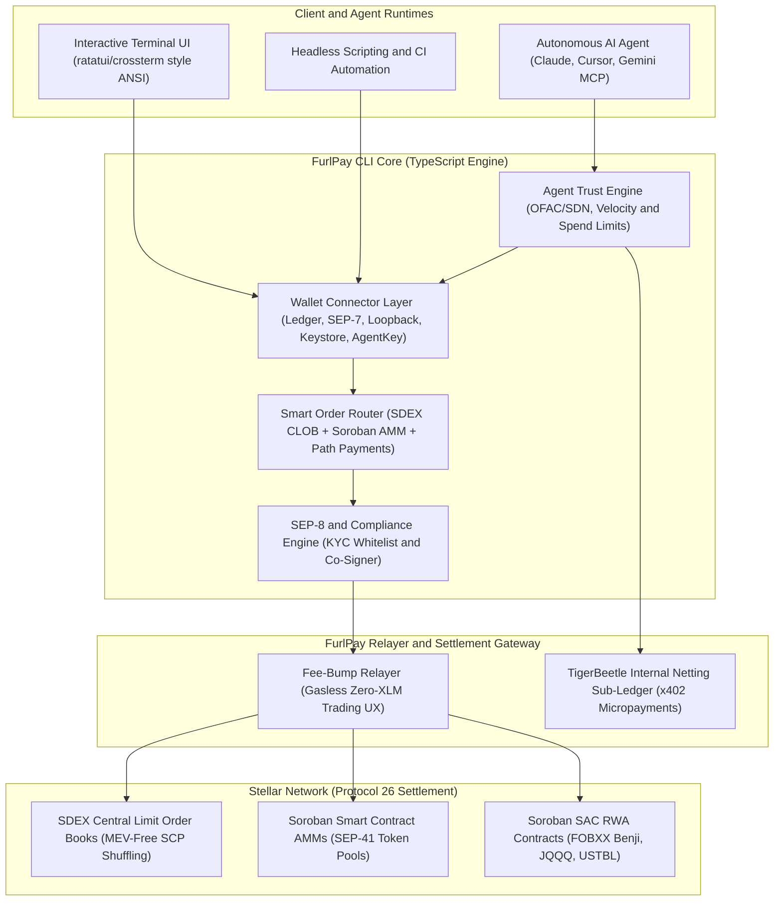
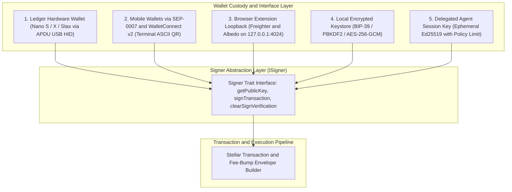
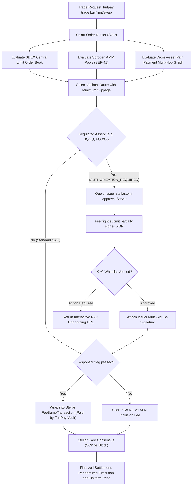
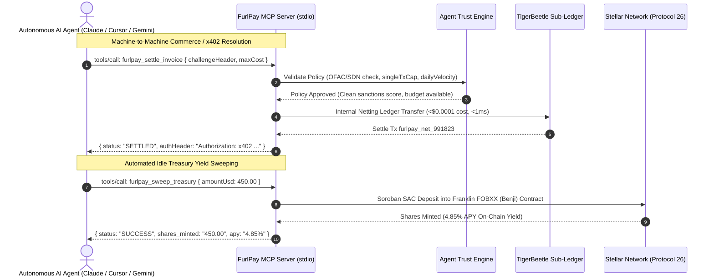

# @furlpay/cli

FurlPay CLI — Stellar Tokenized Equities & RWAs, SDEX/Soroban Trading, x402 Micropayments & MCP Server.

[](https://www.npmjs.com/package/@furlpay/cli)
[](https://nodejs.org)
[](src/index.ts)
[](https://stellar.org)
[](#model-context-protocol-mcp-ai-agents)
[](../../LICENSE)

High-performance terminal execution layer written in TypeScript for connecting Stellar hardware wallets, executing limit orders on the **Stellar Decentralized Exchange (SDEX)**, routing cross-asset liquidity through **Soroban AMMs**, verifying **SEP-8 compliance** on regulated tokenized equities (JQQQ, Securitize NVDA) and money market funds (FOBXX, USTBL), settling **x402 micropayments**, and running autonomous **Model Context Protocol (MCP)** agent trading runtimes.

```bash
npm install -g @furlpay/cli
furlpay wallet connect ledger
furlpay trade terminal --pair JQQQ/USDC
```

---

## System Architecture

### 1. End-to-End System Architecture



---

### 2. Multi-Interface Wallet Connectivity Topology



---

### 3. Trade Execution, Smart Order Routing & SEP-8 Compliance Lifecycle



---

### 4. Autonomous Agent MCP & x402 Micropayments Workflow



---

## Stellar Commands Reference

### 1. Stellar Wallet & Hardware Custody (`furlpay wallet`)

```bash
# Connect Ledger Nano S/X/Stax over USB HID (derivation: m/44'/148'/0')
furlpay wallet connect ledger --derivation-index 0

# Connect mobile wallets via SEP-0007 / WalletConnect v2 (displays high-contrast ASCII QR)
furlpay wallet connect walletconnect --qr
furlpay wallet connect sep7

# Browser loopback bridge on 127.0.0.1:4024 for Freighter & Albedo extension
furlpay wallet connect extension --port 4024

# Generate delegated session key for autonomous AI agent with spending policy cap
furlpay wallet agent-keygen \
  --name agent-alpha \
  --daily-limit 50.00 \
  --allowed-assets USDC,JQQQ,FOBXX \
  --expiry 7d

# Import private key or 12/24-word mnemonic into PBKDF2/AES-256-GCM encrypted keystore
furlpay wallet import --name desk-primary --mnemonic
furlpay wallet list
```

### 2. SDEX & Soroban Trading Execution (`furlpay trade`)

```bash
# SDEX Central Limit Buy Order for Janus Henderson Nasdaq-100 (JQQQ) with gasless sponsorship
furlpay trade limit \
  --side buy \
  --asset JQQQ:GDXFE4P76X667RKYHVMZ4H5XQWPLK3X72Z7YXZGHK8R5M7OQ3V7QJQQQ \
  --against USDC:GA5ZSEJYB37JRC5AVCIA5MOP4RHTM335X2KGX3IHOJAPP5RE34K4KZVN \
  --amount 25 \
  --price 104.20 \
  --sponsor

# Path payment strict send (market buy) with guaranteed dest_min and zero MEV
furlpay trade market-buy \
  --asset JQQQ:GDXFE4P76X667RKYHVMZ4H5XQWPLK3X72Z7YXZGHK8R5M7OQ3V7QJQQQ \
  --with USDC \
  --spend 1000.00 \
  --slippage 0.5 \
  --sponsor

# Soroban AMM SEP-41 liquidity pool swap with pre-flight gas simulation
furlpay trade swap \
  --pool-id 7c8e99...SOROBAN_AMM \
  --sell-asset USDC \
  --sell-amount 500 \
  --min-receive 4.88 \
  --asset FOBXX

# Interactive real-time ASCII depth chart & order book
furlpay trade terminal --pair JQQQ/USDC
```

### 3. Order Management (`furlpay order`)

```bash
# List resting open limit orders
furlpay order list --pair JQQQ/USDC

# Inspect specific SDEX order
furlpay order inspect --offer-id 8829104

# Gasless cancellation via Fee-Bump Relayer
furlpay order cancel --offer-id 8829104 --sponsor

# Batch cancel all resting offers for a pair
furlpay order cancel-all --pair NVDA/USDC
```

### 4. Tokenized Stocks & RWAs (`furlpay rwa`)

```bash
# List institutional tokenized equities and money market funds
furlpay rwa list --category equities,treasuries

# Inspect SEP-8 compliance parameters and SEC CIK registry details
furlpay rwa inspect --asset JQQQ
furlpay rwa inspect --asset FOBXX

# Initiate or refresh accredited investor KYC verification
furlpay rwa kyc --asset FOBXX --interactive
```

### 5. HTTP 402 Micropayments (`furlpay x402`)

```bash
# Settle an HTTP 402 payment challenge via TigerBeetle sub-ledger (<$0.0001 cost)
furlpay x402 pay \
  --challenge-header 'WWW-Authenticate: x402 recipient="GBLX99API", amount="0.0005", token="USDC"' \
  --max-cost 0.005
```

---

### 6. Hyperliquid L1 Perpetuals & Microstructure (`furlpay hyperliquid`, `furlpay market`)

```bash
# Check Hyperliquid validator connectivity, active universe, and canonical HLP vault
furlpay hyperliquid status

# List tradeable perpetual contracts with mark price, funding rate, and open interest
furlpay hyperliquid markets

# Realtime L2 order book, depth bands (10/25/50 bps), OFI, micro-price, and slippage
furlpay market BTC
furlpay market BTC --slippage 0.5 --side buy

# Execute authenticated L1 perpetual order via EIP-712 Phantom Agent
furlpay hyperliquid trade --symbol BTC --side buy --size 0.05 --leverage 5 --limit 75000

# Inspect account equity, margin ratio, unrealized PnL, and open positions
furlpay account balance
furlpay account positions

# Manage pre-trade risk controls and emergency kill-switch
furlpay trading limits --max-single-order 50000 --max-leverage 20
furlpay trading kill-switch --symbol BTC

# Inspect and deposit into HLP clearinghouse vault (with 4-day lockup notification)
furlpay earn hlp stats
furlpay earn hlp deposit 1000
```

---

### 7. Escrow & Time-Locked Settlement Scheme (`furlpay escrow`)

```bash
# Create deterministic cryptographic delivery escrow with SHA-256 proof hash
furlpay escrow create \
  --seller 0x70997970C51812dc3A010C7d01b50e0d17dc79C8 \
  --arbiter 0x3C44CdDdB6a900fa2b585dd299e03d12FA4293BC \
  --amount 5000 \
  --timeout-days 7 \
  --proof-hash 0x2cf24dba5fb0a30e26e83b2ac5b9e29e1b161e5c1fa7425e73043362938b9824

# Fund escrow
furlpay escrow fund --id escrow_1710000000000

# Submit delivery proof and release funds
furlpay escrow release --id escrow_1710000000000 --preimage "invoice_fulfillment_secret_123"
```

---

## Model Context Protocol (MCP) AI Agents

The CLI provides a standardized STDIO MCP server for Claude, Cursor, Gemini, and autonomous AI trading agents:

```bash
furlpay mcp --wallet agent-alpha
```

Add to your MCP configuration (`claude_desktop_config.json` / Cursor):

```json
{
  "mcpServers": {
    "furlpay-execution": {
      "command": "furlpay",
      "args": ["mcp", "--wallet", "agent-alpha"]
    }
  }
}
```

### Exposed MCP Tools:
- `furlpay_settle_invoice`: Settle x402 payment challenges with Agent Trust Engine policy checks (OFAC/SDN check, velocity limit, spend caps).
- `furlpay_sweep_treasury`: Detect idle USDC and sweep into Franklin Templeton FOBXX (Benji) yield on Soroban or Hyperliquid HLP.
- `furlpay_trade`: Execute limit orders, path payments, or AMM swaps with delegated budget enforcement on Stellar.
- `furlpay_trade_perp`: Execute perpetual futures orders on Hyperliquid L1 (BTC-PERP, ETH-PERP, NVDA-PERP, HYPE-PERP).
- `furlpay_get_hlp_yield`: Query live performance, share price, and 30-day trailing APY for Hyperliquid HLP vault.
- `furlpay_balance`: Query balances across Stellar native assets, USDC, and tokenized RWAs.
- `furlpay_get_quote`: Retrieve optimal multi-hop quotes across SDEX and Soroban AMMs.

---

## Multi-Chain Payments & Banking (Original Suite)

```bash
# Session & Account
furlpay login               # email OTP login
furlpay whoami              # active session and Safe address
furlpay balance             # token balances across Arbitrum, Base, Optimism, Ethereum

# A2A Transfers & Payments
furlpay pay @recipient 10 usd   # instant zero-fee transfer to verified handle
furlpay send 25 0xAbc... --token USDC --chain arbitrum
furlpay swap USDT USDC 100
furlpay bridge 100 --from eth --to arb

# Fractional Stocks & Travel
furlpay invest buy AAPL 50
furlpay travel search --city Tokyo --min-stars 4
furlpay dashboard
```

---

## License

MIT © FurlPay Protocol & Systems Engineering Group.
