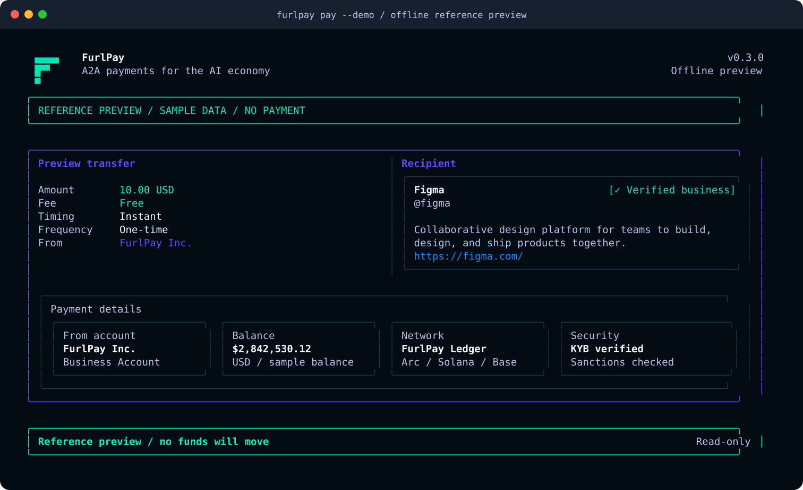

# @furlpay/cli

FurlPay's terminal client for reviewed account-to-account payments and freshness-aware financial monitoring.

The payment review follows the supplied dark fintech reference: mint confirmations, violet panels, rounded terminal geometry, a wide two-column profile and transfer layout, and responsive compact layouts. It adapts to TrueColor, 256-colour, basic ANSI, NO_COLOR, and narrow terminals.

## Install

Requires Node.js 22 or newer.

~~~sh
npm install -g @furlpay/cli
furlpay login
~~~

## Payments

The executable flow fetches a new server quote, binds it to the reviewed recipient, amount, currency, source account, verification and sanctions decision, then asks for a single-key confirmation. The server remains the authority for authorization, fees, limits, balance and settlement.

~~~sh
# Safe, labelled offline recreation of the supplied reference. It never calls an API.
furlpay pay --demo

# Authoritative quote review. This fetches current server data and never sends.
furlpay pay '@recipient' 10.00 USD --dry-run

# Interactive terminal only: press y once the review screen is shown.
furlpay pay '@recipient' 10.00 USD

# Scripted execution needs explicit intent and keeps a reconciliation key.
furlpay pay '@recipient' 10.00 USD --yes --idempotency-key invoice_20261029_001
~~~

PowerShell treats an unquoted @handle as a splat expression. Quote it as shown above. The CLI does not fabricate a recipient, quote, account balance, payment ID, or settlement outcome. If an execution request has an unknown outcome, it prints the idempotency key and requires reconciliation before a retry.

## Live monitoring

Every monitor starts with the signed-in account's REST snapshot. It only displays LIVE after an authenticated event stream delivers authoritative, committed events with source and ingestion timestamps. REST-only values are marked UNKNOWN or DELAYED; data is hidden during SYNCING, STALE, and OFFLINE states.

~~~sh
furlpay dashboard --live
furlpay wallet balance --watch
furlpay chains status --watch
furlpay transactions --live
furlpay directory @recipient --watch
furlpay security monitor
furlpay ledger --watch
~~~

The inspected backend exposes authenticated snapshots for wallets, transactions, chains, directory profiles, and selected admin data. It does not yet expose a general authenticated financial event feed, a Stripe payment feed, or an organisation-scoped customer feed. The CLI surfaces those gaps as UNKNOWN or OFFLINE rather than claiming live data. An SSE or WebSocket feed can be enabled with a same-origin endpoint:

~~~sh
furlpay dashboard --live --stream-path /api/events/stream --transport sse
furlpay dashboard --live --stream-path /api/events/ws --transport ws
~~~

The required event contract, source matrix, security controls, benchmarks, and failover evidence are in [docs/cli](docs/cli).

## Other commands

~~~sh
furlpay whoami
furlpay env sandbox
furlpay balance --output json
furlpay wallet address
furlpay swap USDT USDC 100 --quote-only
furlpay tx list
furlpay invest portfolio
furlpay travel search --city Tokyo --checkin 2026-08-01 --checkout 2026-08-05
furlpay card list
furlpay earn
furlpay completion bash|zsh|fish|powershell
~~~

## MCP and AI clients

~~~sh
furlpay mcp
~~~

The MCP server exposes current, permission-scoped read tools and labels their freshness as UNKNOWN unless upstream provenance is available. It rejects financial mutations because a model must not manufacture payment approval. Use the interactive payment flow for payments.

~~~json
{ "mcpServers": { "furlpay": { "command": "furlpay", "args": ["mcp"] } } }
~~~

## Security model

- Session cookies are sent only to the configured same-origin API over HTTPS, except loopback sandbox HTTP.
- Terminal text from APIs is stripped of ANSI, OSC clipboard sequences, bidirectional overrides, hidden controls, and zero-width characters.
- Every payment checks a fresh authenticated quote before confirmation and again immediately before execution.
- Payment completion requires server-issued transaction evidence; a timeout, disconnect, approval, or pending state never becomes success.
- Event updates are subject- and organisation-scoped, sequenced, deduplicated, gap-detected, reconciled from a snapshot after reconnection, and size-limited.

## Development

~~~sh
npm ci
npm run build
npm test
npm run docs:preview
npm run benchmark
~~~

The package uses Node.js CommonJS and one audited runtime dependency, ws, for optional authenticated WebSocket subscriptions. CI tests Node 22 and 24 on Ubuntu, macOS, and Windows.

## Documentation

- [Real-time architecture](docs/cli/FURLPAY-REALTIME-ARCHITECTURE.md)
- [Authoritative data-source matrix](docs/cli/FURLPAY-REALTIME-DATA-SOURCES.md)
- [Streaming security audit](docs/cli/FURLPAY-STREAMING-SECURITY-AUDIT.md)
- [Measured local benchmarks](docs/cli/FURLPAY-REALTIME-BENCHMARKS.md)
- [Failover test evidence](docs/cli/FURLPAY-REALTIME-FAILOVER-TESTS.md)

## License

MIT
