# @furlpay/cli

FurlPay CLI — Stellar Tokenized Equities & RWAs, SDEX/Soroban Trading, Binance Spot, Hyperliquid Perps, x402 Micropayments & MCP Server.

[](https://www.npmjs.com/package/@furlpay/cli)
[](https://furlpay.github.io/furlpay-cli/)
[](https://nodejs.org)
[](src/index.ts)
[](https://stellar.org)
[](https://hyperliquid.xyz)
[](#binance-exchange-integration)
[](#model-context-protocol-mcp-ai-agents)
[](test/)
[](../../LICENSE)

Terminal execution layer written in TypeScript for connecting Stellar hardware wallets, SDEX/Soroban **trade tooling** (Hyperliquid perp execution is live and signed; Stellar SDEX/Soroban execution is a clearly-labeled local simulation in this build — see the [honesty matrix](#what-is-live-vs-simulated-honesty-matrix)), surfacing **SEP-8 issuer-authorization requirements** for regulated tokenized equities (JQQQ, Securitize NVDA) and money market funds (FOBXX, USTBL) without ever faking an approval, resolving **x402 micropayment challenges** (simulated settlement), and running autonomous **Model Context Protocol (MCP)** agent trading runtimes.

```bash
npm install -g @furlpay/cli
furlpay wallet connect ledger
furlpay trade terminal --pair JQQQ/USDC
```

## Live Documentation

**https://furlpay.github.io/furlpay-cli/** — the full docs site (VitePress, auto-deployed from `main` on every change to `docs-site/`).

| Section | What's in it |
|---|---|
| [Getting Started](https://furlpay.github.io/furlpay-cli/guide/getting-started) | Requirements, first five commands, the two-plane mental model, where data lives |
| [Installation](https://furlpay.github.io/furlpay-cli/guide/installation) | npm / curl / PowerShell / npx / offline tarballs, updates, uninstall |
| [Authentication](https://furlpay.github.io/furlpay-cli/guide/authentication) | RFC 8628 device login, headless OTP, why keys are never argv |
| [Configuration & Diagnostics](https://furlpay.github.io/furlpay-cli/guide/configuration) | `config validate`, `doctor`, `tx verify` semantics, faucet |
| [A2A Payments](https://furlpay.github.io/furlpay-cli/guide/payments) | The quote-bound, consent-first payment flow; outcome classification |
| [Escrow (ETSS)](https://furlpay.github.io/furlpay-cli/guide/escrow) | Lifecycle, cryptographic proof verification, fail-closed modes |
| [x402 Micropayments](https://furlpay.github.io/furlpay-cli/guide/x402) | Challenge settlement (labeled simulated), replay ledger, agent gating |
| [Hyperliquid Perps & HLP](https://furlpay.github.io/furlpay-cli/guide/hyperliquid) | Signer setup, risk engine, live trading, the 4-day-lockup vault |
| [Bitcoin Shorting](https://furlpay.github.io/furlpay-cli/guide/shorting) | Live short execution, mechanism registry, signal research |
| [Stellar Wallets & SDEX](https://furlpay.github.io/furlpay-cli/guide/stellar) | Five custody options, issuer validation, trading surface |
| [Tokenized Stocks & RWAs](https://furlpay.github.io/furlpay-cli/guide/rwa) | Catalog, what the CLI refuses to fake (SEP-8, issuers, APY) |
| [Binance Spot](https://furlpay.github.io/furlpay-cli/guide/binance) | Credentials from env, capability status, body-signed requests |
| [Market Data & Microstructure](https://furlpay.github.io/furlpay-cli/guide/market-data) | Live books, the four HFT indicators, streaming engine |
| [Fork Assets & Replay Risk](https://furlpay.github.io/furlpay-cli/guide/forks) | Read-only fork registry and audits |
| [MCP AI Agents](https://furlpay.github.io/furlpay-cli/guide/agents) | Spend policies, the mandate lifecycle, prompt-injection defense |
| [CLI Command Reference](https://furlpay.github.io/furlpay-cli/reference/cli) | Every command, one table per group |
| [Environment Variables](https://furlpay.github.io/furlpay-cli/reference/environment) | Every variable the CLI reads + the hygiene rules it enforces |
| [Honesty Matrix](https://furlpay.github.io/furlpay-cli/reference/honesty-matrix) | Live vs. simulated, per surface — the authoritative table |
| [Security Model](https://furlpay.github.io/furlpay-cli/reference/security) | Dual-plane architecture, threat table, money-math integrity |
| [Regulatory Overview](https://furlpay.github.io/furlpay-cli/compliance/regulatory) | Licensing matrix across US/EU/UK/SG (full report below in this README) |
| [Compliance Invariants](https://furlpay.github.io/furlpay-cli/compliance/invariants) | The five non-negotiables + engineering corollaries |
| [Use Cases](https://furlpay.github.io/furlpay-cli/use-cases) | Eight end-to-end workflows: payouts, first trade, agent wallets, escrow, forks, yield, verification, research |

---

# Install FurlPay CLI

**Requires Node.js ≥ 22.19.0** (npm ships with it). Works on Linux, macOS,
and Windows — no administrator/root privileges needed. Full details,
verification, troubleshooting and uninstall steps:
[docs/INSTALLATION.md](docs/INSTALLATION.md).

### npm — recommended

```bash
npm install -g @furlpay/cli
furlpay --version
```

### Quick install — macOS / Linux

```bash
curl -fsSL https://raw.githubusercontent.com/FurlPay/furlpay-cli/main/install.sh | sh
```

The script verifies Node/npm, warns on unofficial registry mirrors, never
uses sudo, and verifies the installed version afterwards. Inspect it first,
or run `sh install.sh --help` for pinning (`--version X.Y.Z`), the beta
channel (`--channel beta`), `--dry-run`, and `--uninstall`.

### Quick install — Windows (PowerShell)

```powershell
irm https://raw.githubusercontent.com/FurlPay/furlpay-cli/main/install.ps1 | iex
```

Same checks and options (`-Version`, `-Channel`, `-DryRun`, `-Uninstall`),
per-user, no elevation.

### npx — no global install

```bash
npx @furlpay/cli --help
```

### Other package managers

```bash
pnpm add -g @furlpay/cli     # or: yarn global add @furlpay/cli / bun install -g @furlpay/cli
```

### Offline install from the release tarball

Each [release](https://github.com/FurlPay/furlpay-cli/releases) publishes the
exact npm tarball plus `checksums.txt`, a CycloneDX SBOM, and sigstore
build-provenance attestations:

```bash
sha256sum -c checksums.txt --ignore-missing   # verify first
npm install -g ./furlpay-cli-<version>.tgz
```

> **Standalone binaries (no Node.js required) are not yet available** — npm
> is the supported installation channel. This page will list binaries, with
> checksums and attestations, only once they actually ship.

### Keep it current

```bash
furlpay update --check        # read-only check against npm
furlpay update                # self-update (npm installs), with confirmation
furlpay doctor                # install method, registry, config, connectivity
```

Updates are installation-method aware, transmit no credentials, never touch
`~/.furlpay` (config, wallets, escrow ledger), and roll back with
`npm install -g @furlpay/cli@<previous>`. See [docs/UPDATING.md](docs/UPDATING.md).

---

## System Architecture

### 1. End-to-End System Architecture

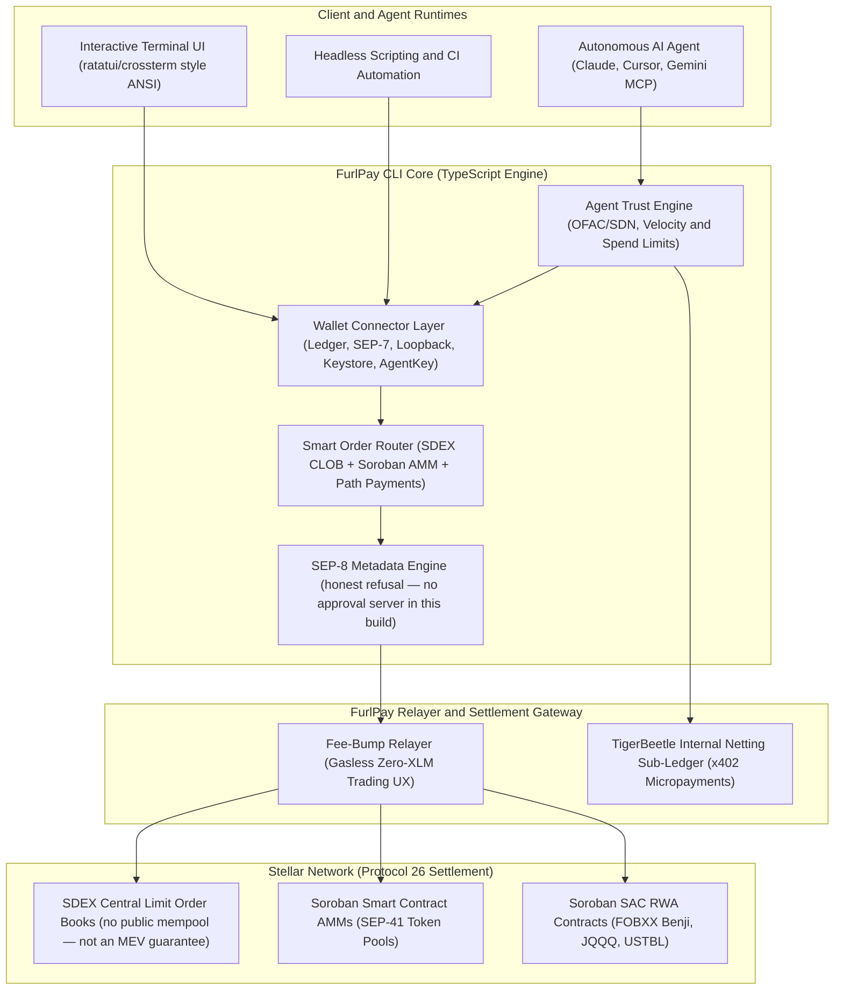

---

### 2. Multi-Interface Wallet Connectivity Topology

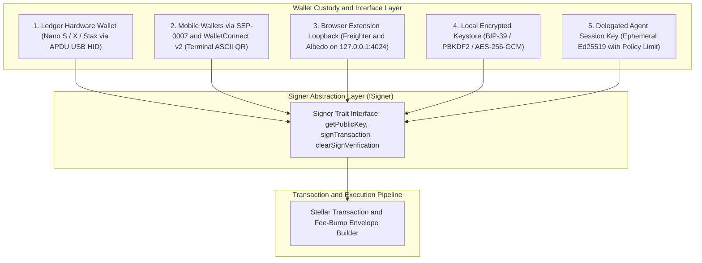

---

### 3. Trade Execution, Smart Order Routing & SEP-8 Compliance Lifecycle

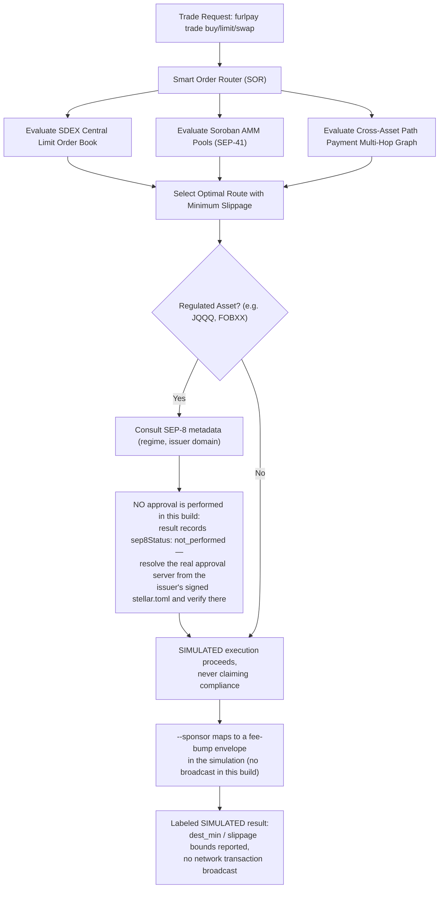

---

### 4. Autonomous Agent MCP & x402 Micropayments Workflow

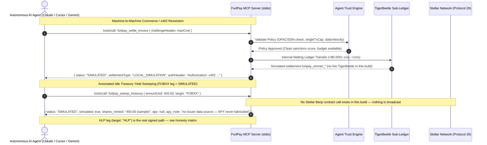

---

## Stellar Commands Reference

### 1. Stellar Wallet & Hardware Custody (`furlpay wallet`)

```bash
# Connect Ledger Nano S/X/Stax over USB HID (derivation: m/44'/148'/0')
furlpay wallet connect ledger --derivation-index 0

# Connect mobile wallets via SEP-0007 / WalletConnect v2 (displays high-contrast ASCII QR)
furlpay wallet connect walletconnect --qr
furlpay wallet connect sep7

# Browser loopback bridge on 127.0.0.1:4024 for Freighter & Albedo extension
furlpay wallet connect extension --port 4024

# Generate delegated session key for autonomous AI agent with spending policy cap
furlpay wallet agent-keygen \
  --name agent-alpha \
  --daily-limit 50.00 \
  --allowed-assets USDC,JQQQ,FOBXX \
  --expiry 7d

# Import private key or 12/24-word mnemonic into PBKDF2/AES-256-GCM encrypted keystore
furlpay wallet import --name desk-primary --mnemonic
furlpay wallet list
```

### 2. SDEX & Soroban Trading Execution (`furlpay trade`)

```bash
# SDEX Central Limit Buy Order for Janus Henderson Nasdaq-100 (JQQQ) with gasless sponsorship
furlpay trade limit \
  --side buy \
  --asset JQQQ:GDXFE4P76X667RKYHVMZ4H5XQWPLK3X72Z7YXZGHK8R5M7OQ3V7QJQQQ \
  --against USDC:GA5ZSEJYB37JRC5AVCIA5MOP4RHTM335X2KGX3IHOJAPP5RE34K4KZVN \
  --amount 25 \
  --price 104.20 \
  --sponsor

# Path payment strict send (market buy) with guaranteed dest_min slippage protection
furlpay trade market-buy \
  --asset JQQQ:GDXFE4P76X667RKYHVMZ4H5XQWPLK3X72Z7YXZGHK8R5M7OQ3V7QJQQQ \
  --with USDC \
  --spend 1000.00 \
  --slippage 0.5 \
  --sponsor

# Soroban AMM SEP-41 liquidity pool swap with pre-flight gas simulation
furlpay trade swap \
  --pool-id 7c8e99...SOROBAN_AMM \
  --sell-asset USDC \
  --sell-amount 500 \
  --min-receive 4.88 \
  --asset FOBXX

# Interactive real-time ASCII depth chart & order book
furlpay trade terminal --pair JQQQ/USDC
```

### 3. Order Management (`furlpay order`)

```bash
# List resting open limit orders
furlpay order list --pair JQQQ/USDC

# Inspect specific SDEX order
furlpay order inspect --offer-id 8829104

# Gasless cancellation via Fee-Bump Relayer
furlpay order cancel --offer-id 8829104 --sponsor

# Batch cancel all resting offers for a pair
furlpay order cancel-all --pair NVDA/USDC
```

### 4. Tokenized Stocks & RWAs (`furlpay rwa`)

```bash
# List institutional tokenized equities and money market funds
furlpay rwa list --category equities,treasuries

# Inspect SEP-8 compliance parameters and SEC CIK registry details
furlpay rwa inspect --asset JQQQ
furlpay rwa inspect --asset FOBXX

# SEP-8 issuer KYC guidance — NOT implemented in this build: prints what must
# be verified with the issuer and exits non-zero. It never reports an approval.
furlpay rwa kyc --asset FOBXX --interactive
```

### 5. HTTP 402 Micropayments (`furlpay x402`)

```bash
# Settle an HTTP 402 payment challenge.
# NOTE: the engine has no live TigerBeetle connection in this build — settlement
# runs as a clearly-labeled local simulation (status: SIMULATED, LOCAL_SIMULATION).
furlpay x402 pay \
  --challenge-header 'WWW-Authenticate: x402 recipient="GBLX99API", amount="0.0005", token="USDC"' \
  --max-cost 0.005
```

---

### 6. Hyperliquid L1 Perpetuals & Microstructure (`furlpay hyperliquid`, `furlpay market`)

```bash
# Check Hyperliquid validator connectivity, active universe, and canonical HLP vault
furlpay hyperliquid status

# List tradeable perpetual contracts with mark price, funding rate, and open interest
furlpay hyperliquid markets

# Realtime L2 order book, depth bands (10/25/50 bps), OFI, micro-price, and slippage
furlpay market BTC
furlpay market BTC --slippage 0.5 --side buy

# Execute authenticated L1 perpetual order via EIP-712 Phantom Agent
furlpay hyperliquid trade --symbol BTC --side buy --size 0.05 --leverage 5 --limit 75000

# Inspect account equity, margin ratio, unrealized PnL, and open positions
furlpay account balance
furlpay account positions

# Manage pre-trade risk controls and emergency kill-switch
furlpay trading limits --max-single-order 50000 --max-leverage 20
furlpay trading kill-switch --symbol BTC

# Inspect, deposit into, and withdraw from the HLP clearinghouse vault
# (4-day lockup notification on deposits and withdrawals)
furlpay earn hlp stats
furlpay earn hlp deposit 1000
furlpay earn hlp withdraw 100

# Deposits/withdrawals require a funded signer — the CLI fails closed without one:
export HYPERLIQUID_PRIVATE_KEY=0x...   # or ETH_PRIVATE_KEY
```

> **Data provenance:** `earn hlp stats` derives equity, APY, and all-time PnL
> from the live Hyperliquid `/info` vault response. Fields the public API does
> not report (share price, open position count) are shown as *unavailable* —
> never fabricated benchmarks. Withdrawals/deposits are real signed L1
> `vaultTransfer` actions and strictly require a configured signer.

---

### 7. Escrow & Time-Locked Settlement Scheme (`furlpay escrow`)

A deterministic escrow state machine
(`CREATED → FUNDED → PROOF_SUBMITTED → RELEASED`, with `DISPUTED` and
refund paths) persisted across invocations in a durable local ledger at
`~/.furlpay/escrows.json` (atomic writes, 0600 on POSIX, symlink refusal).

```bash
# Create an escrow with a pre-agreed SHA-256 delivery proof commitment
furlpay escrow create \
  --seller 0x70997970C51812dc3A010C7d01b50e0d17dc79C8 \
  --arbiter 0x3C44CdDdB6a900fa2b585dd299e03d12FA4293BC \
  --amount 5000 \
  --timeout-days 7 \
  --proof-hash 0x2cf24dba5fb0a30e26e83b2ac5b9e29e1b161e5c1fa7425e73043362938b9824

# Fund (requires the real funding transaction hash — the CLI never fabricates one)
furlpay escrow fund --escrow-id escrow_1710000000000 --tx-hash 0x<your funding tx>

# Seller submits the cryptographic delivery proof (SHA-256 of the deliverable)
furlpay escrow proof --escrow-id escrow_1710000000000 --hash 0x<sha256> --signature <sig>

# Release funds to the seller (buyer approval; auto-release timer also supported)
furlpay escrow release --escrow-id escrow_1710000000000 --tx-hash 0x<settlement tx>

# Open a dispute for arbiter resolution
furlpay escrow dispute --escrow-id escrow_1710000000000 --reason "delivery did not match spec"

# Inspect the ledger (add --verbose for the immutable transition audit log)
furlpay escrow status [--escrow-id escrow_1710000000000] [--verbose]
```

> **Honesty label:** this is a *local* escrow ledger (state machine + audit
> log on disk) — no on-chain escrow contract is deployed and no funds move
> except the transactions you reference via `--tx-hash`. Unauthorized actors,
> malformed proof hashes, and tx-hash-less fund/release attempts fail closed.

---

### 8. Transaction Verification, Testnet Faucet & Diagnostics

```bash
# Verify a transaction against a real Horizon instance (mainnet shown).
# Reports exactly what a lookup proves — and what it does NOT: an API lookup
# of finalized ledger history, never claimed as cryptographic re-verification.
# Exit 0 = confirmed successful; 1 = failed-on-chain / not found / invalid /
# lookup unavailable. A 404 is explicitly NOT reported as "does not exist".
furlpay tx verify <64-hex-hash> [--network mainnet|testnet] [--output json]

# Fund a testnet/futurenet account via the official Stellar Friendbot.
# Mainnet is refused outright — real XLM cannot be fabricated. `FUNDED` is
# reported only on an actual successful Friendbot response, with the funding
# tx hash and an independent Horizon balance check.
furlpay faucet --address <G...> [--network testnet|futurenet] [--output json]

# Validate the local config: canonical network passphrases, https endpoints,
# slippage/risk bounds, and agent-trust cap consistency (single-tx cap may
# not exceed the daily cap). Non-zero exit on any error.
furlpay config validate [--output json]

# Machine-readable diagnostics (also available as --output json); exits
# non-zero when the API connectivity check fails so scripts can rely on it.
furlpay doctor [--output json]
```

> **Verification semantics:** `tx verify` performs `GET /transactions/{hash}`
> against the documented Horizon endpoint for the selected network. The
> result distinguishes `CONFIRMED_SUCCESS`, `CONFIRMED_FAILED` (real tx,
> failed on-chain), `NOT_FOUND` (with an explicit "not proof of absence"
> disclaimer), `INVALID_HASH`, and `UNAVAILABLE` (a Horizon outage is never
> evidence about the transaction). Verified live against Horizon mainnet and
> testnet: a fresh Friendbot funding tx confirmed seconds after funding.

---

## Model Context Protocol (MCP) AI Agents

The CLI provides a standardized STDIO MCP server for Claude, Cursor, Gemini, and autonomous AI trading agents:

```bash
furlpay mcp --wallet agent-alpha
```

Add to your MCP configuration (`claude_desktop_config.json` / Cursor):

```json
{
  "mcpServers": {
    "furlpay-execution": {
      "command": "furlpay",
      "args": ["mcp", "--wallet", "agent-alpha"]
    }
  }
}
```

### Exposed MCP Tools (two surfaces — read-only research + policy-gated execution):

`furlpay mcp --wallet <name>` serves the **TypeScript execution server**
(`src/mcp/server.ts`, 35 tools). Plain `furlpay mcp` serves the **JS research
server** (`lib/mcp.js`, 29 tools). On BOTH servers a default install cannot
move funds: every value-moving tool is structurally ABSENT from tools/list
until `--enable-execution` AND a configured agent policy — and in execution
mode mutating calls still require the two-phase protocol
(`furlpay_preview_execution` → hash-bound single-use `furlpay_confirm_execution`).

**JS research server — fork asset operations (read-only):**
- `fork_list_networks` / `fork_inspect_network` / `fork_replay_check`: declared fork registry and offline replay-risk audits (BTCB2, BTC1, ECX).

**JS research server — market microstructure (read-only quant research):**
- `microstructure_analytics`: exponentially-weighted OBI + Stoikov microprice over a supplied depth snapshot (integer-minor).
- `microstructure_vpin`: Easley/López de Prado/O'Hara order-flow toxicity over a supplied trade tape (fixed-volume buckets, trailing partial excluded per the model).
- `microstructure_quotes`: Avellaneda-Stoikov reservation price + optimal bid/ask for an inventory position.

**JS research server — quantitative algo engines (read-only research — HFT-V2 report §4/§7/§9):**
- `algo_glft_quotes`: Guéant–Lehalle–Fernandez-Tapia closed-form quotes — total spread δa+δb = γσ²τ + (2/γ)ln(1+γ/k) around the inventory-skewed reservation, with GLFT fill probability e^(−kδ). The deployable quoting frontier per the 2026 literature; adds the ½γσ²τ vol term the AS variant omits.
- `algo_breakeven`: maker ship/no-ship arithmetic — E[PnL/h] = λ(δ − a − c) − ½γσ²q² in bps. Verdicts follow the sign of the arithmetic, never optimism.
- `algo_cascade`: liquidation-cascade regime composite (funding spike + ask-wall OBI + toxic VPIN). Analysis only — the response itself carries the correction that undiscounted-book liquidations leave no sniping edge (HFT-V2 §5).

**TS execution server — policy-gated execution (hidden by default, two-phase when enabled):**
- `furlpay_settle_invoice`: Settle x402 payment challenges with Agent Trust Engine policy checks (OFAC/SDN check, velocity limit, spend caps). Responses are explicitly labeled `SIMULATED` / `LOCAL_SIMULATION` in this build.
- `furlpay_sweep_treasury`: Detect idle USDC and sweep into Franklin Templeton FOBXX (Benji) yield on Soroban (labeled simulated) or Hyperliquid HLP (real signed vault transfer).
- `furlpay_trade`: Execute limit orders, path payments, or AMM swaps with delegated budget enforcement on Stellar.
- `furlpay_trade_perp`: Execute perpetual futures orders on Hyperliquid L1 (BTC-PERP, ETH-PERP, NVDA-PERP, HYPE-PERP).
- `furlpay_execute_trade` / `furlpay_cancel_order` / `furlpay_emergency_stop` / `furlpay_pay`: order lifecycle and A2A payment — same gating.

**TS execution server — read-only (always available):**
- `furlpay_get_hlp_yield`: Query live HLP vault performance — equity/APY/PnL derived from the live `/info` response; unreported fields (share price, position count) are returned as `null` rather than fabricated.
- `furlpay_balance`: Query balances across Stellar native assets, USDC, and tokenized RWAs (labeled simulated sample data in unauthenticated mode).
- `furlpay_get_quote`: Retrieve optimal multi-hop quotes across SDEX and Soroban AMMs.
- `furlpay_get_market_data` / `furlpay_get_orderbook` / `furlpay_get_funding` / `furlpay_get_market_analysis` / `furlpay_compare_markets` / `furlpay_market_search` / `furlpay_list_chains` / `furlpay_list_exchanges`: market data and venue discovery.
- `furlpay_positions` / `furlpay_open_orders` / `furlpay_portfolio_risk` / `furlpay_preview_trade`: account views (preview executes nothing).
- `furlpay_get_rwa_assets` / `furlpay_get_rwa_quote`: tokenized securities catalog (SEP-8 never claimed).
- `furlpay_finance_overview` / `furlpay_finance_ledger` / `furlpay_finance_spend` / `furlpay_finance_treasury` / `furlpay_finance_billing` / `furlpay_finance_payments`: read-only views of the local double-entry finance ledger — MCP can inspect money, never authorize its movement.
- `furlpay_oracle_price`: live multi-source USD quote (Coinbase/Kraken/Binance/Jupiter) with a cross-source agreement gate — DISAGREEMENT returns per-source readings with a **null price**, never a blended number.
- `furlpay_solana_cluster_status`: live Solana RPC reads (epoch/slot/block height). No signing path exists on this surface.
- `furlpay_preview_execution` / `furlpay_confirm_execution`: the two-phase protocol itself.

---

## Multi-Chain Payments & Banking (Original Suite)

```bash
# Session & Account
furlpay login               # email OTP login (--device for RFC 8628 browser flow)
furlpay whoami              # active session and Safe address
furlpay balance             # token balances across Arbitrum, Base, Optimism, Ethereum

# A2A Transfers & Payments
furlpay pay @recipient 10 usd   # A2A transfer to a verified handle (no FurlPay fee)
furlpay send 25 0xAbc... --token USDC --chain arbitrum
furlpay swap USDT USDC 100
furlpay bridge 100 --from eth --to arb

# Fractional Stocks & Travel
furlpay invest buy AAPL 50
furlpay travel search --city Tokyo --min-stars 4
furlpay dashboard

# CLI Management
furlpay update --check        # check npm for a newer release (no changes)
furlpay update                # self-update npm global installs (confirmed)
furlpay doctor                # install, config, and connectivity diagnostics
```

---


## Bitcoin Shorting (Hyperliquid rail — LIVE; `furlpay short`)

**Shorting BTC is supported and live** on the Hyperliquid rail: a short is a
signed EIP-712 order with side `sell` through the exchange endpoint, behind
the pre-trade risk engine, mandate gate and kill-switch.

```bash
# Open a short (LIVE, signed, risk-engine enforced)
furlpay hyperliquid trade --symbol BTC --side sell --size 0.05 --leverage 5

# Close the short (market buy-back of the position size)
furlpay account positions
furlpay hyperliquid close BTC
```

`furlpay short` adds the short-specific intelligence from the quantitative
microstructure research:

```bash
# Which mechanisms exist (honest status per venue)
furlpay short mechanisms

# Short-READINESS research: OBI ask-wall + microprice-below-mid + VPIN
# non-toxic flow, evaluated over YOUR supplied data (read-only analysis —
# never an execution trigger; the risk engine gates every real order)
furlpay short signal --book depth.json --tape trades.json --bucket 1000
```

| Mechanism | Status |
|---|---|
| Hyperliquid perpetual short (`--side sell`) | **LIVE** (signed, risk-engine enforced) |
| Binance USD-M futures short | **NOT IMPLEMENTED** (futures declared `false` in the capability registry) |
| CME cash-settled futures / basis trade | **N/A** (no institutional venue access) |

The signal gate combines the three entry-criteria signals from the shorting
literature: ask-wall OBI (≤ −0.65), microprice drifted below mid, and
**non-toxic** VPIN flow (shorting into an informed dump is squeeze risk).

## Binance Exchange Integration (TESTNET-READY, live verification BLOCKED on credentials)

A first-class Binance adapter built on the same architecture as the Hyperliquid
engine, behind the same Agent Trust controls.

```bash
# Credentials come from the environment only — never argv (visible in process listings)
export BINANCE_API_KEY=...
export BINANCE_API_SECRET=...
export FURLPAY_BINANCE_ENV=testnet   # or mainnet — explicit, never silently swapped

# Orders pass the Agent Trust mandate gate BEFORE any request is signed
furlpay binance spot buy BTCUSDT --quote 50
```

Implemented in this build:

| Capability | Status |
|---|---|
| HMAC-SHA256 request signing (deterministic, injected clock, recvWindow enforced at signing) | **IMPLEMENTED + TESTED** |
| Spot REST client — balances, market/limit orders, cancel, open orders, ticker, order book | **IMPLEMENTED + TESTED** (stubbed transport) |
| Testnet/mainnet as distinct constants — never silently swapped | **IMPLEMENTED + TESTED** |
| Capability registry — withdrawals structurally absent (`false`, no method exists on the surface) | **IMPLEMENTED + TESTED** |
| Agent Trust mandate gate runs BEFORE signing — a refused order builds no HTTP request | **IMPLEMENTED + TESTED** |
| USD-M Futures, OCO, trailing stops, WebSocket streams | **NOT IMPLEMENTED** — declared `false` in the capability registry, never assumed |
| Live/testnet end-to-end verification | **BLOCKED** — needs Binance API credentials with withdrawals disabled |

## What Is Live vs. Simulated (Honesty Matrix)

Every execution surface in this CLI is labeled at runtime. Summary:

| Surface | Status | Notes |
|---|---|---|
| Hyperliquid market data (`market`, `hyperliquid markets/status`) | **LIVE** | Real `/info` responses from Hyperliquid validators |
| Live trade terminal (`furlpay live <SYM>`) | **LIVE (data) + LOCAL (render)** | Real Hyperliquid WebSocket (`l2Book` + `trades`) through the streaming state machines: feed regression freezes the book (never renders stale as current), disconnect renders DISCONNECTED — never a fake book. Gauges (OBI, micro-price, rolling VPIN, optional GLFT quotes) computed on the live feed. The terminal NEVER places, signs or broadcasts: [Space] PANIC prints the signed kill-switch command and only spawns it with `--allow-panic` (that command still runs the risk engine and fails closed without a signer) |
| Transaction verification (`tx verify`) | **LIVE** (lookup) | Real Horizon `GET /transactions/{hash}`; distinguishes confirmed-success / confirmed-failed / not-found / invalid / unavailable; explicitly an API lookup, never claimed as cryptographic re-verification |
| Testnet faucet (`faucet`) | **LIVE** | Real Friendbot funding on testnet/futurenet only (mainnet refused); `FUNDED` requires the Friendbot's own successful response + independent Horizon balance check |
| Config validation (`config validate`) | **LOCAL** | Structural checks on the local config (canonical passphrases, https endpoints, risk bounds, cap consistency); no network calls |
| Diagnostics (`doctor`) | **LIVE** checks | Real connectivity/registry checks; `--output json` schema; exits non-zero when the API liveness check fails |
| HLP vault stats (`earn hlp stats`) | **LIVE** | Equity/APY/PnL derived from live `vaultDetails`; unreported fields → `unavailable`, never fabricated |
| HLP deposit / withdraw | **LIVE** (signed) | Real EIP-712 `vaultTransfer` actions; fail closed without `HYPERLIQUID_PRIVATE_KEY`/`ETH_PRIVATE_KEY` |
| Hyperliquid perp execution (`hyperliquid trade`) | **LIVE** (signed) | Requires configured signer; pre-trade risk engine enforced **fail-closed** — asset-metadata, L2-book and clearinghouse-state failures refuse the order instead of skipping the guard; margin check runs on live account state; notional/turnover/margin arithmetic is scaled-BigInt end to end |
| Pre-trade USDC peg guardrail | **LIVE** (feed ingestion) | Every pre-trade evaluation ingests USDC/USD (CoinGecko default, `FURLPAY_USDC_PEG_FEED_URL` override, ≥30s cadence, https-only); >25 bps drift halts risk-increasing orders with 5-min recovery hysteresis. A feed outage is never depeg evidence and never recovery evidence — a halt in force stays until real data proves recovery, and a no-data pass carries an explicit `PEG_FEED_UNAVAILABLE` warning (`riskWarnings` on the execution result) |
| Escrow (`furlpay escrow`) | **LOCAL LEDGER** | Deterministic state machine + audit log at `~/.furlpay/escrows.json`; fund/release require real `--tx-hash` (never fabricated); no on-chain contract is deployed |
| Bitcoin shorting (`furlpay short mechanisms/signal`, execution `hyperliquid trade --side sell`) | **LIVE** (execution) / **ANALYSIS** (signals) | Short execution is the same signed EIP-712 sell order path as any Hyperliquid order — LIVE with the risk engine enforced. `furlpay short signal` is read-only OBI/microprice/VPIN research over supplied data: analysis, never an execution trigger. Binance futures shorts NOT IMPLEMENTED. |
| Streaming engine (L2DeltaBook / RollingVpin / WsConnectionManager) | **IMPLEMENTED (state machines, transport-agnostic)** | Sequence-gap poisoning forces REST resync (a missed delta never silently diverges the book); rolling VPIN accumulator emits verdicts on bucket completion; exponential backoff + heartbeat staleness + subscription dedup/cap. Wire a real socket into `connect()` to go live — the state machines are identical. |
| Binance spot adapter (signed requests, balances, orders) | **IMPLEMENTED, TESTNET-BLOCKED** | Full unit battery against stubbed transport (14 tests: signing determinism, secret redaction, env separation, error surfacing, gate ordering); live/testnet end-to-end requires API credentials with withdrawals disabled. Exchange errors surface code+message+HTTP status — never a synthetic success. |
| Sweep artifact utilities (`fork simulate/psbt-inspect/opreturn/taint-plan`) | **IMPLEMENTED (Phase 2, offline)** | Slippage simulator over a *supplied* depth snapshot (integer minor math, deterministic, depth+cap refusals); BIP-174 PSBT wire inspector; BTC1 OP_RETURN barrier builder (≥83B enforced, PUSHDATA2); BTCB2 per-output taint plans. All artifacts are review-only — never broadcast. Live venue data: NOT IMPLEMENTED (no venue adapter). |
| Market microstructure analytics (`microstructure analytics/vpin/quotes`) | **IMPLEMENTED (offline)** | Exponentially-weighted OBI, Stoikov microprice, Easley-VPIN, Avellaneda-Stoikov reservation quotes — the four canonical HFT indicators, pure math over a *supplied* depth snapshot or trade tape. No live feed in this build; the WebSocket engine feeds these same functions when it ships. Formulas: Easley/López de Prado/O'Hara (VPIN), Stoikov (micro-price), Avellaneda-Stoikov (reservation). |
| Quantitative algo engines (`furlpay algo quotes/schedule/report/breakeven/queue/funding/cascade`; MCP `algo_glft_quotes`/`algo_breakeven`/`algo_cascade`) | **IMPLEMENTED (offline analysis)** | HFT-V2 research §4/§7/§9 realized as pure engines: GLFT closed-form quotes (adds the ½γσ²τ vol term AS omits), micro-TWAP/POV schedulers (seeded-reproducible, BigInt-exact reconciliation, plans never placed), Implementation-Shortfall scorecards vs arrival price, maker breakeven λ(δ−a−c)−½γσ²q², fluid queue-position estimates, funding persistence z-scores, and the cascade composite (which carries the no-sniping correction). Schedules are PLANS; verdicts are arithmetic — nothing signs, places or broadcasts, and no live edge is ever claimed. |
| Fork asset operations (`fork networks/inspect/eligibility`) | **IMPLEMENTED (Phase 1, read-only)** | Offline replay-risk audit + declared registry (BTCB2, BTC1, ECX — unverified-declaration). Phase-3 surfaces (market, simulate, plan, liquidate, settlement) refuse with NOT_IMPLEMENTED — nothing simulated. MCP: fork_list_networks / fork_inspect_network / fork_replay_check (read-only). |
| x402 settlement (`x402 pay`, MCP `furlpay_settle_invoice`) | **SIMULATED** | No live TigerBeetle facilitator in this build; responses say `SIMULATED` / `LOCAL_SIMULATION` |
| Stellar SDEX order flow / SEP-8 KYC / Soroban swaps | **SIMULATED** | Deterministic local simulation of Horizon/Soroban submission — no network transactions are broadcast in this build. SEP-8: `rwa kyc` reports `NOT_IMPLEMENTED` (exit 1), and regulated-asset trade results carry `sep8Status: "not_performed"` — compliance is never claimed. Registry carries no hardcoded APY and no invented approval-server URLs. |
| MCP `furlpay_balance` (unauthenticated mode) | **SIMULATED** | Sample fixture balances, flagged `simulated: true` |
| FOBXX sweep (`furlpay_sweep_treasury` target FOBXX) | **SIMULATED** | No Stellar Benji contract call in this build |
| Oracle quotes (`furlpay oracle price/sources`, MCP `furlpay_oracle_price`) | **LIVE** (read-only) | Multi-source USD price fan-out over real public endpoints (Coinbase spot, Kraken ticker, Binance USDT-cross, Jupiter Solana); median of sources gated on per-asset cross-source agreement (±1–3%). DISAGREEMENT returns per-source readings with a **null price** — never a blended number across disagreeing sources; UNAVAILABLE guesses nothing. Sanity bands per asset (SOL clamped $1–$2000). Optional Pyth Hermes gateway provider is **inactive unless configured** — the public Hermes endpoint is auth-gated (Pyth Pro); no unverified feed IDs ship baked in. This surface never signs or broadcasts. |
| Solana live surface (`furlpay solana status/balance/price/quote`, MCP `furlpay_solana_cluster_status`) | **LIVE** (read-only) | Real JSON-RPC reads against mainnet-beta (epoch/slot/block height, lamport balances; `SOLANA_RPC_URL` override) and indicative Jupiter price/quote routes. Addresses validated as base58 before any request; RPC protocol/HTTP errors **throw** — never a synthetic slot. Every output states that this build has no Solana signing path: quotes are labeled `INDICATIVE` routing information and cannot be filled by anything in this CLI. |

**Environment keys:** HLP/perp execution reads `HYPERLIQUID_PRIVATE_KEY` (or
`ETH_PRIVATE_KEY`) from the environment — never from argv. Private keys and
mnemonics for `wallet import` / `login --key` are accepted on stdin only.

---

# FurlPay CLI — Regulatory, Licensing, and Compliance Research Report

> **Target Software:** [FurlPay CLI (v0.4.0)](https://github.com/FurlPay/furlpay-cli)  
> **Date:** November 17, 2026  
> **Jurisdictions Covered:** United States (FinCEN, SEC, CFTC, 50 States NMLS), European Union (MiCA, MiFID II), United Kingdom (FCA), Singapore (MAS)  
> **Rails & Venues Evaluated:** Circle USDC, Stripe, Stellar (SEP-8 RWAs, SDEX, Soroban), Solana DEX, Hyperliquid L1 Perpetuals, TigerBeetle x402 Facilitator, ETSS Escrow  
> **Regulatory Standards:** FATF Recommendation 16 (Travel Rule), FinCEN FIN-2019-G001, CSBS Money Transmission Modernization Act (MTMA), SEC Regulation ATS / Form BD, CFTC CEA Section 4(c) / 2(c)(2)(D), EU MiCA (Regulation (EU) 2023/1114), MAS Payment Services Act 2019 (PSA).

> **NOT LEGAL ADVICE.** This is an engineering research summary last
> reviewed **November 17, 2026** by the CLI's maintainers — not counsel.
> Figures and thresholds below were compiled from public sources and MUST be
> verified with qualified counsel before any operational reliance.
>
> **Known items to verify with counsel (unverified in this document):**
> - MTMA net-worth breakpoints (exact dollar thresholds by state adoption).
> - MAS cold-storage percentage requirements under the PSA.
> - EU Travel Rule threshold (€1,000 figure) and its current MiCA transition.
> - The Circle EU entity name (MiCA-authorized issuer of EURC).
> - The dates of the CFTC orders cited in the perp-execution section.
> - Post-2025 regulatory changes in all four jurisdictions.

---

## Executive Summary & Legal Characterization

The FurlPay CLI is a command-line interface that integrates payments, cross-chain swaps, tokenized securities/RWAs, decentralized perpetual futures, card issuing, and AI autonomous agent execution.

While the client software incorporates non-custodial cryptography (local keystores, hardware signers, and client-side transaction signing), **the operational deployment of the FurlPay platform crosses multiple clear statutory thresholds that trigger mandatory financial licensing globally**.

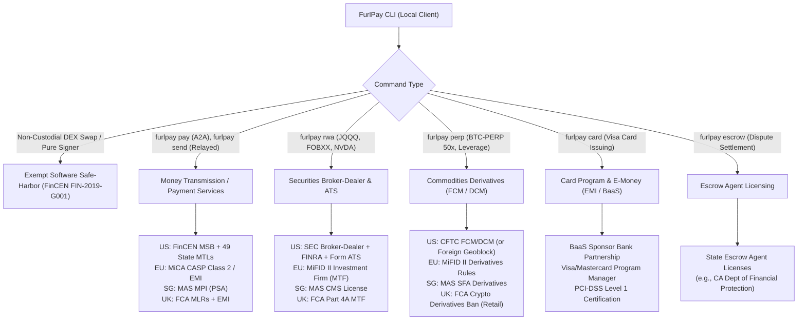

### The Non-Custodial Fallacy vs. Operational Reality

In crypto engineering, developers frequently assume that distributing open-source CLI software or requiring user-held private keys exempts the entire project from regulatory oversight under FinCEN’s non-custodial wallet guidance (*FIN-2019-G001*).

For FurlPay CLI, this exemption applies **only** if the software operates as a closed loop between the user's local terminal and decentralized public blockchain RPCs without intermediary services. However, the FurlPay CLI codebase reveals several core features that eliminate pure non-custodial defense:

1. **Hosted API Backend Dependencies (`apps/web`):** Commands like `furlpay pay`, `furlpay send`, `furlpay card`, `furlpay earn`, and `furlpay invest` rely on central API endpoints (`/api/wallets/transfer`, `/api/actions/pay`, `/api/cards`, `/api/onramp/session`) that coordinate value transfer, custody balances, or relay sponsored transactions.
2. **TigerBeetle Double-Entry Settlement Facilitator (`src/services/x402-facilitator.ts`):** Operating a multi-party HTTP 402 clearing ledger for micropayments positions the operator as a settlement institution and money transmitter.
3. **ETSS Escrow Protocol (`src/settlement/escrow.ts`):** Holding funds or enforcing mediator settlement between buyers and sellers constitutes statutory escrow activity under state law.
4. **Tokenized Securities Catalog (`src/rwa/registry.ts`):** Facilitating trades, quotations, or onboarding for SEC-regulated mutual funds (Franklin Templeton `FOBXX`), ETFs (`JQQQ`), and tokenized corporate stocks (`NVDA`, `AAPL`) constitutes broker-dealer and exchange activity.
5. **Decentralized Perpetual Derivatives (`src/hyperliquid/perp.ts`):** Offering 50x leveraged contracts on Bitcoin and crypto assets to retail customers without registration violates U.S. Commodity Exchange Act (CEA) rules.

---

## 1. Master Global Licensing Requirement Matrix

The following matrix itemizes every single regulatory license and registration required to operate the full suite of FurlPay CLI features across Tier-1 financial jurisdictions.

| Feature / Command Surface | United States (Federal & State) | European Union (MiCA & MiFID II) | United Kingdom (FCA) | Singapore (MAS) |
|---|---|---|---|---|
| **A2A B2B Transfers & Relayed Payments** (`furlpay pay`, `furlpay send`) | **FinCEN:** Registered MSB (31 CFR § 1022.380)<br/>**States:** 49 State Money Transmitter Licenses (MTLs) via NMLS | **MiCA:** CASP Authorization (Class 2 - Transfer Services & Custody)<br/>*or* E-Money Institution (EMI) | **FCA:** Registered Cryptoasset Business (MLRs 2017) + Authorised Payment Institution (API) | **MAS:** Major Payment Institution (MPI) License under Payment Services Act (PSA) 2019 |
| **Cross-Chain Swaps & CCTP Bridging** (`furlpay swap`, `furlpay bridge`) | **FinCEN:** MSB (Virtual Currency Exchanger)<br/>State MTLs where fiat or custodial liquidity is routed | **MiCA:** CASP Authorization (Class 2 - Exchange crypto-to-crypto & crypto-to-fiat) | **FCA:** Registered Cryptoasset Firm (MLRs 2017) | **MAS:** Digital Payment Token (DPT) Service License (under MPI) |
| **Tokenized Stocks & Treasuries** (`furlpay rwa`, `furlpay invest` — JQQQ, NVDA, FOBXX) | **SEC:** Registered Broker-Dealer (Form BD)<br/>**FINRA:** Member Firm (Rule 1014 NMA)<br/>**SEC:** Form ATS-N / Alternative Trading System | **MiFID II:** Authorized Investment Firm<br/>**ESMA:** Multilateral Trading Facility (MTF) License | **FCA:** Part 4A Permission (Arranging/Dealing in Investments) + MTF License | **MAS:** Capital Markets Services (CMS) License + Recognized Market Operator (RMO) |
| **Perpetual Derivatives & Margin** (`furlpay perp`, `furlpay short` — Hyperliquid L1) | **CFTC:** Futures Commission Merchant (FCM) or DCM.<br/>*Note: US retail strictly prohibited; requires ECP validation or strict geoblocking.* | **MiFID II:** Derivatives Trading Venue / Investment Firm with derivatives permissions | **FCA:** Derivatives Brokerage (Retail ban on crypto derivatives strictly enforced) | **MAS:** Capital Markets Services (CMS) License for dealing in capital markets products |
| **Payment Card Issuing** (`furlpay card create`, Visa network) | **Federal:** Bank Partnership (BaaS) or Special Purpose Bank Charter<br/>**PCI SSC:** PCI-DSS Level 1 Certification | **E-Money Directive:** Authorized Electronic Money Institution (EMI) + Visa Associate Membership | **FCA:** Authorized Electronic Money Institution (AEMI) | **MAS:** Major Payment Institution (Account Issuance & Domestic Money Transfer) |
| **Micropayment Clearing Engine** (`furlpay x402`, TigerBeetle facilitator) | **FinCEN:** MSB (Money Transmitter)<br/>State MTLs (subject to clearinghouse exemptions) | **MiCA:** CASP (Execution of orders / Transfer services) | **FCA:** Payment Services Regulations 2017 (PSR) | **MAS:** Merchant Acquisition Service & Domestic Money Transfer (PSA 2019) |
| **Dispute-Mediated Escrow** (`furlpay escrow`, ETSS protocol) | **State Level:** Licensed Escrow Agent (e.g., California DFPI Escrow License, NY DFS) | **National Competent Authority:** Payment Institution / Trust Escrow License | **FCA:** Small Payment Institution or Trust Holding Authorization | **MAS:** Trust Business Act License / Safekeeping of Assets (PSA) |

---

## 2. United States Regulatory Deep Dive

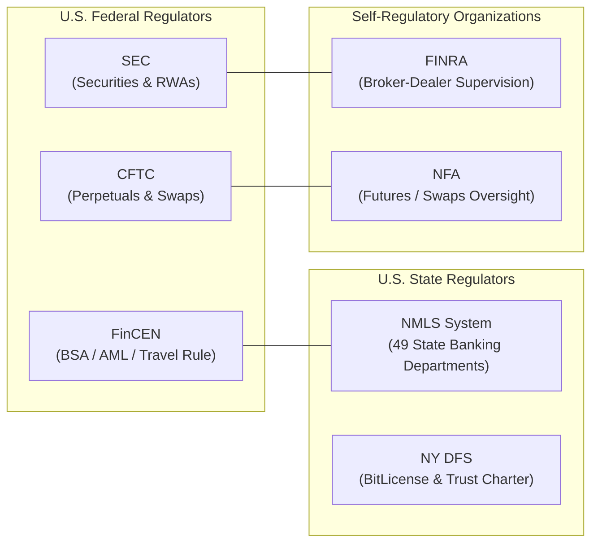

### 2.1 FinCEN & State Money Transmitter Licenses (MTLs)

#### Statutory Authority
- **Bank Secrecy Act (BSA):** 31 U.S.C. § 5330
- **Federal Regulations:** 31 CFR § 1022.380 (Registration of Money Services Businesses)
- **Guidance:** FinCEN FIN-2019-G001 (*Application of FinCEN’s Regulations to Certain Business Models Involving Convertible Virtual Currencies*)

#### Why FurlPay Triggers MSB Classification
1. **Transmission of Value:** Under 31 CFR § 1010.100(ff)(5), a money transmitter is any person that provides "the acceptance of currency, funds, or other value that substitutes for currency from one person and the transmission of currency, funds, or other value that substitutes for currency to another location or person by any means."
2. **Relayed Transfers (`furlpay send` & `furlpay pay`):** The CLI connects to central API endpoints that coordinate transfers, sponsor gas fees, and broadcast transactions on behalf of users. When an intermediary exercises operational discretion or batches transactions, it is an MSB.
3. **x402 Facilitator Settlement:** The TigerBeetle double-entry facilitator acts as an internal clearinghouse, debiting and crediting balances between resource consumers and API providers.

#### State MTL Matrix & MTMA Harmonization
Historically, operating nationally required navigating 50 distinct state money transmitter regimes. Today, over 30 states have enacted the **Conference of State Bank Supervisors (CSBS) Money Transmission Modernization Act (MTMA)**.

- **NMLS Licensing:** Applications must be submitted through the Nationwide Multistate Licensing System & Registry (NMLS).
- **Tangible Net Worth Floor:** Under MTMA standards, licensees must maintain a baseline tangible net worth of **$100,000**, or a graduated percentage of total assets:
  $$\text{Net Worth} = \max\left(\$100,000,\ 3\% \text{ of first } \$100\text{M},\ 2\% \text{ of next } \$400\text{M},\ 0.5\% \text{ over } \$500\text{M}\right)$$
- **Surety Bonding:** 
  - Greater of **$100,000** or **100% of the applicant’s average daily money transmission liability** in that state.
  - **The $500,000 Safe Harbor:** Maintaining a $500,000 surety bond per state satisfies the calculation in most MTMA-adopting jurisdictions.
  - Total bonding portfolio across 49 states: **$12,000,000 to $25,000,000** in aggregate surety bond coverage.
- **Permissible Investments:** Under MTMA Article 6, licensees must hold high-quality liquid assets (cash, bank deposits, U.S. Treasuries) equal to or exceeding 100% of all outstanding transmission obligations at all times. Cryptocurrencies and volatile tokens do not qualify as permissible investments to back customer fiat/stablecoin transmission liabilities.
- **New York BitLicense & Limited Purpose Trust:** New York requires a BitLicense (23 NYCRR Part 200) or a New York Limited Purpose Trust Company Charter (under NY Banking Law) for any virtual currency custody, transmission, or exchange involving NY residents.

---

### 2.2 SEC & FINRA: Tokenized Stocks & RWAs

The FurlPay CLI integrates an explicit catalog of tokenized securities in `src/rwa/registry.ts`:
- **`JQQQ`:** Janus Henderson Nasdaq-100 Equity ETF Token (SEC Reg D Rule 506(c) / Reg S)
- **`FOBXX`:** Franklin OnChain U.S. Government Money Fund (Benji) (SEC 1940 Act Registered Fund, CIK 0001786958)
- **`NVDA` / `AAPL`:** Securitize Tokenized Equities (SEC Reg D Rule 506(c))

#### Triggered Legal Frameworks
1. **Section 15(a) of the Securities Exchange Act of 1934:** Any entity engaged in the business of effecting transactions in securities for the account of others must register with the SEC as a **Broker-Dealer**.
2. **FINRA Membership Application Program (MAP):** Under **FINRA Rule 1014**, an applicant must establish supervisory systems, Written Supervisory Procedures (WSPs), pass Series 7/24/27 examinations for principals, and prove financial solvency.
3. **Regulation ATS (Rule 300–303):** If FurlPay operates an order book, matches buy/sell orders, or provides a marketplace for tokenized securities without being a national exchange, it must file **Form ATS** and comply with Fair Access and Systems Compliance and Integrity (Reg SCI) standards.
4. **SEC Rule 15c3-3 (Customer Protection Rule):** Requires broker-dealers to maintain "physical possession or control" of customer fully paid securities. For tokenized securities on public blockchains (Stellar), demonstrating exclusive control requires specialized wallet architecture (such as an SEC Special Purpose Broker-Dealer structure).
5. **Accredited Investor Verification (SEC Rule 506(c)):** Unlike Rule 506(b), offerings under 506(c) permit general solicitation only if the issuer/broker takes **reasonable steps to verify** that all purchasers are accredited investors (tax returns, bank statements, or third-party CPA/attorney verification letters).

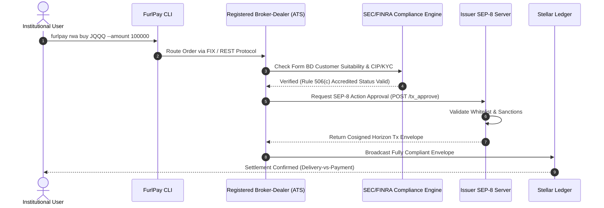

---

### 2.3 CFTC & NFA: Perpetual Derivatives & Shorting Surface

The FurlPay CLI integrates Hyperliquid L1 perpetual execution (`src/hyperliquid/perp.ts`, `lib/short/`) offering up to 50x leverage on BTC-PERP and altcoin contracts.

#### Statutory Reality under the Commodity Exchange Act (CEA)
1. **Section 2(c)(2)(D) of the CEA:** Retail commodity transactions offered on margin or leverage are treated as futures contracts unless there is **actual commercial delivery within 28 days**. Cash-settled perpetual contracts (such as Hyperliquid perps) never result in physical delivery of commodities and therefore legally constitute futures contracts.
2. **Section 4(a) of the CEA:** It is unlawful to offer futures contracts to U.S. persons unless executed on or subject to the rules of a designated board of trade (a CFTC-registered **Designated Contract Market (DCM)**).
3. **Intermediary Registration:** Any entity soliciting or accepting orders for futures contracts from retail customers must register as a **Futures Commission Merchant (FCM)** or **Introducing Broker (IB)** and join the **National Futures Association (NFA)**.
4. **Eligible Contract Participant (ECP) Standard:** Derivatives restrictions apply primarily to retail. U.S. institutional entities can trade off-exchange derivatives only if they qualify as an ECP under 7 U.S.C. § 1a(18) (requiring total assets exceeding **$10,000,000**).
5. **Regulatory Precedents for Front-End Interfaces:**
   - *CFTC v. bZeroX, LLC & Ooki DAO (2022/2023):* Operating a software interface that facilitates leveraged retail commodity trading triggers federal registration liability.
   - *CFTC Orders on Deridex, Opyn, and ZeroEx (2023):* Facilitating access to blockchain derivatives without DCM registration violates federal law, regardless of smart contract decentralization.
   - *CFTC Action on Uniswap Labs (September 2024):* Uniswap Labs settled CFTC charges for illegally offering leveraged retail commodity transactions via its front-end protocol interface.

#### Mandatory U.S. Risk Mitigation
To maintain legal standing in the United States without an FCM/DCM license ($20M+ capitalization), FurlPay CLI must implement **strict, tamper-resistant geoblocking**:
- Hard IP geofencing preventing U.S. IP connections to `furlpay perp` and `furlpay short`.
- Detection of commercial VPN and Tor exit nodes.
- EIP-712 signer address attestation confirming non-U.S. person status.

---

## 3. European Union Regulatory Deep Dive (MiCA & MiFID II)

The regulatory regime in the European Union is divided between **MiCA (Markets in Crypto-Assets Regulation)** for native cryptocurrencies and stablecoins, and **MiFID II (Markets in Financial Instruments Directive II)** for tokenized financial instruments.

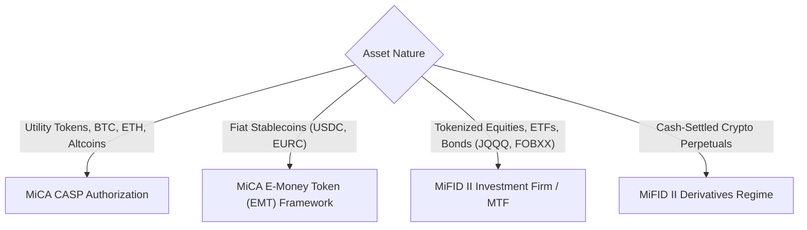

### 3.1 MiCA: Crypto-Asset Service Provider (CASP) Authorization
Under **Regulation (EU) 2023/1114 (MiCA)**, all entities providing crypto services within the EU must obtain CASP authorization from their National Competent Authority (e.g., BaFin in Germany, AMF in France, AFM in Netherlands, CySEC in Cyprus).

#### CASP Class Architecture (MiCA Article 67 & Annex IV)
| Class | Minimum Capital Requirement | Authorized Service Scope | Applicability to FurlPay CLI |
|---|---|---|---|
| **Class 1** | **€50,000** | • Reception and transmission of orders<br/>• Execution of orders on behalf of clients<br/>• Portfolio management<br/>• Crypto advisory | Applies to basic order routing and non-custodial execution modules. |
| **Class 2** | **€125,000** | • Custody and administration of crypto-assets<br/>• Exchange crypto-for-fiat<br/>• Exchange crypto-for-crypto<br/>*(Includes Class 1 permissions)* | **MANDATORY FOR FURLPAY:** Required for `furlpay swap`, `furlpay bridge`, and custody/relaying mechanisms. |
| **Class 3** | **€150,000** | • Operation of a crypto-asset trading platform<br/>*(Includes Class 1 and Class 2 permissions)* | Required if FurlPay matches orders or runs an internal CLOB/AMM. |

#### Prudential Overheads Rule
In addition to the minimum initial capital, Article 67 mandates that a CASP must at all times maintain own funds equal to the higher of:
1. The statutory tier base (€50k, €125k, or €150k); **or**
2. **One-quarter (25%) of the fixed overheads of the preceding year** (calculated in accordance with EU regulatory technical standards).

#### Stablecoins under MiCA (Titles III & IV)
- **E-Money Tokens (EMTs):** Fiat-pegged stablecoins like USDC are classified as EMTs under MiCA Article 48. Only authorized Credit Institutions or Electronic Money Institutions (EMIs) can issue EMTs in the EU.
- Circle achieved full MiCA compliance in 2024 through **Circle Mint France SAS**, obtaining an EMI license from the ACPR. FurlPay CLI’s integration of USDC complies with MiCA provided it sources USDC from authorized European redemption pathways.

### 3.2 MiFID II: Tokenized RWAs & Derivatives
Under MiCA Article 2(4), **crypto-assets that qualify as financial instruments under MiFID II are explicitly excluded from MiCA**.
- **Janus Henderson `JQQQ` and Securitize `NVDA`/`AAPL`** are transferable securities (shares/ETFs) represented on-chain.
- Operating an interface or brokerage that executes orders in tokenized securities requires an **Investment Firm authorization under MiFID II (Directive 2014/65/EU)** and authorization as a **Multilateral Trading Facility (MTF)** under ESMA oversight.
- **Capital Requirements for MiFID II Investment Firms:** Typically **€730,000** for firms dealing on own account or underwriting, or **€150,000** for agency brokerages, plus stringent DORA (Digital Operational Resilience Act) cybersecurity audits.

---

## 4. United Kingdom & Singapore Regulatory Deep Dive

### 4.1 United Kingdom: Financial Conduct Authority (FCA)

#### Cryptoasset Business Registration (MLRs 2017)
- Any firm operating a cryptoasset exchange or custodian wallet service in the UK must register with the FCA under the **Money Laundering, Terrorist Financing and Transfer of Funds (Information on the Payer) Regulations 2017**.
- The FCA approval rate is historically below 15%, requiring exhaustive proof of fit and proper management, automated blockchain forensic screening, and clear governance.

#### Financial Services and Markets Act 2023 (FSMA 2023)
- FSMA 2023 brought fiat-backed stablecoins used in payment systems under the regulation of the Payment Systems Regulator (PSR) and the FCA.
- **Ban on Retail Crypto Derivatives:** Under FCA Policy Statement PS20/10, the FCA **strictly prohibits the sale, marketing, and distribution of crypto derivatives and exchange-traded notes (ETNs) to retail consumers**. Offering `furlpay perp` to UK retail consumers constitutes an immediate criminal offense under UK financial promotions legislation.

---

### 4.2 Singapore: Monetary Authority of Singapore (MAS)

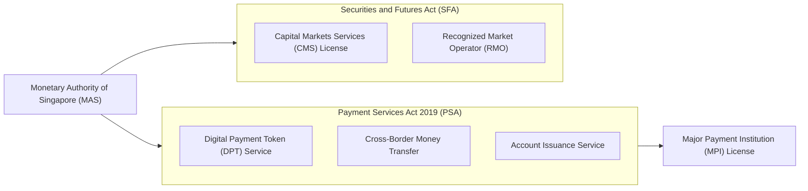

#### Payment Services Act 2019 (PSA)
The MAS regulates payment systems and digital payment tokens under the PSA:
- **Major Payment Institution (MPI) License:** Mandatory if monthly payment transactions exceed **S$3,000,000** for any payment service, or if daily outstanding e-money exceeds **S$5,000,000**.
- **Regulated Activities for FurlPay:**
  1. *Account Issuance Service:* Managing user accounts and balance tracking.
  2. *Domestic & Cross-Border Money Transfer:* Routing funds and cross-chain transactions.
  3. *Digital Payment Token (DPT) Service:* Swapping, buying, or selling cryptocurrencies (USDC, SOL, XLM).
- **Financial & Capital Requirements:**
  - Base Capital: **S$250,000** minimum paid-up capital for an MPI.
  - Security Deposit: **S$100,000** cash deposit or bank guarantee with MAS.
  - Local Presence: Executive director who is a Singapore Citizen or Permanent Resident.
  - **Asset Segregation & Custody (Notice PSN07):** Under 2024/2026 MAS rules, DPT service providers must segregate customer assets in statutory trust accounts, conduct daily reconciliations, and hold at least **50% of customer assets in cold storage**.

#### Securities and Futures Act (SFA)
- Trading tokenized equities (`JQQQ`, `NVDA`) requires a **Capital Markets Services (CMS) License** for dealing in capital markets products under SFA Section 82.
- Operating an order-matching facility requires recognition as a **Recognized Market Operator (RMO)** under SFA Part II.

---

## 5. Subsystem-by-Subsystem Regulatory Blueprint

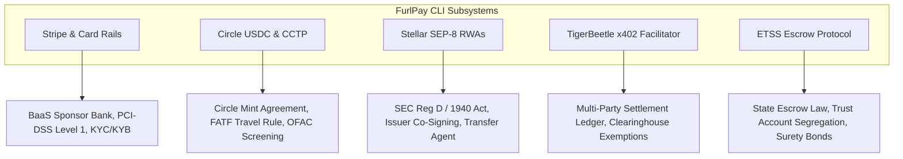

---

### 5.1 Rail 1: Stripe Integration & Card Issuance (`furlpay card`, `furlpay pay`)

#### Architecture & Partnerships
The CLI provides Visa card creation and funding commands (`furlpay card create`, `furlpay wallet fund`). To execute these flows legally, FurlPay cannot simply call APIs without underlying regulatory infrastructure:
1. **Banking-as-a-Service (BaaS) Sponsor Bank:** FurlPay must partner with a chartered issuing bank (e.g., Cross River Bank, Lead Bank, Pathward) that holds the Bank Identification Number (BIN) and sits on the Visa/Mastercard network.
2. **Program Manager Agreement:** FurlPay acts as the Program Manager, assuming responsibility for cardholder KYC, transaction monitoring, and fraud chargebacks under bank supervision.
3. **PCI-DSS Level 1 Compliance:** The CLI enforces that PAN (card number) and CVV are never output in plaintext in terminal logs (`src/cli.ts` / `lib/commands.js`). The infrastructure backend must maintain annual PCI-DSS Level 1 RoC (Report on Compliance) audits to handle tokenized card credentials.
4. **Stripe Restricted Business Policy:** Operating crypto-funded cards or crypto on-ramps through Stripe requires explicit written onboarding approval under Stripe's Financial Services & Virtual Currency terms.

---

### 5.2 Rail 2: Circle USDC & Cross-Chain Transfer Protocol (CCTP)

#### Architecture
The CLI executes stablecoin transfers and bridges across Stellar, Solana, Arbitrum, Base, and Ethereum using Circle USDC.

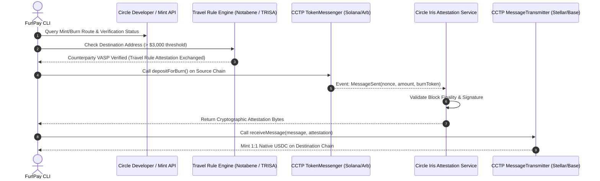

#### Regulatory Obligations
1. **FATF Travel Rule (Recommendation 16 / FinCEN 31 CFR § 1010.410):**
   - Whenever an entity facilitates a stablecoin transfer exceeding **$3,000 USD** (or **€1,000** in the EU under the EU Transfer of Funds Regulation 2023/1113), it must securely transmit verified originator and beneficiary PII (Full Legal Name, Account Number/Address, Physical Address or Date of Birth) to the receiving VASP.
   - FurlPay CLI integrates this protocol via the `furlpay travel` command interface, communicating with compliance protocols such as **Notabene**, **TRISA**, or **Sygna Bridge**.
2. **Sanctions Compliance (OFAC SDN):**
   - Pre-flight screening of every source and destination address against the U.S. Treasury OFAC Specially Designated Nationals (SDN) list.
   - Immediate fail-closed transaction abort if an address exhibits exposure to sanctioned mixers (e.g., Tornado Cash, Blender.io) or jurisdictional sanctions (Cuba, Iran, North Korea, Syria, Crimea/Donetsk/Luhansk).

---

### 5.3 Rail 3: Stellar SEP-8 Regulated Asset Infrastructure

Stellar’s **SEP-0008 (Regulated Assets)** standard governs compliant token trading on-chain. FurlPay CLI’s `src/compliance/sep8.ts` defines the client-side compliance protocol:

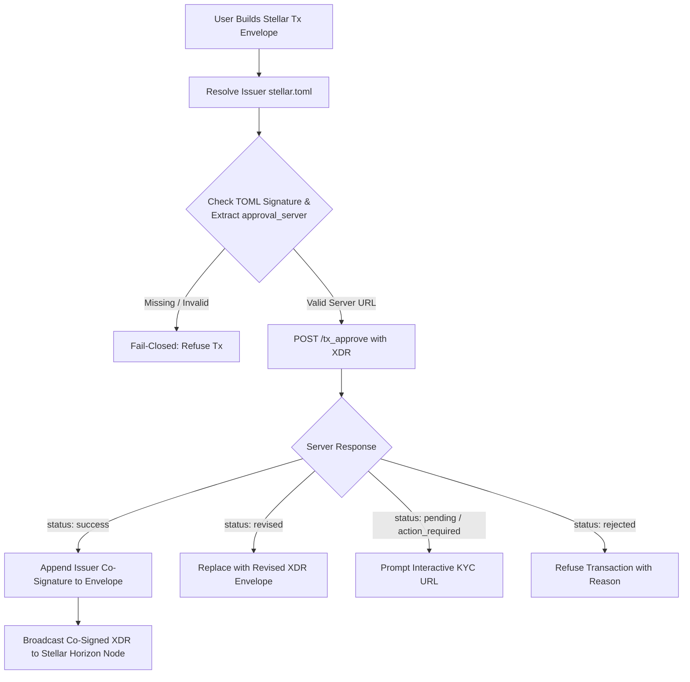

#### Legal Roles in the SEP-8 Pipeline
1. **Transfer Agent Jurisdiction:** Under Section 17A of the Exchange Act, records of ownership for tokenized mutual funds (`FOBXX`) must be maintained by an SEC-registered Transfer Agent. On Stellar, Franklin Templeton maintains its own registered transfer agent records synchronized with the on-chain ledger.
2. **SEP-8 Compliance Server Liability:** The approval server acts as an automated regulatory gate. It verifies that both sending and receiving Stellar accounts have completed institutional KYC, reside in permitted jurisdictions, and are not restricted by lock-up periods (Rule 144 for Reg D securities).
3. **FurlPay Client Obligation:** The CLI must never bypass SEP-8 or report synthetic approvals. It must submit the transaction to the issuer's authenticated approval server and verify the resulting Ed25519 co-signature before submitting to Horizon.

---

### 5.4 Rail 4: TigerBeetle x402 Micropayment Facilitator

The FurlPay x402 engine (`src/services/x402-facilitator.ts`, `src/x402/micropayments.ts`) facilitates autonomous machine-to-machine micropayments using HTTP 402 Payment Required status codes and EIP-712 cryptographic authorization.

#### Statutory Clearinghouse Analysis
- **Double-Entry State Machine:** The x402 facilitator's settlement math runs over the CLI's local double-entry finance ledger (`src/finance/ledger.ts` — hash-chained JSON store with atomic writes). **No TigerBeetle instance is in the settlement path in this build**; where this report discusses TigerBeetle netting it describes a design option under evaluation, not shipped infrastructure.
- **Money Transmission Trigger:** When an entity maintains a centralized ledger that debits Customer A and credits Customer B across a network, state regulators presume money transmission unless the entity qualifies under the **clearinghouse or payment processor exemption**:
  - *Payment Processor Exemption Criteria (FinCEN FIN-2014-R009):* (1) Operates pursuant to an agreement with the creditor/payee; (2) Transits funds through a regulated financial institution; (3) Settles payments instantaneously.
  - If FurlPay pools funds in its own omnibus smart contract or operating account before crediting TigerBeetle, it **must be licensed as an MSB and State Money Transmitter**.

---

### 5.5 Rail 5: ETSS Dispute-Mediated Escrow Settlement

The ETSS Escrow module (`src/settlement/escrow.ts`) implements multi-party escrow contracts where funds are locked until buyer, seller, or mediator release conditions are satisfied.

#### Legal Licensing Requirements
- **State Escrow Laws:** In jurisdictions such as California (**California Financial Code Division 6**), engaging in the business of receiving escrows for deposit or delivery without an Escrow Agent License from the Department of Financial Protection and Innovation (DFPI) is a criminal violation.
- **Escrow Agent Requirements:**
  - Surety Bond: **$25,000 to $100,000+** based on monthly average escrow liability.
  - Tangible Net Worth: Minimum **$50,000 to $100,000** liquid assets.
  - Trust Account Segregation: Escrowed funds must be held in dedicated non-commingled trust accounts.
  - Background Investigation: Fingerprinting and background clearance for all directors and officers.

---

## 6. Enterprise Compliance Technology Architecture

To operate compliantly, FurlPay must deploy an automated compliance pipeline integrated directly into the CLI dispatcher and API gateway.

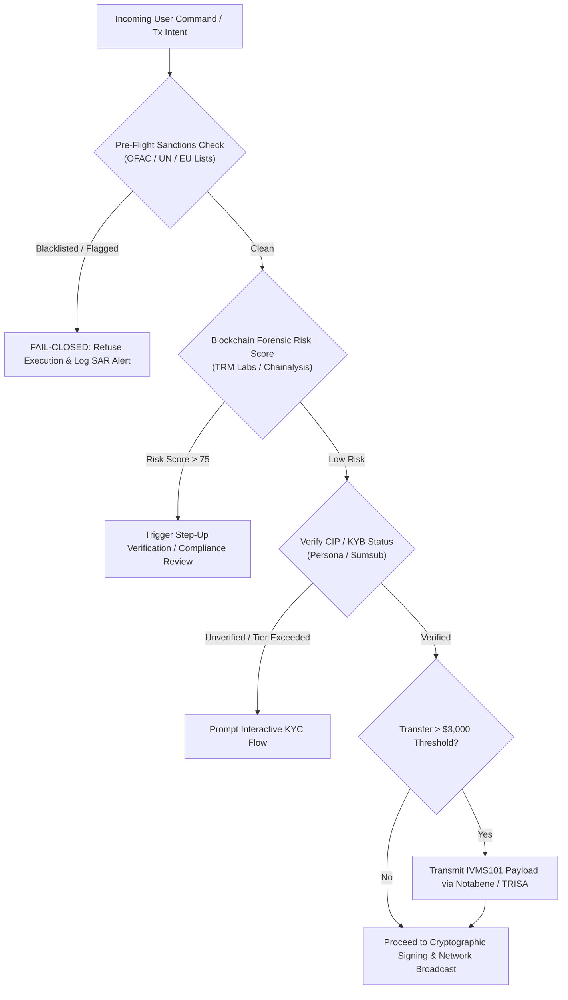

### 6.1 Recommended Compliance Vendor Stack

| Compliance Domain | Selected Tier-1 Provider | Implementation Mechanism in FurlPay CLI |
|---|---|---|
| **Identity Verification (CIP / KYC / KYB)** | **Persona** / **Sumsub** | Webhook integration delivering cryptographically signed `kycToken` JWTs; interactive verification URLs opened via system browser. |
| **Blockchain Transaction Monitoring** | **Chainalysis KYT** / **TRM Labs** | Real-time REST API intercepting every address before `furlpay send`, `swap`, `bridge`, or `perp` execution; checks wallet taint score. |
| **Sanctions Screening** | **Castellum.AI** / **ComplyAdvantage** | Daily automated synchronization of OFAC SDN, UK HMT, EU Consolidated, and UN Security Council sanctions lists. |
| **Travel Rule Messaging** | **Notabene** / **TRISA Engine** | Implementation of IVMS101 standard data payloads for transfers $\ge \$3,000$; counterparty VASP discovery and public key encryption. |
| **Regulatory Reporting (SAR / CTR)** | **Hummingbird** | Automated case management and electronic FinCEN Form 111 (SAR) and Form 112 (CTR) XML generation. |

---

## 7. Financial Capital, Surety Bond & Timeline Summary

Operating the fully built FurlPay CLI with all services licensed and live requires substantial capital reserves, surety bond facilities, and a structured multi-phase regulatory roadmap.

### 7.1 Capital & Surety Bond Requirements Table

| Regulatory Authority / License | Minimum Paid-Up Capital | Surety Bond Obligation | Initial Application Fees | Estimated Legal & Setup Costs |
|---|---|---|---|---|
| **FinCEN MSB Registration** | $0 | $0 | $0 | $15,000 – $30,000 |
| **U.S. 49 State MTLs (via NMLS)** | $100,000 – $2,000,000 | $12,000,000 – $25,000,000 *(Total bond coverage)* | $150,000 – $350,000 | $500,000 – $1,200,000 |
| **NYDFS BitLicense / Trust** | $1,000,000 – $5,000,000 | $500,000 – $2,000,000 | $100,000 | $400,000 – $800,000 |
| **SEC Broker-Dealer + FINRA** | $250,000 *(Net Capital Rule 15c3-1)* | $100,000 *(Fidelity Bond)* | $50,000 – $100,000 | $300,000 – $600,000 |
| **Regulation ATS Filing** | Included above | $0 | $0 | $100,000 – $250,000 |
| **EU MiCA CASP (Class 2)** | €125,000 *(+ 25% fixed overheads)* | Optional (PII substitution) | €20,000 – €50,000 | €150,000 – €350,000 |
| **EU MiFID II Investment Firm** | €150,000 – €730,000 | N/A | €30,000 – €80,000 | €250,000 – €500,000 |
| **UK FCA Cryptoasset Reg (MLRs)** | £50,000 *(Prudential base)* | N/A | £10,000 – £25,000 | £150,000 – £300,000 |
| **Singapore MAS MPI (PSA 2019)** | S$250,000 *(Paid-up capital)* | S$100,000 *(Government deposit)* | S$10,000 – S$20,000 | S$120,000 – S$250,000 |
| **TOTAL ESTIMATED COMMITMENT** | **$3,500,000 – $10,000,000+** | **$13,000,000 – $28,000,000** | **$520,000 – $1,100,000** | **$2,000,000 – $4,700,000** |

*Note: Surety bonds are secured through insurance surety underwriters typically at an annual premium cost of 1.5% to 3.5% of the total bond face value (requiring roughly $200,000 to $600,000 in annual recurring premium payments).*

---

### 7.2 Multi-Phase Regulatory Roadmap

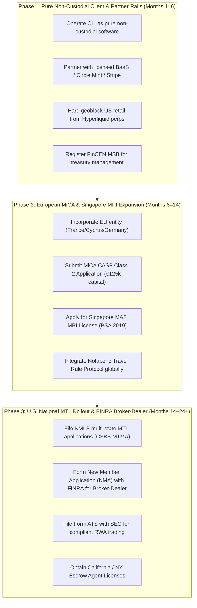

#### Detailed Phase Execution
- **Phase 1 (Immediate / Months 1–6): Partner-Led Operations & Non-Custodial Isolation**
  - Restructure CLI architecture so all fiat on-ramps, card issuing, and regulated transfers flow through contractually indemnified third-party licensed entities (Stripe, Circle, BaaS banks).
  - Register FurlPay Inc. as an MSB with FinCEN to cover internal treasury operations.
  - Implement strict IP geoblocking and VPN detection to prevent U.S. persons from executing Hyperliquid perpetuals (`furlpay perp`, `furlpay short`).
  - Keep SEP-8 tokenized stock purchases gated on accredited investor verification via Securitize / Franklin Templeton directly.
- **Phase 2 (Months 6–14): European Union MiCA CASP & Singapore PSA**
  - Establish an EU subsidiary and file for a **MiCA Class 2 CASP License** (enabling passporting across all 27 EU member states).
  - Submit application for an **MPI License under the Singapore Payment Services Act 2019**.
  - Deploy complete FATF Recommendation 16 Travel Rule integration (Notabene/TRISA) for all cross-border transactions exceeding $3,000.
- **Phase 3 (Months 14–24+): Full U.S. Nationwide Licensing & Capital Markets**
  - File for **Money Transmitter Licenses across 49 states** using the NMLS standardized MTMA pathway.
  - Complete **FINRA New Member Application (Form BD)** and file **Form ATS** with the SEC to legally internalize and clear tokenized securities (`JQQQ`, `NVDA`, `FOBXX`).
  - Secure state escrow licenses to operate the ETSS escrow settlement facilitator natively.

---

## 8. Summary of Legal & Compliance Invariants for Developers

1. **Never bypass SEP-8 verification:** Client code must never simulate or fabricate SEP-8 approval. If an issuer approval server is unreachable, the transaction must fail closed.
2. **Never claim retail perpetual availability in the U.S.:** All marketing, documentation, and CLI dispatcher help text must clearly state that derivatives and margin shorting are strictly restricted to verified non-U.S. persons or qualified Eligible Contract Participants (ECPs).
3. **Never output plaintext payment card credentials:** Card PAN and CVV numbers must remain within the secure enclave or biometric mobile app and never appear in terminal output, command history, or persistent logs.
4. **Enforce Travel Rule at the protocol level:** Cross-chain bridging and stablecoin transfers exceeding $3,000 must integrate encrypted IVMS101 counterparty VASP data exchanges prior to on-chain execution.
5. **Maintain strict separation between local non-custodial tools and hosted platform services:** Where the CLI functions as a pure client tool, maintain decentralized RPC paths; where it touches FurlPay platform APIs, mandate authenticated KYC/KYB session tokens.

---

## Distribution Security

- npm installs are integrity-checked by npm (registry sha512 + signatures);
  the package publishes with **npm provenance** (sigstore, OIDC-bound to this
  repo and workflow).
- GitHub Release assets (tarball, `checksums.txt`, CycloneDX SBOM) carry
  **build-provenance attestations** — verify with
  `gh attestation verify --repo FurlPay/furlpay-cli <file>`.
- Release builds are gated on tag/version consistency, full typecheck +
  tests, and a three-OS smoke install (CLI boot + MCP stdio handshake) of the
  packed tarball before anything is published.
- No postinstall scripts; no secrets in the package; CI actions are
  SHA-pinned; the supply-chain posture is reviewed per release.

See [docs/RELEASING.md](docs/RELEASING.md) and [docs/PACKAGING.md](docs/PACKAGING.md).

---

## License

MIT © FurlPay Protocol & Systems Engineering Group.
