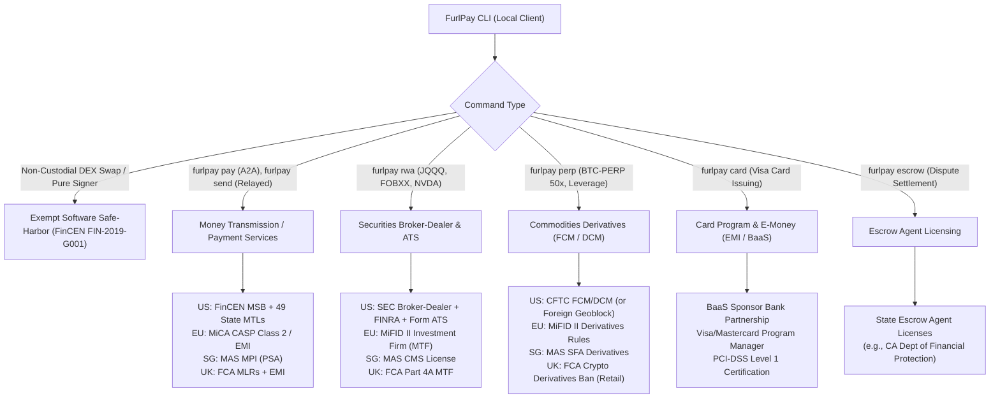
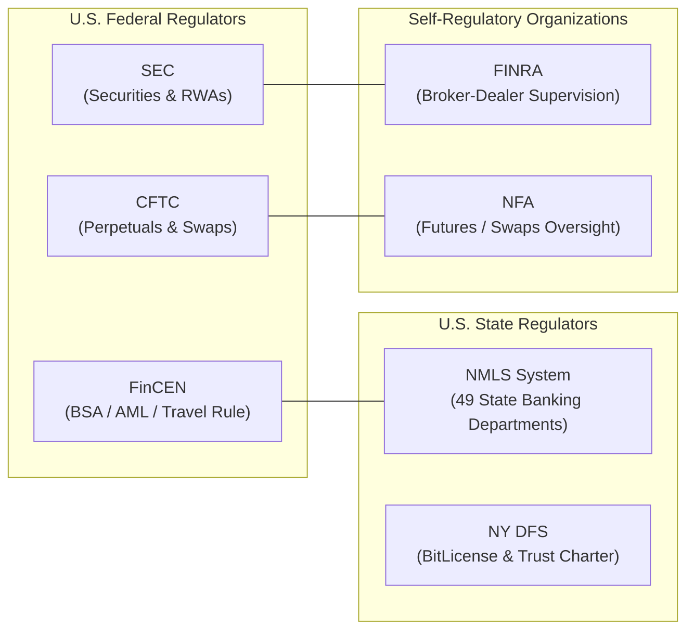
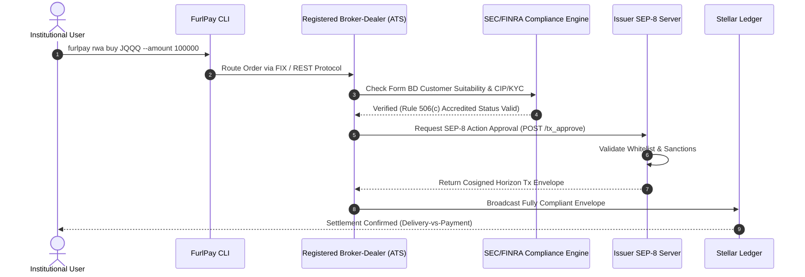
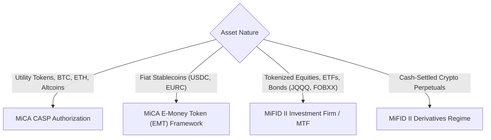
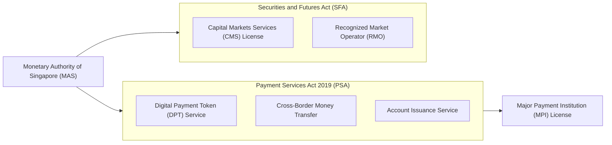
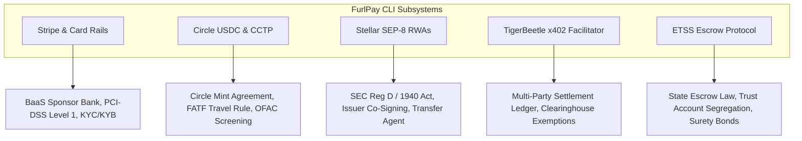
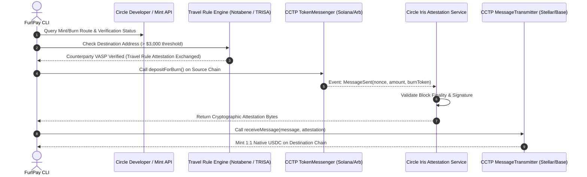
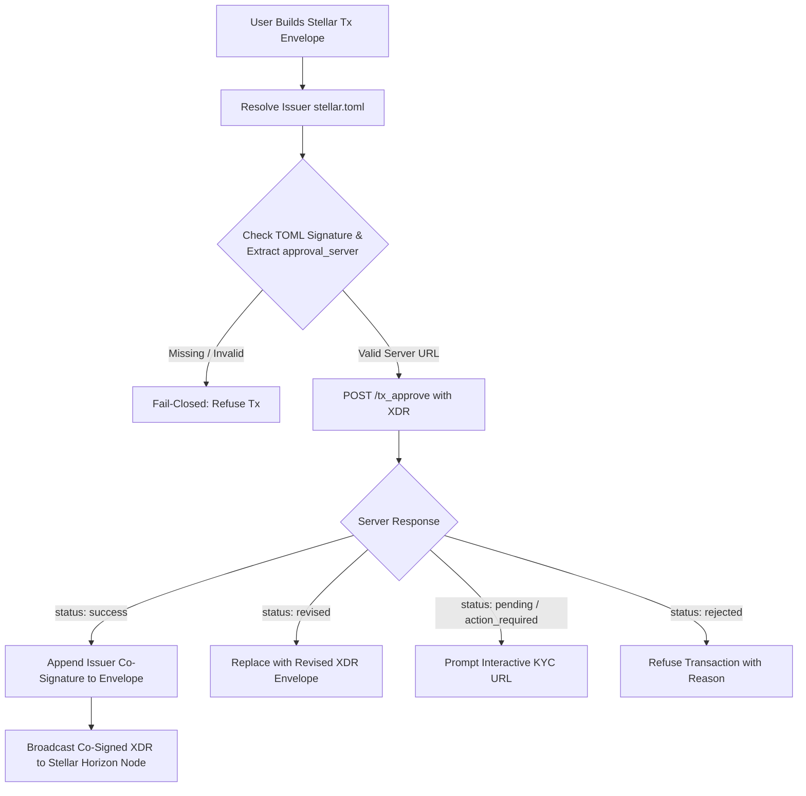
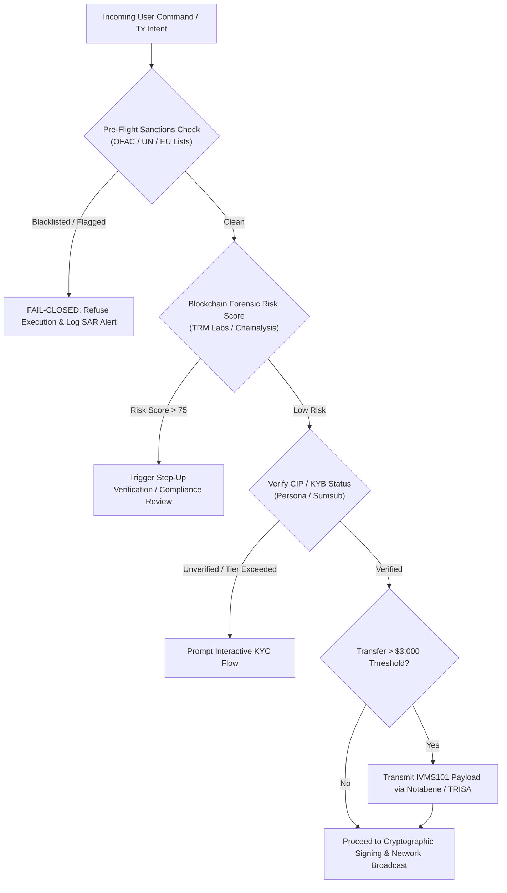
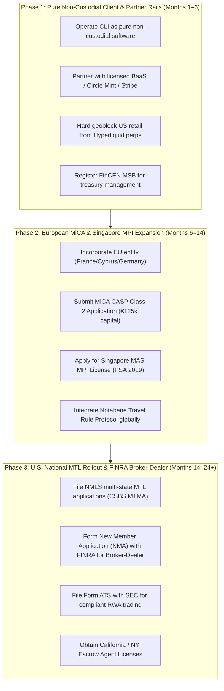

# FurlPay CLI — Regulatory, Licensing, and Compliance Research Report

> **Target Software:** [FurlPay CLI (v0.4.0)](https://github.com/FurlPay/furlpay-cli)  
> **Date:** November 17, 2026  
> **Jurisdictions Covered:** United States (FinCEN, SEC, CFTC, 50 States NMLS), European Union (MiCA, MiFID II), United Kingdom (FCA), Singapore (MAS)  
> **Rails & Venues Evaluated:** Circle USDC, Stripe, Stellar (SEP-8 RWAs, SDEX, Soroban), Solana DEX, Hyperliquid L1 Perpetuals, TigerBeetle x402 Facilitator, ETSS Escrow  
> **Regulatory Standards:** FATF Recommendation 16 (Travel Rule), FinCEN FIN-2019-G001, CSBS Money Transmission Modernization Act (MTMA), SEC Regulation ATS / Form BD, CFTC CEA Section 4(c) / 2(c)(2)(D), EU MiCA (Regulation (EU) 2023/1114), MAS Payment Services Act 2019 (PSA).

---

## Executive Summary & Legal Characterization

The FurlPay CLI is an enterprise-grade command-line interface that integrates payments, cross-chain swaps, tokenized securities/RWAs, decentralized perpetual futures, card issuing, and AI autonomous agent execution.

While the client software incorporates non-custodial cryptography (local keystores, hardware signers, and client-side transaction signing), **the operational deployment of the FurlPay platform crosses multiple clear statutory thresholds that trigger mandatory financial licensing globally**.

### The Non-Custodial Fallacy vs. Operational Reality

In crypto engineering, developers frequently assume that distributing open-source CLI software or requiring user-held private keys exempts the entire project from regulatory oversight under FinCEN’s non-custodial wallet guidance (*FIN-2019-G001*).

For FurlPay CLI, this exemption applies **only** if the software operates as a closed loop between the user's local terminal and decentralized public blockchain RPCs without intermediary services. However, the FurlPay CLI codebase reveals several core features that eliminate pure non-custodial defense:

1. **Hosted API Backend Dependencies (`apps/web`):** Commands like `furlpay pay`, `furlpay send`, `furlpay card`, `furlpay earn`, and `furlpay invest` rely on central API endpoints (`/api/wallets/transfer`, `/api/actions/pay`, `/api/cards`, `/api/onramp/session`) that coordinate value transfer, custody balances, or relay sponsored transactions.
2. **TigerBeetle Double-Entry Settlement Facilitator (`src/services/x402-facilitator.ts`):** Operating a multi-party HTTP 402 clearing ledger for micropayments positions the operator as a settlement institution and money transmitter.
3. **ETSS Escrow Protocol (`src/settlement/escrow.ts`):** Holding funds or enforcing mediator settlement between buyers and sellers constitutes statutory escrow activity under state law.
4. **Tokenized Securities Catalog (`src/rwa/registry.ts`):** Facilitating trades, quotations, or onboarding for SEC-regulated mutual funds (Franklin Templeton `FOBXX`), ETFs (`JQQQ`), and tokenized corporate stocks (`NVDA`, `AAPL`) constitutes broker-dealer and exchange activity.
5. **Decentralized Perpetual Derivatives (`src/hyperliquid/perp.ts`):** Offering 50x leveraged contracts on Bitcoin and crypto assets to retail customers without registration violates U.S. Commodity Exchange Act (CEA) rules.

---

## 1. Master Global Licensing Requirement Matrix

The following matrix itemizes every single regulatory license and registration required to operate the full suite of FurlPay CLI features across Tier-1 financial jurisdictions.

| Feature / Command Surface | United States (Federal & State) | European Union (MiCA & MiFID II) | United Kingdom (FCA) | Singapore (MAS) |
|---|---|---|---|---|
| **A2A B2B Transfers & Relayed Payments** (`furlpay pay`, `furlpay send`) | **FinCEN:** Registered MSB (31 CFR § 1022.380) **States:** 49 State Money Transmitter Licenses (MTLs) via NMLS | **MiCA:** CASP Authorization (Class 2 - Transfer Services & Custody) *or* E-Money Institution (EMI) | **FCA:** Registered Cryptoasset Business (MLRs 2017) + Authorised Payment Institution (API) | **MAS:** Major Payment Institution (MPI) License under Payment Services Act (PSA) 2019 |
| **Cross-Chain Swaps & CCTP Bridging** (`furlpay swap`, `furlpay bridge`) | **FinCEN:** MSB (Virtual Currency Exchanger) State MTLs where fiat or custodial liquidity is routed | **MiCA:** CASP Authorization (Class 2 - Exchange crypto-to-crypto & crypto-to-fiat) | **FCA:** Registered Cryptoasset Firm (MLRs 2017) | **MAS:** Digital Payment Token (DPT) Service License (under MPI) |
| **Tokenized Stocks & Treasuries** (`furlpay rwa`, `furlpay invest` — JQQQ, NVDA, FOBXX) | **SEC:** Registered Broker-Dealer (Form BD) **FINRA:** Member Firm (Rule 1014 NMA) **SEC:** Form ATS-N / Alternative Trading System | **MiFID II:** Authorized Investment Firm **ESMA:** Multilateral Trading Facility (MTF) License | **FCA:** Part 4A Permission (Arranging/Dealing in Investments) + MTF License | **MAS:** Capital Markets Services (CMS) License + Recognized Market Operator (RMO) |
| **Perpetual Derivatives & Margin** (`furlpay perp`, `furlpay short` — Hyperliquid L1) | **CFTC:** Futures Commission Merchant (FCM) or DCM. *Note: US retail strictly prohibited; requires ECP validation or strict geoblocking.* | **MiFID II:** Derivatives Trading Venue / Investment Firm with derivatives permissions | **FCA:** Derivatives Brokerage (Retail ban on crypto derivatives strictly enforced) | **MAS:** Capital Markets Services (CMS) License for dealing in capital markets products |
| **Payment Card Issuing** (`furlpay card create`, Visa network) | **Federal:** Bank Partnership (BaaS) or Special Purpose Bank Charter **PCI SSC:** PCI-DSS Level 1 Certification | **E-Money Directive:** Authorized Electronic Money Institution (EMI) + Visa Associate Membership | **FCA:** Authorized Electronic Money Institution (AEMI) | **MAS:** Major Payment Institution (Account Issuance & Domestic Money Transfer) |
| **Micropayment Clearing Engine** (`furlpay x402`, TigerBeetle facilitator) | **FinCEN:** MSB (Money Transmitter) State MTLs (subject to clearinghouse exemptions) | **MiCA:** CASP (Execution of orders / Transfer services) | **FCA:** Payment Services Regulations 2017 (PSR) | **MAS:** Merchant Acquisition Service & Domestic Money Transfer (PSA 2019) |
| **Dispute-Mediated Escrow** (`furlpay escrow`, ETSS protocol) | **State Level:** Licensed Escrow Agent (e.g., California DFPI Escrow License, NY DFS) | **National Competent Authority:** Payment Institution / Trust Escrow License | **FCA:** Small Payment Institution or Trust Holding Authorization | **MAS:** Trust Business Act License / Safekeeping of Assets (PSA) |

---

## 2. United States Regulatory Deep Dive

### 2.1 FinCEN & State Money Transmitter Licenses (MTLs)

#### Statutory Authority
- **Bank Secrecy Act (BSA):** 31 U.S.C. § 5330
- **Federal Regulations:** 31 CFR § 1022.380 (Registration of Money Services Businesses)
- **Guidance:** FinCEN FIN-2019-G001 (*Application of FinCEN’s Regulations to Certain Business Models Involving Convertible Virtual Currencies*)

#### Why FurlPay Triggers MSB Classification
1. **Transmission of Value:** Under 31 CFR § 1010.100(ff)(5), a money transmitter is any person that provides "the acceptance of currency, funds, or other value that substitutes for currency from one person and the transmission of currency, funds, or other value that substitutes for currency to another location or person by any means."
2. **Relayed Transfers (`furlpay send` & `furlpay pay`):** The CLI connects to central API endpoints that coordinate transfers, sponsor gas fees, and broadcast transactions on behalf of users. When an intermediary exercises operational discretion or batches transactions, it is an MSB.
3. **x402 Facilitator Settlement:** The TigerBeetle double-entry facilitator acts as an internal clearinghouse, debiting and crediting balances between resource consumers and API providers.

#### State MTL Matrix & MTMA Harmonization
Historically, operating nationally required navigating 50 distinct state money transmitter regimes. Today, over 30 states have enacted the **Conference of State Bank Supervisors (CSBS) Money Transmission Modernization Act (MTMA)**.

- **NMLS Licensing:** Applications must be submitted through the Nationwide Multistate Licensing System & Registry (NMLS).
- **Tangible Net Worth Floor:** Under MTMA standards, licensees must maintain a baseline tangible net worth of **$100,000**, or a graduated percentage of total assets:
  $$\text{Net Worth} = \max\left(\$100,000,\ 3\% \text{ of first } \$100\text{M},\ 2\% \text{ of next } \$400\text{M},\ 0.5\% \text{ over } \$500\text{M}\right)$$
- **Surety Bonding:** 
  - Greater of **$100,000** or **100% of the applicant’s average daily money transmission liability** in that state.
  - **The $500,000 Safe Harbor:** Maintaining a $500,000 surety bond per state satisfies the calculation in most MTMA-adopting jurisdictions.
  - Total bonding portfolio across 49 states: **$12,000,000 to $25,000,000** in aggregate surety bond coverage.
- **Permissible Investments:** Under MTMA Article 6, licensees must hold high-quality liquid assets (cash, bank deposits, U.S. Treasuries) equal to or exceeding 100% of all outstanding transmission obligations at all times. Cryptocurrencies and volatile tokens do not qualify as permissible investments to back customer fiat/stablecoin transmission liabilities.
- **New York BitLicense & Limited Purpose Trust:** New York requires a BitLicense (23 NYCRR Part 200) or a New York Limited Purpose Trust Company Charter (under NY Banking Law) for any virtual currency custody, transmission, or exchange involving NY residents.

---

### 2.2 SEC & FINRA: Tokenized Stocks & RWAs

The FurlPay CLI integrates an explicit catalog of tokenized securities in `src/rwa/registry.ts`:
- **`JQQQ`:** Janus Henderson Nasdaq-100 Equity ETF Token (SEC Reg D Rule 506(c) / Reg S)
- **`FOBXX`:** Franklin OnChain U.S. Government Money Fund (Benji) (SEC 1940 Act Registered Fund, CIK 0001786958)
- **`NVDA` / `AAPL`:** Securitize Tokenized Equities (SEC Reg D Rule 506(c))

#### Triggered Legal Frameworks
1. **Section 15(a) of the Securities Exchange Act of 1934:** Any entity engaged in the business of effecting transactions in securities for the account of others must register with the SEC as a **Broker-Dealer**.
2. **FINRA Membership Application Program (MAP):** Under **FINRA Rule 1014**, an applicant must establish supervisory systems, Written Supervisory Procedures (WSPs), pass Series 7/24/27 examinations for principals, and prove financial solvency.
3. **Regulation ATS (Rule 300–303):** If FurlPay operates an order book, matches buy/sell orders, or provides a marketplace for tokenized securities without being a national exchange, it must file **Form ATS** and comply with Fair Access and Systems Compliance and Integrity (Reg SCI) standards.
4. **SEC Rule 15c3-3 (Customer Protection Rule):** Requires broker-dealers to maintain "physical possession or control" of customer fully paid securities. For tokenized securities on public blockchains (Stellar), demonstrating exclusive control requires specialized wallet architecture (such as an SEC Special Purpose Broker-Dealer structure).
5. **Accredited Investor Verification (SEC Rule 506(c)):** Unlike Rule 506(b), offerings under 506(c) permit general solicitation only if the issuer/broker takes **reasonable steps to verify** that all purchasers are accredited investors (tax returns, bank statements, or third-party CPA/attorney verification letters).

---

### 2.3 CFTC & NFA: Perpetual Derivatives & Shorting Surface

The FurlPay CLI integrates Hyperliquid L1 perpetual execution (`src/hyperliquid/perp.ts`, `lib/short/`) offering up to 50x leverage on BTC-PERP and altcoin contracts.

#### Statutory Reality under the Commodity Exchange Act (CEA)
1. **Section 2(c)(2)(D) of the CEA:** Retail commodity transactions offered on margin or leverage are treated as futures contracts unless there is **actual commercial delivery within 28 days**. Cash-settled perpetual contracts (such as Hyperliquid perps) never result in physical delivery of commodities and therefore legally constitute futures contracts.
2. **Section 4(a) of the CEA:** It is unlawful to offer futures contracts to U.S. persons unless executed on or subject to the rules of a designated board of trade (a CFTC-registered **Designated Contract Market (DCM)**).
3. **Intermediary Registration:** Any entity soliciting or accepting orders for futures contracts from retail customers must register as a **Futures Commission Merchant (FCM)** or **Introducing Broker (IB)** and join the **National Futures Association (NFA)**.
4. **Eligible Contract Participant (ECP) Standard:** Derivatives restrictions apply primarily to retail. U.S. institutional entities can trade off-exchange derivatives only if they qualify as an ECP under 7 U.S.C. § 1a(18) (requiring total assets exceeding **$10,000,000**).
5. **Regulatory Precedents for Front-End Interfaces:**
   - *CFTC v. bZeroX, LLC & Ooki DAO (2022/2023):* Operating a software interface that facilitates leveraged retail commodity trading triggers federal registration liability.
   - *CFTC Orders on Deridex, Opyn, and ZeroEx (2023):* Facilitating access to blockchain derivatives without DCM registration violates federal law, regardless of smart contract decentralization.
   - *CFTC Action on Uniswap Labs (September 2024):* Uniswap Labs settled CFTC charges for illegally offering leveraged retail commodity transactions via its front-end protocol interface.

#### Mandatory U.S. Risk Mitigation
To maintain legal standing in the United States without an FCM/DCM license ($20M+ capitalization), FurlPay CLI must implement **strict, tamper-resistant geoblocking**:
- Hard IP geofencing preventing U.S. IP connections to `furlpay perp` and `furlpay short`.
- Detection of commercial VPN and Tor exit nodes.
- EIP-712 signer address attestation confirming non-U.S. person status.

---

## 3. European Union Regulatory Deep Dive (MiCA & MiFID II)

The regulatory regime in the European Union is divided between **MiCA (Markets in Crypto-Assets Regulation)** for native cryptocurrencies and stablecoins, and **MiFID II (Markets in Financial Instruments Directive II)** for tokenized financial instruments.

### 3.1 MiCA: Crypto-Asset Service Provider (CASP) Authorization
Under **Regulation (EU) 2023/1114 (MiCA)**, all entities providing crypto services within the EU must obtain CASP authorization from their National Competent Authority (e.g., BaFin in Germany, AMF in France, AFM in Netherlands, CySEC in Cyprus).

#### CASP Class Architecture (MiCA Article 67 & Annex IV)
| Class | Minimum Capital Requirement | Authorized Service Scope | Applicability to FurlPay CLI |
|---|---|---|---|
| **Class 1** | **€50,000** | • Reception and transmission of orders • Execution of orders on behalf of clients • Portfolio management • Crypto advisory | Applies to basic order routing and non-custodial execution modules. |
| **Class 2** | **€125,000** | • Custody and administration of crypto-assets • Exchange crypto-for-fiat • Exchange crypto-for-crypto *(Includes Class 1 permissions)* | **MANDATORY FOR FURLPAY:** Required for `furlpay swap`, `furlpay bridge`, and custody/relaying mechanisms. |
| **Class 3** | **€150,000** | • Operation of a crypto-asset trading platform *(Includes Class 1 and Class 2 permissions)* | Required if FurlPay matches orders or runs an internal CLOB/AMM. |

#### Prudential Overheads Rule
In addition to the minimum initial capital, Article 67 mandates that a CASP must at all times maintain own funds equal to the higher of:
1. The statutory tier base (€50k, €125k, or €150k); **or**
2. **One-quarter (25%) of the fixed overheads of the preceding year** (calculated in accordance with EU regulatory technical standards).

#### Stablecoins under MiCA (Titles III & IV)
- **E-Money Tokens (EMTs):** Fiat-pegged stablecoins like USDC are classified as EMTs under MiCA Article 48. Only authorized Credit Institutions or Electronic Money Institutions (EMIs) can issue EMTs in the EU.
- Circle achieved full MiCA compliance in 2024 through **Circle Mint France SAS**, obtaining an EMI license from the ACPR. FurlPay CLI’s integration of USDC complies with MiCA provided it sources USDC from authorized European redemption pathways.

### 3.2 MiFID II: Tokenized RWAs & Derivatives
Under MiCA Article 2(4), **crypto-assets that qualify as financial instruments under MiFID II are explicitly excluded from MiCA**.
- **Janus Henderson `JQQQ` and Securitize `NVDA`/`AAPL`** are transferable securities (shares/ETFs) represented on-chain.
- Operating an interface or brokerage that executes orders in tokenized securities requires an **Investment Firm authorization under MiFID II (Directive 2014/65/EU)** and authorization as a **Multilateral Trading Facility (MTF)** under ESMA oversight.
- **Capital Requirements for MiFID II Investment Firms:** Typically **€730,000** for firms dealing on own account or underwriting, or **€150,000** for agency brokerages, plus stringent DORA (Digital Operational Resilience Act) cybersecurity audits.

---

## 4. United Kingdom & Singapore Regulatory Deep Dive

### 4.1 United Kingdom: Financial Conduct Authority (FCA)

#### Cryptoasset Business Registration (MLRs 2017)
- Any firm operating a cryptoasset exchange or custodian wallet service in the UK must register with the FCA under the **Money Laundering, Terrorist Financing and Transfer of Funds (Information on the Payer) Regulations 2017**.
- The FCA approval rate is historically below 15%, requiring exhaustive proof of fit and proper management, automated blockchain forensic screening, and clear governance.

#### Financial Services and Markets Act 2023 (FSMA 2023)
- FSMA 2023 brought fiat-backed stablecoins used in payment systems under the regulation of the Payment Systems Regulator (PSR) and the FCA.
- **Ban on Retail Crypto Derivatives:** Under FCA Policy Statement PS20/10, the FCA **strictly prohibits the sale, marketing, and distribution of crypto derivatives and exchange-traded notes (ETNs) to retail consumers**. Offering `furlpay perp` to UK retail consumers constitutes an immediate criminal offense under UK financial promotions legislation.

---

### 4.2 Singapore: Monetary Authority of Singapore (MAS)

#### Payment Services Act 2019 (PSA)
The MAS regulates payment systems and digital payment tokens under the PSA:
- **Major Payment Institution (MPI) License:** Mandatory if monthly payment transactions exceed **S$3,000,000** for any payment service, or if daily outstanding e-money exceeds **S$5,000,000**.
- **Regulated Activities for FurlPay:**
  1. *Account Issuance Service:* Managing user accounts and balance tracking.
  2. *Domestic & Cross-Border Money Transfer:* Routing funds and cross-chain transactions.
  3. *Digital Payment Token (DPT) Service:* Swapping, buying, or selling cryptocurrencies (USDC, SOL, XLM).
- **Financial & Capital Requirements:**
  - Base Capital: **S$250,000** minimum paid-up capital for an MPI.
  - Security Deposit: **S$100,000** cash deposit or bank guarantee with MAS.
  - Local Presence: Executive director who is a Singapore Citizen or Permanent Resident.
  - **Asset Segregation & Custody (Notice PSN07):** Under 2024/2026 MAS rules, DPT service providers must segregate customer assets in statutory trust accounts, conduct daily reconciliations, and hold at least **50% of customer assets in cold storage**.

#### Securities and Futures Act (SFA)
- Trading tokenized equities (`JQQQ`, `NVDA`) requires a **Capital Markets Services (CMS) License** for dealing in capital markets products under SFA Section 82.
- Operating an order-matching facility requires recognition as a **Recognized Market Operator (RMO)** under SFA Part II.

---

## 5. Subsystem-by-Subsystem Regulatory Blueprint

---

### 5.1 Rail 1: Stripe Integration & Card Issuance (`furlpay card`, `furlpay pay`)

#### Architecture & Partnerships
The CLI provides Visa card creation and funding commands (`furlpay card create`, `furlpay wallet fund`). To execute these flows legally, FurlPay cannot simply call APIs without underlying regulatory infrastructure:
1. **Banking-as-a-Service (BaaS) Sponsor Bank:** FurlPay must partner with a chartered issuing bank (e.g., Cross River Bank, Lead Bank, Pathward) that holds the Bank Identification Number (BIN) and sits on the Visa/Mastercard network.
2. **Program Manager Agreement:** FurlPay acts as the Program Manager, assuming responsibility for cardholder KYC, transaction monitoring, and fraud chargebacks under bank supervision.
3. **PCI-DSS Level 1 Compliance:** The CLI enforces that PAN (card number) and CVV are never output in plaintext in terminal logs (`src/cli.ts` / `lib/commands.js`). The infrastructure backend must maintain annual PCI-DSS Level 1 RoC (Report on Compliance) audits to handle tokenized card credentials.
4. **Stripe Restricted Business Policy:** Operating crypto-funded cards or crypto on-ramps through Stripe requires explicit written onboarding approval under Stripe's Financial Services & Virtual Currency terms.

---

### 5.2 Rail 2: Circle USDC & Cross-Chain Transfer Protocol (CCTP)

#### Architecture
The CLI executes stablecoin transfers and bridges across Stellar, Solana, Arbitrum, Base, and Ethereum using Circle USDC.

#### Regulatory Obligations
1. **FATF Travel Rule (Recommendation 16 / FinCEN 31 CFR § 1010.410):**
   - Whenever an entity facilitates a stablecoin transfer exceeding **$3,000 USD** (or **€1,000** in the EU under the EU Transfer of Funds Regulation 2023/1113), it must securely transmit verified originator and beneficiary PII (Full Legal Name, Account Number/Address, Physical Address or Date of Birth) to the receiving VASP.
   - FurlPay CLI integrates this protocol via the `furlpay travel` command interface, communicating with compliance protocols such as **Notabene**, **TRISA**, or **Sygna Bridge**.
2. **Sanctions Compliance (OFAC SDN):**
   - Pre-flight screening of every source and destination address against the U.S. Treasury OFAC Specially Designated Nationals (SDN) list.
   - Immediate fail-closed transaction abort if an address exhibits exposure to sanctioned mixers (e.g., Tornado Cash, Blender.io) or jurisdictional sanctions (Cuba, Iran, North Korea, Syria, Crimea/Donetsk/Luhansk).

---

### 5.3 Rail 3: Stellar SEP-8 Regulated Asset Infrastructure

Stellar’s **SEP-0008 (Regulated Assets)** standard governs compliant token trading on-chain. FurlPay CLI’s `src/compliance/sep8.ts` defines the client-side compliance protocol:

#### Legal Roles in the SEP-8 Pipeline
1. **Transfer Agent Jurisdiction:** Under Section 17A of the Exchange Act, records of ownership for tokenized mutual funds (`FOBXX`) must be maintained by an SEC-registered Transfer Agent. On Stellar, Franklin Templeton maintains its own registered transfer agent records synchronized with the on-chain ledger.
2. **SEP-8 Compliance Server Liability:** The approval server acts as an automated regulatory gate. It verifies that both sending and receiving Stellar accounts have completed institutional KYC, reside in permitted jurisdictions, and are not restricted by lock-up periods (Rule 144 for Reg D securities).
3. **FurlPay Client Obligation:** The CLI must never bypass SEP-8 or report synthetic approvals. It must submit the transaction to the issuer's authenticated approval server and verify the resulting Ed25519 co-signature before submitting to Horizon.

---

### 5.4 Rail 4: TigerBeetle x402 Micropayment Facilitator

The FurlPay x402 engine (`src/services/x402-facilitator.ts`, `src/x402/micropayments.ts`) facilitates autonomous machine-to-machine micropayments using HTTP 402 Payment Required status codes and EIP-712 cryptographic authorization.

#### Statutory Clearinghouse Analysis
- **Double-Entry State Machine:** TigerBeetle tracks debits, credits, and pending transfers with microsecond deterministic guarantees.
- **Money Transmission Trigger:** When an entity maintains a centralized ledger that debits Customer A and credits Customer B across a network, state regulators presume money transmission unless the entity qualifies under the **clearinghouse or payment processor exemption**:
  - *Payment Processor Exemption Criteria (FinCEN FIN-2014-R009):* (1) Operates pursuant to an agreement with the creditor/payee; (2) Transits funds through a regulated financial institution; (3) Settles payments instantaneously.
  - If FurlPay pools funds in its own omnibus smart contract or operating account before crediting TigerBeetle, it **must be licensed as an MSB and State Money Transmitter**.

---

### 5.5 Rail 5: ETSS Dispute-Mediated Escrow Settlement

The ETSS Escrow module (`src/settlement/escrow.ts`) implements multi-party escrow contracts where funds are locked until buyer, seller, or mediator release conditions are satisfied.

#### Legal Licensing Requirements
- **State Escrow Laws:** In jurisdictions such as California (**California Financial Code Division 6**), engaging in the business of receiving escrows for deposit or delivery without an Escrow Agent License from the Department of Financial Protection and Innovation (DFPI) is a criminal violation.
- **Escrow Agent Requirements:**
  - Surety Bond: **$25,000 to $100,000+** based on monthly average escrow liability.
  - Tangible Net Worth: Minimum **$50,000 to $100,000** liquid assets.
  - Trust Account Segregation: Escrowed funds must be held in dedicated non-commingled trust accounts.
  - Background Investigation: Fingerprinting and background clearance for all directors and officers.

---

## 6. Enterprise Compliance Technology Architecture

To operate compliantly, FurlPay must deploy an automated compliance pipeline integrated directly into the CLI dispatcher and API gateway.

### 6.1 Recommended Compliance Vendor Stack

| Compliance Domain | Selected Tier-1 Provider | Implementation Mechanism in FurlPay CLI |
|---|---|---|
| **Identity Verification (CIP / KYC / KYB)** | **Persona** / **Sumsub** | Webhook integration delivering cryptographically signed `kycToken` JWTs; interactive verification URLs opened via system browser. |
| **Blockchain Transaction Monitoring** | **Chainalysis KYT** / **TRM Labs** | Real-time REST API intercepting every address before `furlpay send`, `swap`, `bridge`, or `perp` execution; checks wallet taint score. |
| **Sanctions Screening** | **Castellum.AI** / **ComplyAdvantage** | Daily automated synchronization of OFAC SDN, UK HMT, EU Consolidated, and UN Security Council sanctions lists. |
| **Travel Rule Messaging** | **Notabene** / **TRISA Engine** | Implementation of IVMS101 standard data payloads for transfers $\ge \$3,000$; counterparty VASP discovery and public key encryption. |
| **Regulatory Reporting (SAR / CTR)** | **Hummingbird** | Automated case management and electronic FinCEN Form 111 (SAR) and Form 112 (CTR) XML generation. |

---

## 7. Financial Capital, Surety Bond & Timeline Summary

Operating the fully built FurlPay CLI with all services licensed and live requires substantial capital reserves, surety bond facilities, and a structured multi-phase regulatory roadmap.

### 7.1 Capital & Surety Bond Requirements Table

| Regulatory Authority / License | Minimum Paid-Up Capital | Surety Bond Obligation | Initial Application Fees | Estimated Legal & Setup Costs |
|---|---|---|---|---|
| **FinCEN MSB Registration** | $0 | $0 | $0 | $15,000 – $30,000 |
| **U.S. 49 State MTLs (via NMLS)** | $100,000 – $2,000,000 | $12,000,000 – $25,000,000 *(Total bond coverage)* | $150,000 – $350,000 | $500,000 – $1,200,000 |
| **NYDFS BitLicense / Trust** | $1,000,000 – $5,000,000 | $500,000 – $2,000,000 | $100,000 | $400,000 – $800,000 |
| **SEC Broker-Dealer + FINRA** | $250,000 *(Net Capital Rule 15c3-1)* | $100,000 *(Fidelity Bond)* | $50,000 – $100,000 | $300,000 – $600,000 |
| **Regulation ATS Filing** | Included above | $0 | $0 | $100,000 – $250,000 |
| **EU MiCA CASP (Class 2)** | €125,000 *(+ 25% fixed overheads)* | Optional (PII substitution) | €20,000 – €50,000 | €150,000 – €350,000 |
| **EU MiFID II Investment Firm** | €150,000 – €730,000 | N/A | €30,000 – €80,000 | €250,000 – €500,000 |
| **UK FCA Cryptoasset Reg (MLRs)** | £50,000 *(Prudential base)* | N/A | £10,000 – £25,000 | £150,000 – £300,000 |
| **Singapore MAS MPI (PSA 2019)** | S$250,000 *(Paid-up capital)* | S$100,000 *(Government deposit)* | S$10,000 – S$20,000 | S$120,000 – S$250,000 |
| **TOTAL ESTIMATED COMMITMENT** | **$3,500,000 – $10,000,000+** | **$13,000,000 – $28,000,000** | **$520,000 – $1,100,000** | **$2,000,000 – $4,700,000** |

*Note: Surety bonds are secured through insurance surety underwriters typically at an annual premium cost of 1.5% to 3.5% of the total bond face value (requiring roughly $200,000 to $600,000 in annual recurring premium payments).*

---

### 7.2 Multi-Phase Regulatory Roadmap

#### Detailed Phase Execution
- **Phase 1 (Immediate / Months 1–6): Partner-Led Operations & Non-Custodial Isolation**
  - Restructure CLI architecture so all fiat on-ramps, card issuing, and regulated transfers flow through contractually indemnified third-party licensed entities (Stripe, Circle, BaaS banks).
  - Register FurlPay Inc. as an MSB with FinCEN to cover internal treasury operations.
  - Implement strict IP geoblocking and VPN detection to prevent U.S. persons from executing Hyperliquid perpetuals (`furlpay perp`, `furlpay short`).
  - Keep SEP-8 tokenized stock purchases gated on accredited investor verification via Securitize / Franklin Templeton directly.
- **Phase 2 (Months 6–14): European Union MiCA CASP & Singapore PSA**
  - Establish an EU subsidiary and file for a **MiCA Class 2 CASP License** (enabling passporting across all 27 EU member states).
  - Submit application for an **MPI License under the Singapore Payment Services Act 2019**.
  - Deploy complete FATF Recommendation 16 Travel Rule integration (Notabene/TRISA) for all cross-border transactions exceeding $3,000.
- **Phase 3 (Months 14–24+): Full U.S. Nationwide Licensing & Capital Markets**
  - File for **Money Transmitter Licenses across 49 states** using the NMLS standardized MTMA pathway.
  - Complete **FINRA New Member Application (Form BD)** and file **Form ATS** with the SEC to legally internalize and clear tokenized securities (`JQQQ`, `NVDA`, `FOBXX`).
  - Secure state escrow licenses to operate the ETSS escrow settlement facilitator natively.

---

## 8. Summary of Legal & Compliance Invariants for Developers

1. **Never bypass SEP-8 verification:** Client code must never simulate or fabricate SEP-8 approval. If an issuer approval server is unreachable, the transaction must fail closed.
2. **Never claim retail perpetual availability in the U.S.:** All marketing, documentation, and CLI dispatcher help text must clearly state that derivatives and margin shorting are strictly restricted to verified non-U.S. persons or qualified Eligible Contract Participants (ECPs).
3. **Never output plaintext payment card credentials:** Card PAN and CVV numbers must remain within the secure enclave or biometric mobile app and never appear in terminal output, command history, or persistent logs.
4. **Enforce Travel Rule at the protocol level:** Cross-chain bridging and stablecoin transfers exceeding $3,000 must integrate encrypted IVMS101 counterparty VASP data exchanges prior to on-chain execution.
5. **Maintain strict separation between local non-custodial tools and hosted platform services:** Where the CLI functions as a pure client tool, maintain decentralized RPC paths; where it touches FurlPay platform APIs, mandate authenticated KYC/KYB session tokens.
