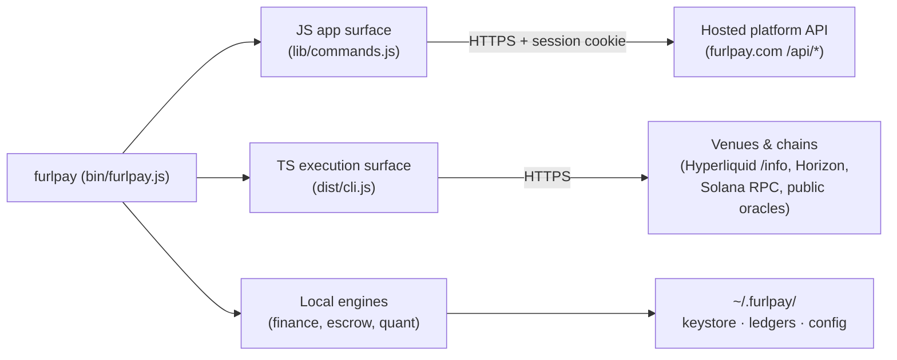

# Platform API integration

How the CLI relates to the FurlPay hosted platform documented at
[furlpay.com/docs](https://furlpay.com/docs) — which commands call hosted
APIs, which operate locally, which talk to public blockchain RPCs, and the
payment-safety rules that hold everywhere. Audited 2026-11-17 against
`lib/commands.js` (the hosted-app surface) and `bin/furlpay.js` routing.

## The three planes

1. **Hosted platform APIs** — session-authenticated app commands (payments,
   cards, travel, investing, earn) in `lib/commands.js`. Authenticated by the
   device-login/OTP session cookie. These correspond to the platform docs
   (API Routes, Merchant Payments, Payroll, Travels, and so on).
2. **Public chains & venues** — `tx verify` (Horizon), `faucet` (Friendbot),
   `hyperliquid`/`market` (/info), `solana` (JSON-RPC), `oracle` (public
   price sources), Jupiter quotes. No FurlPay backend involved.
3. **Local-only engines** — `finance`, `escrow`, `microstructure`, `algo`,
   `fork`: state machines and arithmetic over files in `~/.furlpay/`. No
   network at all.

A credential for one plane does nothing on another: **an API credential does
not turn on an unconfigured rail**, and a local ledger entry is not a chain
fact.

## Hosted endpoints the CLI calls

Verified by reading `lib/commands.js`:

| Area | Endpoints | CLI commands |
|---|---|---|
| Auth | `/api/auth/otp/start`, `/api/auth/otp/check` (+ RFC 8628 device flow) | `login`, `logout`, `whoami` |
| Wallets | `/api/wallets`, `/api/wallets/transfer` | `balance`, `send` |
| Payments | `/api/v1/payments`, `/api/payments/*` | `pay`, `payments` |
| Swaps | `/api/swaps` | `swap` |
| Cards | `/api/cards`, `/api/cards/settings` | `card`, `cards` |
| Investing | `/api/investing/portfolio`, `/api/investing/order`, `/api/investing/schedule` | `invest` |
| Travel | `/api/travel/search`, `/api/travel/book`, `/api/travel/trips`, `/api/travel/cancel/*` | `travel` |
| Earn | `/api/earn`, `/api/earn/vaults` | `earn` (JS surface) |
| Markets | `/api/markets`, `/api/markets/indices`, `/api/markets/movers` | `dashboard` |
| On-ramp | `/api/onramp/quote`, `/api/onramp/session` | (JS surface) |
| Approvals | `/api/control-plane/approvals` | `approvals` |
| Health | `/api/health` | `status`, `doctor` |

Rail availability: the CLI checks `/api/rails` semantics exactly as the
[platform quickstart](https://furlpay.com/docs/getting-started/quickstart)
prescribes — **check before integrating, re-check before submitting, and
treat stale or unavailable status as unknown**.

## Payment-safety contract (identical to the platform docs)

These are the load-bearing rules; the CLI enforces the ones it can and
labels the rest:

- **A fee estimate is not a payment.** `/api/payments/fees/estimate` (or any
  quote) prices; nothing settles.
- **A payment intent is not a settled transaction.** `POST /api/payments/create`
  returning EIP-712 signing data means the wallet can now *authorize* — not
  that anything moved.
- **An HTTP 200 is not proof of settlement.** Poll the payment status and
  verify the returned transaction reference (`furlpay tx verify <hash>` does
  exactly that for Stellar hashes — honest lookup semantics, `404` is
  explicitly *not* "does not exist").
- **Idempotency.** Use `Idempotency-Key` on supported routes; the finance
  layer records an idempotency key per ledger transaction, and replayed
  intents are refused rather than double-counted.
- **Webhooks.** Verify signatures over the raw body, constant-time compare,
  reject stale timestamps — the same rule the CLI's own webhook receiver
  (`FURLPAY_FINANCE_WEBHOOK_URL`) documents.
- **Never treat sandbox, demo inventory, or generated signing data as a
  production payment.** Every simulated surface in this CLI is labeled at
  runtime — see the [Honesty Matrix](/reference/honesty-matrix).

## Authentication & credentials

| Plane | Credential | Where it lives |
|---|---|---|
| Hosted API | Session cookie from device login / OTP | OS-bound local storage, cookie only attaches to furlpay.com over TLS or loopback (`--api-base` to any other target goes credential-less, loudly) |
| Hyperliquid / Binance | Private key / API keys | Environment only (see [Environment variables](/guide/environment-variables)) |
| Stellar | Encrypted keystore or hardware | `~/.furlpay` keystore (PBKDF2 + AES-256-GCM) or Ledger |
| MCP execution | Agent policy file | `~/.furlpay/agent-policies/` — created by `wallet agent-keygen` |

Secrets are never accepted on argv, never logged, and never returned by any
command or MCP tool (a property test pins redaction).

## Where the CLI does NOT integrate (yet)

Marked unavailable rather than invented — per the platform docs these exist
server-side, but no CLI command calls them today:

- Merchant checkout creation/webhooks (`/api/merchant/*`) — CLI: **not
  implemented** (use the platform dashboard or the HTTP API directly).
- CCTP cross-chain transfer initiation — CLI: **not implemented** (quotes and
  balances only).
- LI.FI swap routing — CLI: **not implemented** (`swap` uses the hosted
  platform swap endpoint only).
- Settlement workspace operations — CLI: **not implemented**.

If a future build adds them, they will appear here with the command that
calls them and the honesty-matrix row that labels them.
