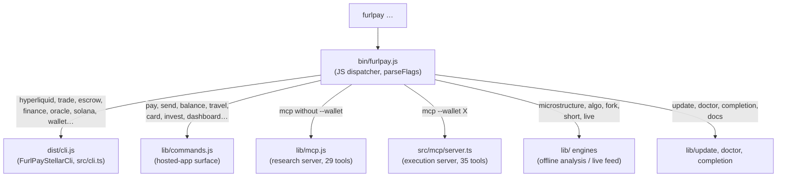
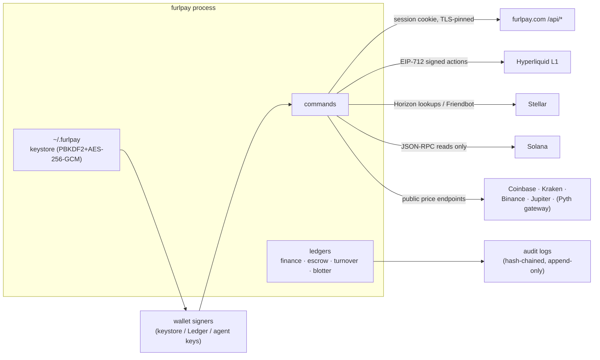
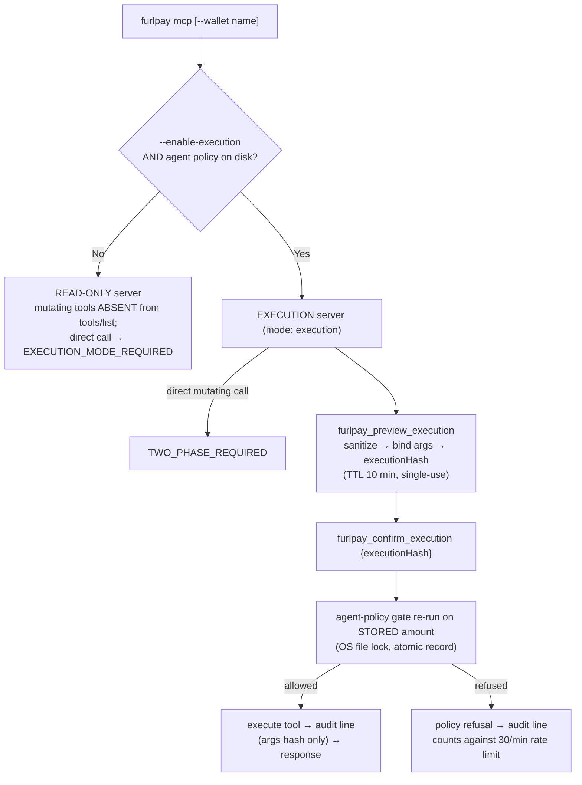
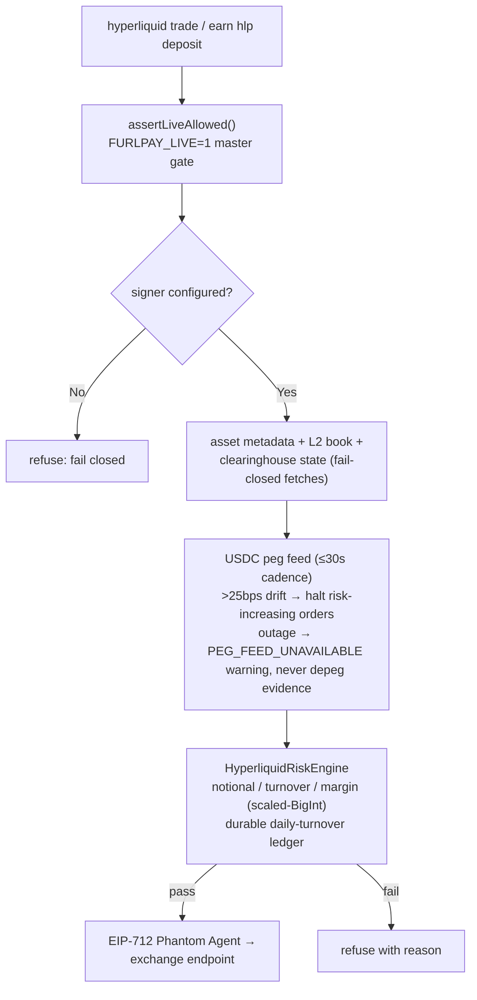
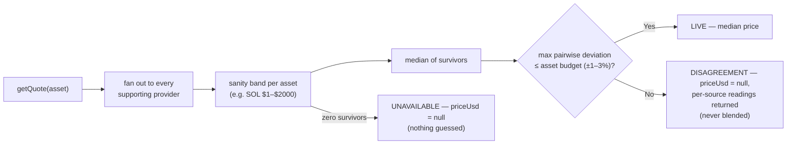
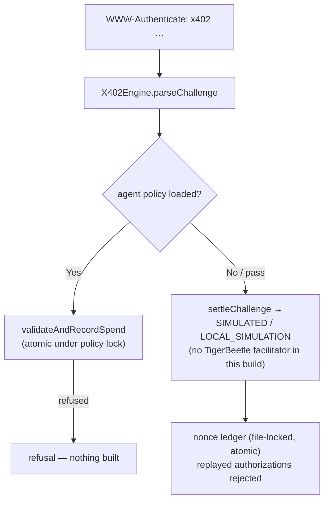
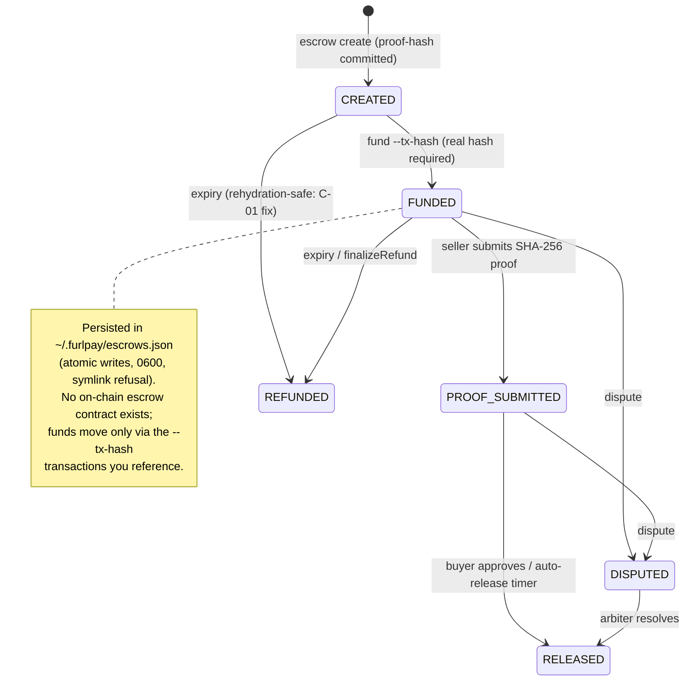

# Architecture

All diagrams describe the actual source implementation (audited 2026-11-17).
Module paths are clickable truth: if a box names `src/...`, that file exists
and behaves as drawn.

## 1. Entry point & dispatcher

`bin/furlpay.js` routes by command; the TS execution surface is lazy-loaded
from `dist/` only for the commands that need it.

## 2. Hosted API vs local vs chain boundaries

Nothing signs inside the hosted-API plane; chain signatures are produced
locally from the keystore or hardware and only *relayed* where a platform
feature does so explicitly.

## 3. MCP read-only vs execution surfaces (readiness P7)

## 4. Pre-trade risk gate (Hyperliquid execution)

## 5. Oracle aggregation & disagreement handling

## 6. x402 challenge lifecycle (labeled SIMULATED)

## 7. Escrow state machine (local ledger)

## 8. Two-plane honesty model

Every surface carries a runtime label backed by the
[Honesty Matrix](/reference/honesty-matrix): **LIVE** (real network, real
signatures where applicable), **LOCAL**, **SIMULATED**, **IMPLEMENTED**
(offline/stub), **BLOCKED**, **NOT IMPLEMENTED**. The label is data on the
result object, not prose — tests pin the labels, and the CLI prints them
alongside every result.
