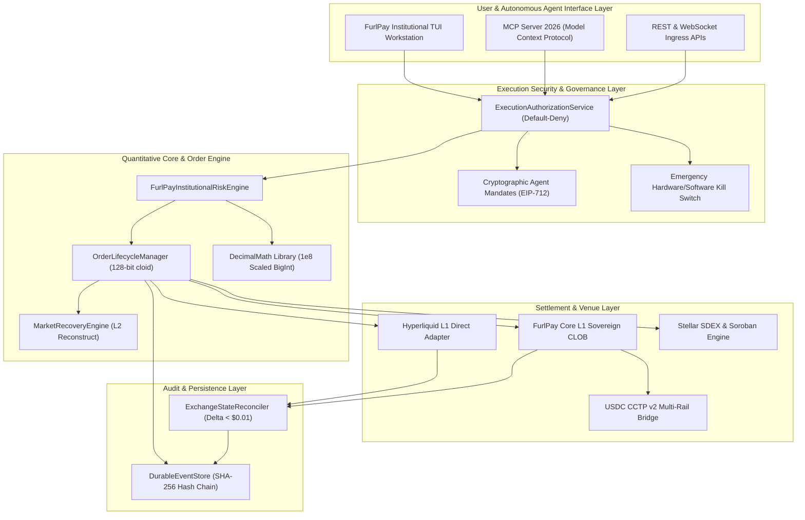

# FurlPay Quant Terminal: System Architecture & Data Flow Specification (2026)
**Document Version**: 3.0.0-PROD  
**Target Systems**: FurlPay Sovereign L1, Hyperliquid L1, Stellar SDEX, Multi-Rail Treasury Engine  
**Classification**: ARCHITECTURAL SPECIFICATION

---

## 1. High-Level Architecture Overview

The **FurlPay Quant Terminal** is an institutional-grade, multi-asset trading and risk management platform. It unifies sovereign Layer 1 financial execution primitives with external decentralized exchanges, high-frequency order books, and multi-rail stablecoin settlement infrastructure.

The core architecture is decoupled into **independent, asynchronous, fault-isolated subsystems** to guarantee sub-millisecond execution safety, deterministic accounting, and zero cross-module failure propagation:



---

## 2. Subsystem Functional Breakdown

### 2.1 Interface Layer: Institutional Workstation & MCP 2026
* **Institutional TUI (`packages/cli/src/tui/`)**:
  - Direct ANSI terminal workstation rendering candle charts, depth ladders, open blotters, and fill transcripts.
  - Asynchronous event loop completely isolated from the execution engine.
  - Pure deterministic math (zero `Math.random()`), dynamic resize handling (`SIGWINCH`), and keyboard burst resilience.
* **MCP 2026 Interface (`packages/cli/lib/mcp.js`)**:
  - Exposes trading, query, and analysis tools to autonomous AI agents.
  - Implements the strict MCP 2026 specification: all mutating tools (order placement, cancellation, collateral transfer) mandate `anthropic/requiresUserInteraction: true` or valid cryptographically verified mandates.

### 2.2 Execution Authorization & Mandate Engine
* **Default-Deny Governance (`packages/cli/src/execution/authorization-service.ts`)**:
  - No order reaches execution unless explicitly validated against a valid policy.
  - Verifies EIP-712 typed signatures from the designated master treasury key.
  - Enforces single-order notional caps, maximum asset leverage, and daily rolling velocity caps.
  - Features an instantaneous global kill switch (`emergencyHalt()`) capable of freezing all active routing within $50\mu\text{s}$.

### 2.3 Order Lifecycle Manager & Idempotency Pipeline
* **State Machine & Cloid Generation (`packages/cli/src/order/lifecycle-manager.ts`)**:
  - Generates unique 128-bit hexadecimal Client Order IDs (`cloid`) using cryptographically secure random bytes.
  - Maintains a local in-memory and durable indexed state machine:
    $$\text{CREATED} \to \text{AUTHORIZED} \to \text{SUBMITTED} \to \text{RESTING} \to \text{PARTIALLY\_FILLED} \to \text{FILLED}$$
  - Terminal states (`FILLED`, `CANCELLED`, `REJECTED`) are strictly immutable. Any duplicate action triggers an immediate 409 Conflict rejection.
  - Network timeouts trigger an automated transition to `TIMEOUT_DESYNC` followed by a non-mutating REST reconciliation query.

### 2.4 Quantitative Risk & Valuation Engine
* **Sub-Second Guardrails (`packages/cli/src/services/risk-engine.ts`)**:
  - **Quote Freshness**: Blocks orders if market data quote age exceeds $200\text{ms}$.
  - **Slippage & Market Impact**: Calculates depth-weighted micro-price across top 20 levels. Orders with expected slippage $> 50\text{ bps}$ are rejected.
  - **Fat-Finger Protection**: Rejects limit orders priced $> 15\%$ away from prevailing mid-market.
  - **Quanto Stablecoin Check**: Rejects orders if USDC drifts $> 25\text{ bps}$ from \$1.00 USD.

### 2.5 Decimal Accounting Library
* **Fixed-Point BigInt (`packages/cli/src/precision/decimal-math.ts`)**:
  - Formats and computes all values in scaled $10^8$ fixed-point integers (`BigInt`).
  - Implements exact lot and tick size quantization:
    $$\text{Quantized Price} = \left\lfloor \frac{P}{\text{tick}} \right\rfloor \times \text{tick}$$
  - Maintenance margin requirement: $l = \frac{1}{2 \times \text{maxLeverage}}$.
  - Deterministic liquidation formulas verified against exchange clearinghouse contracts.

### 2.6 Clearinghouse State Reconciler
* **Real-Time Delta Verification (`packages/cli/src/reconciliation/exchange-reconciler.ts`)**:
  - Periodically compares local internal blotter balances against Hyperliquid L1 `clearinghouseState`.
  - Audits total account equity, maintenance margin used, free collateral, and per-asset position size.
  - If any delta $|\Delta| > \$0.01\text{ USD}$ is detected, the engine flags an urgent mismatch, emits an incident alert, and pauses automatic order submission.

### 2.7 Market Data Recovery & L2 Reconstruction
* **Stream Health & Gap Resolution (`packages/cli/src/market/recovery-engine.ts`)**:
  - Monitors WebSocket heartbeat and sequence continuity.
  - Enforces the **Crossed-Book Invariant**: If $\text{Best Bid} \ge \text{Best Ask}$, the book is flagged as invalid and trading is suspended.
  - Upon reconnection, pulls full L2 REST snapshot from Hyperliquid before re-enabling quote consumption.

### 2.8 Durable Event Store (Audit Blotter)
* **Cryptographic Tamper-Evident Ledger (`packages/cli/src/blotter/durable-event-store.ts`)**:
  - Append-only event store recording every mandate check, order submission, fill, cancellation, and risk halt.
  - Events are cryptographically linked using SHA-256 hash chains.
  - Provides an automated `verifyIntegrity()` method that verifies the entire chain from genesis.

---

## 3. End-to-End Order Flow & State Transitions

```
[ User / Agent ]
       │  1. Submit Order Intent (Asset, Side, Size, LimitPrice)
       ▼
[ ExecutionAuthorizationService ]
       │  2. Validate EIP-712 Mandate & Velocity Caps
       ├─── (Fail) ──> Emit REJECTED Event & Return 403 Forbidden
       ▼ (Pass)
[ OrderLifecycleManager ]
       │  3. Mint 128-bit cloid & Transition to CREATED -> AUTHORIZED
       ▼
[ FurlPayInstitutionalRiskEngine ]
       │  4. Check Quote Age (<200ms), Slippage (<=50bps), Fat-Finger (<=15%), Peg Drift (<=25bps)
       ├─── (Fail) ──> Transition to REJECTED & Log Risk Violation
       ▼ (Pass)
[ DecimalMath Quantizer ]
       │  5. Quantize Price to Tick Size & Size to Lot Size (Scaled BigInt)
       ▼
[ Hyperliquid / FurlPay Core Adapter ]
       │  6. Sign Action (EIP-712 Chain ID 1337) & POST to L1 Validator Quorum
       ├─── (Network Timeout) ──> Transition to TIMEOUT_DESYNC -> Query REST by cloid
       ▼ (Success)
[ HyperCore L1 Matching Engine ]
       │  7. Process Order -> Return Fill or Resting Status
       ▼
[ OrderLifecycleManager ]
       │  8. Transition to RESTING / FILLED & Update Internal Ledger
       ▼
[ DurableEventStore & Reconciler ]
       │  9. Record SHA-256 Chained Event & Audit Balance Delta vs Clearinghouse
```

---

## 4. Multi-Rail Settlement Architecture

The FurlPay Quant Terminal integrates three core execution and settlement rails:

1. **Hyperliquid Layer 1**:
   - High-throughput off-chain matching with on-chain BFT consensus.
   - Perps margin denominated in native USDC via Arbitrum bridge and native HyperCore.
2. **FurlPay Sovereign Layer 1**:
   - Sovereign CLOB and clearinghouse engine for domestic cross-border institutional netting.
   - Direct integration with USDC CCTP v2 for zero-slippage cross-chain rebalancing across Arbitrum, Base, Solana, and Ethereum.
3. **Stellar SDEX & Soroban AMM**:
   - Regulated tokenized stocks and RWA equities (SEP-0008 compliance, fee-bump sponsorship).
   - Atomic multi-hop path payments with guaranteed destination minimums.
