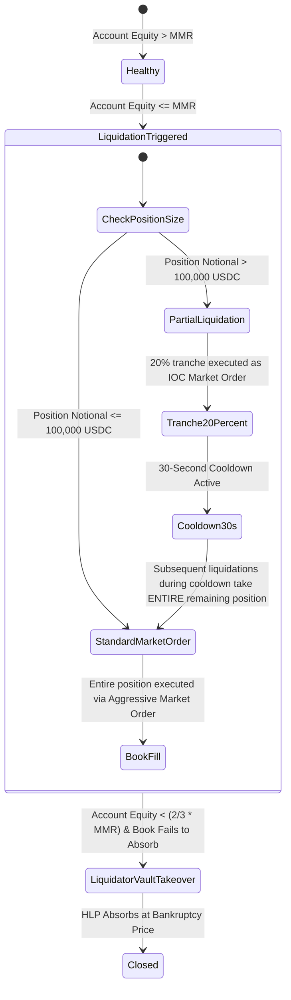

# Hyperliquid L1 Protocol Verified Specification (v3.0)
**Document Version**: 3.0.0-VERIFIED  
**Classification**: PROTOCOL VERIFICATION & ENGINEERING SPECIFICATION  
**Target Systems**: Hyperliquid Layer 1 (HyperBFT Consensus & HyperCore CLOB) & FurlPay Risk Infrastructure  
**Verification Standard**: Primary Official Documentation, Verified Protocol Behavior & Cryptographic Test Vectors

---

## 1. Document Status Taxonomy & Governance

Every protocol claim, architectural parameter, and implementation standard in this document is explicitly classified under one of four normative statuses:

| Status Tag | Definition & Criteria |
|:---|:---|
| `[VERIFIED]` | Rigorously verified against Hyperliquid official documentation, SDK implementations, or reproducible on-chain test vectors. |
| `[CONDITIONAL]` | Behavior is dynamic and depends on asset context, account leverage mode (cross vs. isolated), position notional tier, or network version. |
| `[REJECTED]` | Previously published assumption or community claim proven to be mathematically incorrect, outdated, or unsafe for production trading. |
| `[PROPOSED]` | FurlPay sovereign engineering policy, independent risk safeguard, or defensive fail-closed architecture. |

---

## 2. Protocol Architecture & Consensus Realities

### 2.1 Dual-Engine Architecture `[VERIFIED]`
- **HyperCore**: A custom, optimized state machine and clearinghouse running directly within validator node software. It executes native perpetual futures and spot limit order books via deterministic Price-Time Priority matching.
- **HyperEVM**: A custom EVM implementation running general-purpose Solidity smart contracts. HyperEVM accesses HyperCore state via native precompiles.
- **Precompile Interaction Mode `[CONDITIONAL]`**: HyperEVM smart contract precompiles that execute state mutations on HyperCore (e.g. `CoreWriter`) enforce an intentional architectural latency buffer to mitigate toxic front-running and MEV. **For low-latency quantitative execution, FurlPay connects directly to HyperCore L1 via direct REST/WebSocket signing, bypassing HyperEVM smart contracts.**

### 2.2 Consensus & Finality Realities `[VERIFIED]`
- **Consensus Algorithm**: HyperBFT, a pipelined HotStuff-derived linear Byzantine Fault Tolerant protocol with linear view change $O(n)$.
- **Finality `[VERIFIED]`**: Single-slot deterministic finality ($\approx 0.2\text{s}$ to $0.4\text{s}$ round-trip network finality across validator quorum).
- **Sub-Second Execution Claims `[REJECTED]`**: Claims of "0.07-second blocks" represent optimistic local matching engine clock ticks within a validator process, not end-to-end distributed network finality.

---

## 3. Network Interfaces & Exact Rate Limiting Architecture

### 3.1 Network Endpoints `[VERIFIED]`
* **Mainnet REST API**: `https://api.hyperliquid.xyz`
* **Mainnet WebSocket**: `wss://api.hyperliquid.xyz/ws`
* **Testnet REST API**: `https://api.hyperliquid-testnet.xyz`
* **Testnet WebSocket**: `wss://api.hyperliquid-testnet.xyz/ws`

### 3.2 Rate Limiting Architecture `[VERIFIED]` & Corrections `[REJECTED]`

| Interface | Erroneous Assumption `[REJECTED]` | Verified Protocol Rule `[VERIFIED]` |
|:---|:---|:---|
| **REST IP Weight** | Unweighted request count | Base budget of **1,200 weight points per minute** per IP. Exceeding results in HTTP 429 and escalating IP bans (1m $\to$ 10m $\to$ 24h). |
| **REST Batch Weight** | 1 request = 1 point | Batch weight formula: $\text{Weight} = 1 + \left\lfloor \frac{\text{batch\_length}}{40} \right\rfloor$. 1–39 orders = 1 pt; 40–79 orders = 2 pts. |
| **WebSocket Global Budget** | *100 requests per minute* `[REJECTED]` | Documented global limit of **2,000 messages per minute across all WebSocket connections** per IP address. |
| **WebSocket In-Flight** | Unlimited asynchronous calls | Maximum **10 in-flight unacknowledged requests** per connection. |
| **WebSocket Subscriptions** | Unlimited channel subscriptions | Max **10 active WebSocket connections** per IP; max **1,000 active topic subscriptions** per connection. |

---

## 4. EIP-712 Signing Specifications & Agent Key Architecture

Hyperliquid enforces two distinct signing structures. Hand-rolled signing without exact MessagePack canonicalization will cause validator signature rejection or recover the wrong signer address `[VERIFIED]`.

### 4.1 L1 Action Signing (Trading & Cancellations) `[VERIFIED]`
* **Domain Name**: `"Exchange"`
* **Domain Version**: `"1"`
* **Chain ID**: `1337` (0x539) — Fixed across Mainnet and Testnet.
* **Verifying Contract**: `0x0000000000000000000000000000000000000000`
* **Primary Type**: `"Agent"`
* **Agent Payload Construction**:
  1. The action payload is MessagePack-encoded using canonical field serialization via `algo-msgpack-with-bigint`.
  2. A big-endian 8-byte unsigned 64-bit integer (`uint64BE`) timestamp/nonce is appended.
  3. A vault marker is appended: `0x00` if no vault; `0x01` + 20-byte address if trading on behalf of a vault.
  4. The 32-byte `connectionId` is derived as:
     $$\text{connectionId} = \text{keccak256}(\text{msgpack}(\text{action}) \parallel \text{nonce}_{\text{BE}} \parallel \text{vaultMarker})$$
  5. The EIP-712 payload signs:
     ```json
     {
       "source": "a", // "a" for Mainnet, "b" for Testnet
       "connectionId": "0x..."
     }
     ```

### 4.2 User Administrative Actions (Agent Approval, Transfers, Withdrawals) `[VERIFIED]`
* **Domain Name**: `"HyperliquidTransaction"` (Mainnet) or `"HyperliquidTransaction:Testnet"` (Testnet).
* **Chain ID**: `42161` (Arbitrum One) for Mainnet; `421614` (Arbitrum Sepolia, `0x66eee`) for Testnet.
* **Security Separation Policy `[PROPOSED]`**: FurlPay enforces complete credential separation. API Agent Session Keys sign L1 Trading Actions only. Master Treasury Keys holding custody and withdrawal powers (`approveAgent`, `withdraw3`) must reside in hardware wallets or 2-of-3 multi-sig custody, completely isolated from automated bot execution servers.

---

## 5. Dynamic Margin Tiers & Position Sizing `[CONDITIONAL]`

Static assumptions of maximum leverage (e.g. "BTC 50x, ETH 40x") are `[REJECTED]`. Hyperliquid implements **tiered leverage and margin deductions** parameterized dynamically by asset and position notional:

### 5.1 Dynamic Margin Tier Structure `[VERIFIED]`

| Asset | Tier 1 Max Notional | Tier 1 Max Leverage | Tier 1 Maintenance Margin Rate ($l_1$) | Tier 2 Max Notional | Tier 2 Max Leverage |
|:---|:---:|:---:|:---:|:---:|:---:|
| **BTC** | \$1,000,000 | **40x** | $1.25\%$ ($l = \frac{1}{2 \times 40}$) | \$5,000,000 | **20x** ($l_2 = 2.5\%$) |
| **ETH** | \$500,000 | **25x** | $2.00\%$ ($l = \frac{1}{2 \times 25}$) | \$2,500,000 | **15x** ($l_2 = 3.33\%$) |
| **SOL** | \$250,000 | **20x** | $2.50\%$ ($l = \frac{1}{2 \times 20}$) | \$1,000,000 | **10x** ($l_2 = 5.0\%$) |

*FurlPay Rule `[PROPOSED]`: FurlPay polls `metaAndAssetCtxs` on startup and dynamically refreshes the active margin tiers table. Hardcoded static leverage limits are strictly prohibited.*

### 5.2 Tiered Maintenance Margin Required ($MMR$) `[VERIFIED]`
For a position with notional $N = Q \times P$, tiered maintenance margin incorporates a cumulative deduction $D_k$:
$$MMR = N \times l_k - D_k$$
Where $l_k$ is the maintenance margin rate for tier $k$ and $D_k$ is the cumulative margin deduction preventing discrete cliff edges at tier boundaries.

---

## 6. Mathematical Liquidation Specification

### 6.1 Erroneous Simplified Formula `[REJECTED]`
The previously published formula:
$$P_{\text{liq}} = P_{\text{entry}} \times \frac{1 \mp 1/L}{1 \mp l} \quad \text{[REJECTED: Inaccurate for accounts with cross-margin, existing P&L, or multi-tier positions]}$$

### 6.2 Official Protocol Liquidation Formula `[VERIFIED]`
The exact exchange-wide liquidation price equation implemented on Hyperliquid L1 is:

$$P_{\text{liq}} = P_{\text{entry}} - \frac{s \cdot M_{\text{available}}}{Q(1 - s \cdot l)}$$

Where:
* $s \in \{+1, -1\}$ is the position direction ($s = +1$ for Long, $s = -1$ for Short).
* $P_{\text{entry}}$ is the weighted average entry price.
* $Q$ is the absolute position size ($Q = |\text{positionSize}|$).
* $l$ is the effective maintenance margin rate for the position's notional tier.
* $M_{\text{available}}$ is the available margin buffer before liquidation:
  - **Cross Margin Mode `[VERIFIED]`**:
    $$M_{\text{available}} = \text{Account Value} - \text{Total Maintenance Margin Required across All Positions}$$
  - **Isolated Margin Mode `[VERIFIED]`**:
    $$M_{\text{available}} = \text{Isolated Margin Assigned} - MMR_{\text{position}}$$

### 6.3 Liquidation Execution Mechanics & State Machine `[VERIFIED]`

The assumption that "every liquidation follows a universal 20% Dutch auction" is `[REJECTED]`. The documented exchange liquidation lifecycle operates as follows:



1. **Standard Liquidation ($\le \$100,000\text{ USDC}$)**: Immediately routed as an aggressive market order for the **entire 100% position size**.
2. **Partial Liquidation ($> \$100,000\text{ USDC}$)**: The liquidator submits a **20% partial liquidation market order**.
3. **30-Second Cooldown Period**: After a 20% partial liquidation, a 30-second cooldown timer begins. Any subsequent liquidation orders triggered during this cooldown are sent for the **entire remaining position**, not another 20% tranche.
4. **HLP Liquidator Vault Backstop**: If account equity drops below **two-thirds of maintenance margin ($\text{Equity} < \frac{2}{3} \times MMR$)** and the public order book fails to absorb the liquidated size, the position is transferred directly to the **HLP Liquidator Vault** at the bankruptcy price.

---

## 7. Hourly Funding Rate Calculation Specification

### 7.1 Erroneous Premium-Only Formula `[REJECTED]`
The assumption:
$$F = \operatorname{Clamp}(\text{Avg Premium}, -0.05\%, +0.05\%) \quad \text{[REJECTED: Omits interest rate component]}$$

### 7.2 Verified Protocol Funding Rate Formula `[VERIFIED]`
Hyperliquid calculates 1-hour funding using continuous premium sampling and a fixed interest component:

$$F = P + \operatorname{Clamp}\left(I - P, -0.0005, +0.0005\right)$$

Where:
* $P$ is the 1-hour time-weighted average premium index:
  $$P = \frac{1}{N} \sum_{k=1}^{N} \frac{\text{Impact Mid Price}_k - \text{Oracle Price}_k}{\text{Oracle Price}_k}$$
  *(Sampled once every 5 seconds; $N = 720$ samples per hour).*
* $I$ is the fixed baseline interest rate component:
  $$I = \frac{0.01\%}{8\text{ hours}} = \frac{0.0001}{8} = 0.0000125 \quad (0.00125\% \text{ per hour})$$
* $\operatorname{Clamp}(x, -0.0005, +0.0005)$ restricts the interest component drift to $\pm 0.05\%$.
* **Absolute Protocol Cap `[VERIFIED]`**: The total hourly funding rate $F$ is capped at $\pm 4.0\%$ per hour ($|F| \le 0.0400$).

---

## 8. USDC Collateral Accounting vs. FurlPay Risk Valuation

### 8.1 Protocol Clearinghouse Collateral Rule `[VERIFIED]`
* **Contract Denomination**: Hyperliquid perpetual contracts track USDT/USD external oracle indexes.
* **Collateral & P&L**: All balances, margin deposits, realized P&L, and funding payments are cleared exclusively in **USDC**.
* **Protocol Accounting Model**: HyperCore values 1 USDC as exactly 1 USD without a real-time FX haircut in its internal clearinghouse equations.

### 8.2 FurlPay Independent USDC Peg Guardrail `[PROPOSED]`
* **Risk Separation**: FurlPay maintains an independent, off-exchange valuation of USDC against real-world USD and USDT prices.
* **25 bps Depeg Monitor Policy**:
  - If external oracles detect $\text{USDC/USD} < 0.9975$ or $> 1.0025$ ($> 25\text{ bps}$ depeg) with multi-source consensus:
    1. **Block Risk-Increasing Orders**: Prevent opening new leveraged positions that deposit USDC or increase directional exposure.
    2. **Hysteresis Buffer**: Peg status remains in alert until price recovers within $15\text{ bps}$ ($0.9985 \le P \le 1.0015$) for $\ge 5$ continuous minutes.
    3. **No Automatic Customer Position Dumping**: The system does NOT forcefully market-sell client positions during a depeg (avoiding unnecessary realized losses during temporary liquidity wicks); instead, it triggers an urgent desk notification and permits controlled risk-reducing closes.

---

## 9. Hyperliquid Liquidity Provider (HLP) Vault Specifications

### 9.1 Lockup Restriction `[VERIFIED]`
* **4-Day Continuous Lockup**: Withdrawals from the HLP vault are strictly prohibited for **4 continuous days (345,600 seconds)** starting from the **most recent deposit timestamp**.
* Any new deposit resets the 4-day lockup timer for the entire balance in that vault position.
* **FurlPay Implementation Standard `[PROPOSED]`**:
  - Track `lastDepositTimestamp` locally and query on-chain `vaultDetails`.
  - Block withdrawal requests in the UI/CLI if $t_{\text{now}} - t_{\text{last\_deposit}} < 345,600\text{s}$.
  - Clearly display countdown timer: `Lockup Remaining: DD:HH:MM:SS`.
  - Mandate explicit interactive confirmation before executing an HLP deposit.

---

## 10. Summary Verification Matrix

| Area | Original Claim | Status | Corrected Specification |
|:---|:---|:---:|:---|
| **WebSocket Rate Limit** | 100 req/min | `[REJECTED]` | 2,000 msgs/min global budget across all connections |
| **Asset Leverage** | BTC 50x, ETH 40x | `[REJECTED]` | Tiered dynamic metadata: BTC 40x/20x, ETH 25x/15x |
| **Liquidation Price** | $P_{\text{entry}} \frac{1 \mp 1/L}{1 \mp l}$ | `[REJECTED]` | Official tier-aware: $P_{\text{liq}} = P_{\text{entry}} - \frac{s \cdot M_{\text{available}}}{Q(1 - s \cdot l)}$ |
| **Liquidation Tranches** | Universal 20% Dutch auction | `[REJECTED]` | Standard market order; 20% partial only for $> \$100\text{k}$; 30s cooldown; 2/3 MMR vault takeover |
| **Funding Rate** | $\text{Clamp}(\text{Premium}, \pm 0.05\%)$ | `[REJECTED]` | $F = P + \operatorname{Clamp}(I - P, \pm 0.0005)$ with $I = 0.01\%/8\text{h}$ and $4\%$ max cap |
| **USDC Valuation** | Fixed \$1 unconditional | `[REJECTED]` | Exchange clears at \$1; FurlPay enforces independent 25 bps depeg guardrail |
| **Signing Validation** | Handwritten EIP-712 signer | `[CONDITIONAL]` | Canonical MessagePack field order, uint64BE nonce, vault marker |
| **HLP Lockup** | 4-day lockup | `[VERIFIED]` | 4 days from most recent deposit; resets on new deposit |
